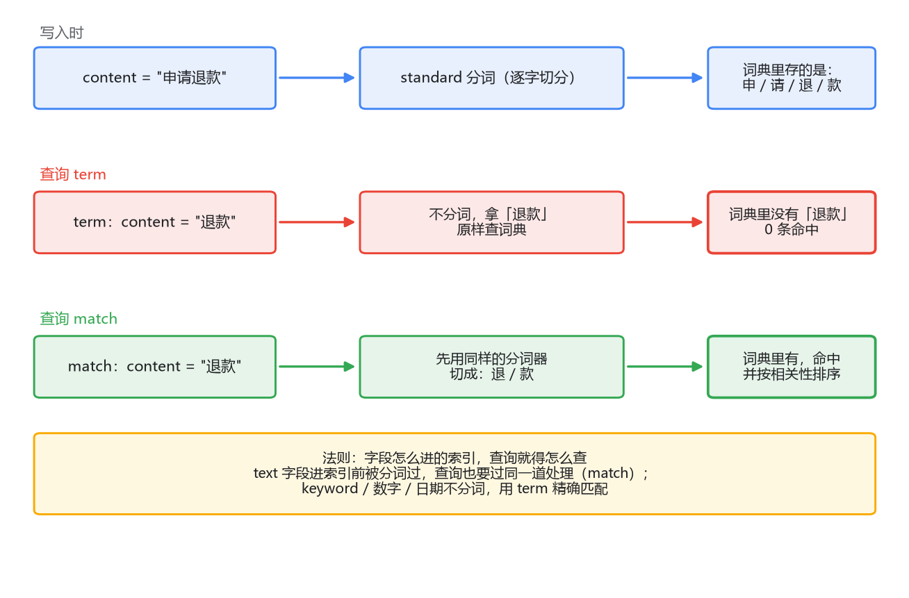

# 01 ES 实战分册

对应专栏一 7 篇（01 为什么是 ES ~ 07 Java 客户端）。主线：**为什么是倒排 → 概念坐标 → 查得到（DSL）→ 拆得对（分词）→ 排得好（打分）→ 数得清（聚合）→ 接得进（Java）**。

## 1. 为什么是 ES：LIKE 的两个结构性死穴

`LIKE '%退款%'` 的问题有两层，且都补不上：

1. **慢**：前导通配符废掉 B+ 树——匹配起点定不下来，只能全表扫。
2. **更根本**：逐行做子串匹配，匹配是布尔值（非 0 即 1），**给不出"匹配程度"，相关性排序无从谈起**。加机器解决不了这一层。

MySQL 全文索引（FULLTEXT + ngram）能顶一阵：底层就是倒排索引，还自带相关性排序。但中文按固定字数滑窗切（"退款流程"→"退款/款流/流程"，搜"开发"会命中"打开发货"）、打分查询几乎不可调、扩展有天花板。所以：**搜索是辅助功能、数据百万级以内，可以不上 ES；是核心功能就躲不开**——这是权衡，不是技术先进性问题。

**倒排索引**是 ES 的立身之本：写入时把文档切成词，反过来记"每个词出现在哪些文档"。三件套：

- **词典（term dictionary）**：词的有序集合，二分定位。
- **posting list**：每个词背后按文档号排好的文档列表。
- **打分原料就存在索引里**：词频挂在 posting list 条目上、文档频率挂在词典的词上——倒排不只是"找得快"，是把"找"和"算分"要的东西一起组织好了。多词查询 = 两个有序 posting list 归并求交。

代价（这笔账要记牢）：**写入放大**（一篇文档拆出几十上百个词，一次写入放大成几十上百次索引更新）、**空间比原文大**、**秒级可见性延迟**。结论：ES 是检索引擎不是数据库，主数据留 MySQL，ES 存异构副本。（原文：专栏一·01）

## 2. 五个核心概念：对照 MySQL，但每处都有坑

| 概念 | 与 MySQL 的对照 | 坑 |
|------|----------------|---|
| index | ≈ 表 | 单词陷阱：MySQL 的 index=加速结构，ES 的 index=容器；7.x 起 index ≈ 表 |
| document | ≈ 行 | 自由 JSON；同 `_id` 再写=整篇覆盖（MySQL 直觉会以为报错）；`_update` 是取出-合并-写回 |
| mapping | ≈ 列定义 | 动态映射替你猜类型；**字段类型不可变**，错了只能 reindex；业务索引要手写 mapping + `dynamic: strict` |
| shard | 分库分表分片 | 原生内置路由归并；**主分片数建后不可改**（路由公式里有 N），副本数随时可调 |
| replica | 从库 | 有副本，但"读写分离"不是你的决策；7.x 起默认 1 主 0 副本 |

最容易翻车的两件事：

- **动态映射**：第一条数据 `phone` 写成数字 → mapping 定成 long → 后面带横线的字符串全写不进；更阴的是带引号纯数字被默默强转，错误类型陪着几百万条数据住下。防御：上线前 `GET /_mapping` 亲自过一遍。
- **可见性**：按 `_id` GET 是**实时**的，搜索是**近实时**的（默认约 1 秒 refresh）。两个别混。ES 没有跨文档事务。（原文：专栏一·02）

## 3. 检索 DSL：term 和 match 之分的本质

**term 拿你给的值原封不动查词典；match 先把查询串过分词器再查。** 法则一句话：**字段怎么进的索引，查询就得怎么查。**

text 字段写入时被分词（可能还被小写化），进倒排索引的是切出来的词。`term` 拿"退款"原样查，词典里只有"退"和"款"——查不到；改成"退"就命中。所以 text 上用 term 十有八九查不到；term 的正确对象是 **keyword、数字、日期**这些不分词的字段。同一个值存 text 还是 keyword 决定了能怎么查（动态映射对字符串默认 text + keyword 子字段双存）。



match 家族三句话：**match 管词在不在（默认 OR，`operator: and` 收紧），match_phrase 管词挨不挨着（靠位置信息，顺序敏感），slop 管能容忍多不挨着。**

bool 四子句对照 SQL：`must`=AND 且算分；`filter`=AND 但**不算分**；`must_not`=NOT；`should`=加分项（只有 should 时至少满足一个；一旦有 must/filter 就退化成纯加分）。filter 不算分的两个好处：**快**（省算分计算）、**能缓存成位图**（roaring bitmap，条件与排序无关才可缓存）。章法：**"要不要分"决定条件放 query 还是 filter，而不是"要不要 AND"**——状态、时间、权限放 filter，文本相关性放 must/should。（原文：专栏一·03）

## 4. 中文分词：查不到的第一嫌疑人

standard 分词器为什么把中文拆成单字？它按 Unicode 词边界（UAX #29）切分，英文有空格标点天然边界，中文在 Unicode 定义里**每个汉字就是一个字符单元**——不是 bug，是规范。深层原因：**英文的"词"是书写系统的一部分，中文的"词"是认知的一部分**，纸上看不出边界，必须靠词典和模型。

IK 两个粒度（用"中华人民共和国"记）：

- **ik_max_word**：最细，嵌套词全切（中华人民共和国/中华人民/中华/华人/人民/共和国/共和/国）。
- **ik_smart**：最粗，挑最长路径（就一个词）。

smart 切出的词必在 max_word 的集合里，所以唯一安全组合是**索引 max_word + 搜索 smart**（召回有保障、搜索侧干扰少）；**反过来是稳定复现的事故配置**。

最隐蔽的坑：**索引分词和搜索分词不一致**。查询切出的词必须和写入切出的词是同一个词才能在词典碰头。写错 analyzer 不报错、不告警、监控全绿，只有用户知道搜不到。三个常见来源：查询里显式指定了 analyzer；reindex 换分词器后两端不同步；term 天然绕过分词（碰巧命中时更忽悠人）。防御：**两端只从 mapping 一处拿配置，查询代码永远不写 analyzer**。

调试第一工具 `_analyze`：指定 analyzer 看写入侧、指定 field 看搜索侧，两边词集合一对照，不一致立刻现形。排查"查不到"的三步：写入侧切出了什么 → 搜索侧切成什么 → 前者的集合里找得到后者的词吗。（原文：专栏一·04）

## 5. 相关性打分：BM25 直觉版 + 业务插队

ES 8.x 默认打分是 **BM25**（5.0 之前是 TF-IDF）。直觉版三因子：

> **TF 词频（越多越相关，但边际递减饱和——堆词霸榜没用）× IDF 逆文档频率（越稀有的词越值钱）× 长度折扣（短文档命中的含金量更高）**

完整公式和三处修正（k1 饱和、b 长度归一、IDF 平滑）在 04 分册 BM25 一节展开——混合检索要合并两路分数时必须懂到参数级。

两个实用工具：

- 排序诡异时 `"explain": true`，看 idf/tf 各是多少，别猜。
- 业务干预分两级：**boost**（查询期乘系数，轻量，2~5 起步；mapping 里的索引期 boost 已废弃）；**function_score**（filter+weight 打标、field_value_factor 用字段值、gauss 时间衰减，能干"官方文档置顶"这种绝对规则——`boost_mode: replace`）。注意分寸：能用 boost 别上 function_score，叠多了分数没人能口算。
- `_score` 只在同一次查询内有意义，别当监控指标、别跨查询比。（原文：专栏一·05）

## 6. 聚合：搜索之外的第二战场

两类聚合 + 一次请求合并：

- **指标聚合**：avg/max/min/sum/stats，以及 cardinality（去重计数，HyperLog++，同 Redis PFCOUNT 思想——用近似换内存）。
- **桶聚合**：terms（=GROUP BY）、range、date_histogram；**桶可嵌套**，"每个分类下平均点赞"= 桶里套指标。
- **搜索+聚合一次请求**：`query` 先圈范围，`aggs` 在圈定范围上算；`"size": 0` 只要统计不要文档。对应 SQL `WHERE ... GROUP BY`，但 SQL 版要全表扫。

必知的近似：**`doc_count_error_upper_bound`**。根因：每个分片各自聚合、只上报本地 top N，协调节点归并——**每个分片只看得到局部数据**，全局第 4 名的词条可能两个分片都排本地第 4 而双双不上报。对照 MySQL：单机 GROUP BY 统计者看得见全量。误差怎么办：看趋势无所谓，**计费对账别用**；`shard_size` 调大（默认 `size×1.5+10`）花钱买精度但买不到精确。（原文：专栏一·06）

## 7. Java 客户端：选型、连接、bulk

- **选型**：新项目用 `co.elastic.clients:elasticsearch-java`（8.x 官方主推）；RestHighLevelClient 7.15 起废弃（中文教程大量是它）；TransportClient 7.0 已移除。Spring Data Elasticsearch 适合"当数据库 CRUD"，检索精细活直接用官方客户端。
- **连接**：client 线程安全，全局单例；它池化的是**无状态 HTTP 连接**，类比 HttpClient 而不是 HikariCP（MySQL 连接有状态要池化，HTTP 只是省握手）。生产必配：超时、多节点轮询。
- **bulk**：快的两笔账——一批一次网络往返（同 Kafka producer 攒批、Redis pipeline 一个思想）；协调节点按目标分片归并。**按 5~15 MB 物理大小起步**，别按条数。**bulk 是部分成功**（HTTP 200 但里面 10 条失败是常态），必须逐 item 检查。
- 灌库调优：`refresh_interval` 调 -1、副本临时设 0，导完改回手动 refresh。（原文：专栏一·07）

## 最后，总结

ES 实战七篇其实是一条线：倒排索引解决"找得到+能算分"（代价是写入放大和近实时）；DSL 的 term/match 之分本质是"索引怎么进就怎么查"；分词是中文搜索的第一嫌疑人，两端一致性靠 _analyze 把守；打分是 BM25 三因子，业务插队用 boost/function_score；聚合是第二战场，但要接受分片级近似的账；Java 侧记住三代客户端选型、bulk 部分成功、连接池化的是 HTTP 不是会话。

```text
━━━━━━━━━━ 一页纸背诵版 ━━━━━━━━━━
□ LIKE 死穴：前导通配符全表扫 + 匹配是布尔值给不出相关性
□ 倒排三件套：词典 + posting list + 打分原料（词频/文档频率存在索引里）
□ 倒排的代价：写入放大、空间>原文、秒级可见 → 主数据留 MySQL
□ index≈表 document≈行 mapping≈列定义 shard≈分片 replica≈副本
  · mapping 字段类型不可变，错了只能 reindex
  · 主分片数不可改，副本数随时可调
  · 按 _id GET 实时；搜索近实时；无跨文档事务
□ DSL 法则：字段怎么进的索引就怎么查
  · term=原值查（keyword/数字/日期）；match=先分词（text）；match_phrase=顺序敏感
  · bool：must=AND算分 filter=AND不算分(可缓存位图) must_not=NOT should=加分
□ 分词：standard 对中文逐字切（UAX#29，中文的词是认知不是书写）
  · 安全组合：索引 ik_max_word + 搜索 ik_smart；反了=事故
  · 隐蔽坑：索引/搜索分词不一致（查询手写 analyzer/reindex 不同步/term 绕过分词）
  · 调试：_analyze 两端对照
□ 打分：BM25 = TF(饱和) × IDF(稀有词值钱) × 长度折扣
  · 诡异排序 → explain:true
  · boost=乘系数(2~5起)；function_score 置顶用 boost_mode:replace
  · _score 只在同次查询内有意义
□ 聚合：指标(avg/stats/cardinality=HLL) + 桶(terms/range/date_histogram,可嵌套)
  · query+aggs 一次请求，"size":0 只要统计
  · terms 的 doc_count 是近似（分片各自聚合只报本地topN）
  · shard_size 默认 size×1.5+10，能买精度买不到精确；对账别用
□ Java：用 elasticsearch-java(8.x)；RestHighLevelClient 已废弃
  · client 全局单例，池化的是无状态 HTTP（≠HikariCP）
  · bulk 按 5~15MB 攒批；部分成功必须逐 item 检查
  · 灌库：refresh_interval=-1 + 副本=0
━━━━━━━━━━━━━━━━━━━━━━━━━━━━━━━━
```
