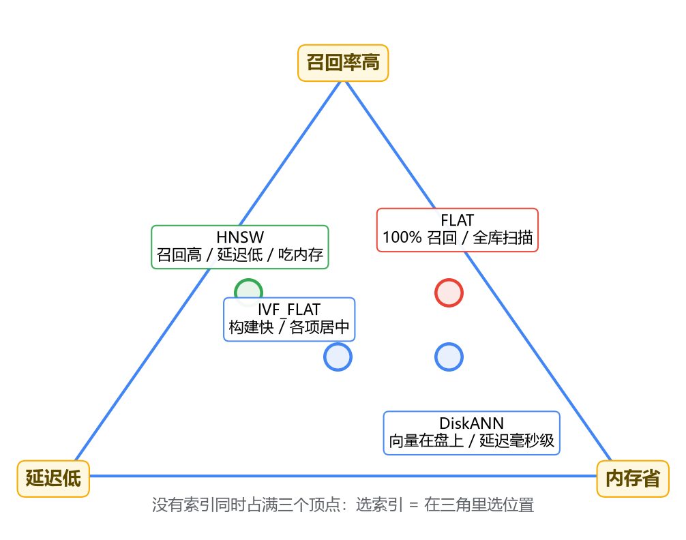

# 02 Milvus 实战分册

对应专栏二 7 篇（01 为什么需要向量检索 ~ 07 客户端使用）。主线：**为什么需要向量 → 长什么样 → 怎么建表 → 怎么灌数据 → 索引怎么选怎么调 → 过滤与租户隔离 → 客户端怎么接**。

## 1. 为什么需要向量检索：语义鸿沟

关键词检索的工作前提是"query 和 doc 至少共享一个词"。用户问"怎么退货"，文档写"退款流程"——一个字都没对上，检索没有起点。这叫**语义鸿沟**：字面不匹配，语义匹配。

同义词词典为什么治不了本？它是**枚举**，用户的问法是**组合**——"显示器没信号"和"电脑开机黑屏"没有任何词相同，你往词典里写哪条？而且它只能建"词到词"的二元映射，表达不了连续的距离。

**embedding**：用神经网络把文本映射成高维空间（如 768/1024 维）里的点，"意思越近，点挨得越近"，检索从字符串匹配变成几何问题：查询也变成点，找最近的 k 个点。与人工标签的本质区别：embedding 是模型从几亿语料学出来的几百维连续空间，**不可解释**（你说不出第 317 维是什么），换来任意两段文本的远近都可计算。

远近用**余弦相似度**（方向相近，不看模长；模型输出做归一化后点积=余弦）。

**暴力检索为什么撑不住**：100 万条 × 768 维 × 4 字节 ≈ 2.9 GB，一次查询全量过一遍，瓶颈是**内存带宽**；亿级数据单机内存放不下，方案死亡。

**为什么不能建 B+ 树**：B+ 树的剪枝靠一维全序（比较一次证明另一半不可能有答案）；高维空间没有这种全序（维度灾难：维度一高任意两点距离都差不多远），精确剪枝做不了。只能退到 **ANN**：不保证找到真 top-k，只保证大概率找到很近的——**拿召回率换速度**。RAG 场景成立的前提：top-10 和第 12 名相似度只差千分之几，塞给 LLM 没区别。

**向量的盲区**（所以 Milvus 替代不了 ES）：错误码、型号、法条编号的价值恰在一个字符的差别上，这个信号在语义空间里被"平均"掉——ERR_CONN_10053 和 10054 的向量近得几乎重合。**一个管"意思相近"，一个管"一字不差"，互补不是替代。**（原文：专栏二·01）

## 2. 架构速览：三个容器就是架构本身

standalone 的 docker compose 起三个容器：**milvus（服务本体）、etcd（元数据）、MinIO（数据真身）**——不是依赖，是把分布式版的角色原样塞进一台机器。和 mysqld 一个进程包揽一切完全不同。

五个角色一句话（细节见 03 分册）：**proxy** 唯一入口；**coordinator**（root/data/query/index 四个）只决策不干活；**worker**（query/data/index node）纯算力；**对象存储**是数据最终归宿；**log broker**（内置 RocksMQ / 分布式 Kafka）是写入第一落点，兼任 redo log 的角色（先写日志再落盘，宕机从日志补）。

一句话：**计算节点无状态，数据都在对象存储，写入先过消息队列**——存算分离。好处是节点挂了重拉一个、扩容加减节点；代价是链路长。

上手路径：Docker compose 起 standalone + attu（Milvus 的 Navicat）。排查问题的第一步永远是先去 attu 看数据在不在——先分清是数据没进去还是查询写错。（原文：专栏二·02）

## 3. Collection 与 Schema：表围绕向量组织

collection ≈ 表、entity ≈ 行、field ≈ 列，但根本区别：**整张表围绕向量字段组织**——先想清楚向量怎么检索，再补标量字段（要么是展示用的注脚，要么是过滤用的约束）。建表思路与 MySQL 相反。

三个必须想清楚的决策：

**主键**：建议用业务主键（`doc_id + 切片序号`），不用 auto_id。RAG 场景天然有业务主键；用了 auto_id，想按业务逻辑更新/删除时手里没有抓手，还得另维护映射表。关键差异：**MySQL 用唯一键冲突拦重复，Milvus 不拦**——同主键 insert 出多条 entity 不报错，查询命中哪条不保证。幂等入库靠业务主键 + upsert（2.3+）。

**维度 dim**：必须精确等于 embedding 模型输出维度，差一维插不进去；建后不可改。更要命的是**换模型 = 全量重灌**——不同模型的向量空间互不兼容，两套向量混在一个空间里就是噪声。**embedding 模型是 collection 定义的一部分**。

**partition**：形似 MySQL 分区表，动机不同——MySQL 主要为**管理**（备份、删历史），Milvus 首先是**检索裁剪**工具。多租户最典型：查询带 partition 名，其他租户的数据根本不进比对范围（隔离+提速）。注意：数量有上限（默认 4096 量级）；租户多用 **partition key**（2.3+，按哈希自动路由+自动裁剪）。"单纯数据多"不是切 partition 的理由。（原文：专栏二·03）

## 4. 数据入库：模型选型是第一步

**embedding 模型选型框架**（按顺序过）：语言（纯中文 bge-zh 系/多语言 bge-m3）→ 维度=内存（100万×1024维×4B ≈ 4GB 裸向量）→ 文本长度上限（bge-zh 系 512 token，超长截断=信息丢失；长文档选 8192 的 bge-m3）→ 部署条件（有 GPU 本地起，没有走 API）→ 榜单只当初筛，拿自己业务两三百条真实问答对实测。

调模型两个细节，漏一个效果打折：`normalize_embeddings=True`（归一化，和 metric 选择直接相关）；**bge 查询侧要加指令前缀**（文档侧不加）。

**三层批量化**：embedding 层（64~256 条喂满 GPU 吞吐）、insert 层（几百到几千条一次往返）、任务层（幂等可重跑，断点续灌）。别频繁手动 flush——数据立刻在消息队列里、growing segment 可搜；频繁小 flush 制造碎 segment 给后台合并添堵。

**metric_type**：文本场景默认 **COSINE**（信息在方向上）。归一化后 COSINE/L2/IP **排序完全一致**（余弦=内积，L2²=2−2cos），选 COSINE 是语义最直白且不怕换模型。原则：**metric 是模型的一部分**，按 model card 来；改 metric 删索引重建即可，不用重灌向量。（原文：专栏二·04）

## 5. 索引与搜索参数：召回-延迟-内存三角

先打破 MySQL 直觉：B+ 树是**精确**索引，向量索引是**有损**索引（ANN，名字里的 Approximate 已挑明）。选索引 = 在三角里选位置：



| 索引 | 召回 | 延迟 | 内存 | 适用 |
|------|------|------|------|------|
| FLAT | 100% | 随 N 线性涨 | 低（仅向量） | 几万条以内、要精确结果、当评测基准 |
| IVF_FLAT | 中 | 中 | 中 | 量大且内存紧、构建快 |
| HNSW | 高（99%+） | 低且稳 | **最高**（向量+图结构） | 百万级内存放得下，**RAG 默认** |
| DiskANN | 中高 | 毫秒级（读盘） | 最低（向量在 SSD） | 上亿条/内存硬受限；必须 SSD |

三个索引一句话画像：

- **IVF_FLAT**：k-means 聚成 nlist 个簇，查询挑最近的 nprobe 个桶只扫桶内。召回损失出在**边界点**（真近邻散落在隔壁桶）。`nlist` 建索引时定（经验 `4×√N`），`nprobe` 搜索时调。
- **HNSW**：近邻图+分层（结构对照跳表见 03 分册）。参数 `M`（每节点边数，16~48）、`efConstruction`（建图质量，100~500）建索引时定；**`ef` 搜索时调**，必须 ≥ top-k。
- **DiskANN**：内存只放压缩过的图，完整向量放 SSD，导航时按需读盘。

**nprobe 和 ef 是同一个旋钮的两张脸**：都是控制搜索时候选集多大——候选留得越多，真近邻越不容易漏，每次比对量也越大。这是"花延迟买召回"，**值不值要用固定测试集量**：抽 100~200 条真实查询 → 用 FLAT 跑出 ground truth → 扫几档参数记录 recall@k 和 P99 延迟 → 找"召回增益放缓、延迟还在涨"的拐点。别人博客的 ef=64 不能直接抄。这套验证脚本要当资产存下来。（原文：专栏二·05）

## 6. 标量过滤与租户隔离：权限必须做进检索本身

**应用层过滤是错误方案**：向量检索返回的是全库 top-k，B 租户的数据可能包圆前 10，过滤完是零。把 k 调大是在赌，赌自己租户的条目挤得进前 k——走到头就是暴力搜索。根子：过滤发生在检索之后，引擎对它一无所知。

正解：**filter 表达式传进引擎**。Milvus 2.x 把表达式编译成 **bitset**，搜索时标 0 的行不进结果——效果等价于 **pre-filter**（结果数量有保证），不是"查完再筛"。语法像 WHERE（`== in > and or not like`），但执行上 filter 和向量检索是**交织**的，不是先后两阶段。

一个 HNSW 特有的暗坑：被过滤的点**不能从图里删掉**（图会断成几截，导航走到一半路没了），只能"不作为结果、仍可作为路径路过"——这是带过滤的图检索的经典难题。

两件工具按条件性质分：**每查询必带、取值互斥**（租户、环境）→ partition key，物理隔离；**灵活组合的业务条件**（时间窗、类型标签）→ filter。两者可叠加。（原文：专栏二·06）

## 7. 客户端使用：四个工程决定

- **pymilvus 两代 API**：新代码用 **MilvusClient**（2.4+，无全局状态）；老 ORM 风格（`connections.connect` + `Collection`）能用但别再写。插入**批量**（几百到几千）；**主键映射自己管**（auto_id 返回的 id 接住存业务库）；插入后立刻搜不到先想**一致性级别**（默认 Bounded 有秒级滞后，联调用 `Strong`）。
- **更新删除**：删除按 filter 表达式，是**逻辑标记**，磁盘空间等后台 compaction 回收；更新用 **upsert，但前提是主键归业务管**——auto_id 模式下"用哪个主键覆盖旧数据"没有答案。会修订的知识库别用 auto_id，这个决定建库前就要定。
- **Java SDK**：milvus-sdk-java 用 **V2**（MilvusClientV2，builder 风格），SDK 与 server 大版本对齐。
- **Spring 集成四个决定**：client 单例 Bean（线程安全，底层 gRPC 长连接，类比 Lettuce 不是 Jedis）；**collection/索引当 DDL 管理**，不进业务代码（迁移脚本/初始化 Job，权限收口）；**embedding 调用按外部强依赖**配超时重试熔断——它是链路故障率最高的环节；**参数进配置中心**（ef 的工作点跟数据绑定，数据变了改配置不发版）。（原文：专栏二·07）

## 最后，总结

Milvus 实战七篇的主线：向量检索填的是语义鸿沟（embedding 把意思变成几何问题），但拿召回换速度、在精确词上失明，所以与关键词互补；建表先定向量怎么检索（业务主键、dim 与模型绑定是两大不可逆决定）；索引选型没有最好只有三角里的位置，ef/nprobe 要自己量出来；权限必须做进引擎（bitset 等价 pre-filter），租户隔离优先 partition key；客户端侧最要紧的是想清楚"数据会不会更新"再决定主键策略。

```text
━━━━━━━━━━ 一页纸背诵版 ━━━━━━━━━━
□ 语义鸿沟：字面不匹配语义匹配；同义词词典是枚举，问法是组合，治不了本
□ embedding=模型把文本映射成高维点，意思近方向近；不可解释换可计算
□ 暴力检索死于内存带宽；高维无全序→B+树失效→ANN拿召回换速度
□ 向量盲区：错误码/型号/编号一字之差被语义平均掉 → 与关键词互补
□ 三容器=架构本身：milvus + etcd(元数据) + MinIO(数据真身)
□ 存算分离一句话：计算无状态，数据在对象存储，写入先过消息队列
□ 主键：用业务主键(doc_id+序号)不用 auto_id；Milvus 不拦重复主键
□ dim = 模型输出维度，建后不可改；换模型=全量重灌（向量空间互不兼容）
□ partition：检索裁剪工具（非管理）；租户多用 partition key(2.3+)
□ 模型选型顺序：语言→维度(内存)→长度上限→部署→榜单只初筛
  · normalize_embeddings=True；bge 查询侧加指令前缀
□ 三层批量化：模型层/insert层/任务层；别频繁 flush
□ metric 默认 COSINE；归一化后 COSINE=L2=IP 排序等价；metric 跟着模型走
□ 索引三角：FLAT(精确基准)/IVF_FLAT(构建快)/HNSW(RAG默认)/DiskANN(下盘)
  · nlist 建时定(4√N)，nprobe 查时调；M/efConstruction 建时定，ef 查时调
  · ef/nprobe = 花延迟买召回；自己量：FLAT 出 ground truth → 扫参找拐点
□ 过滤：filter 进引擎=bitset 等价 pre-filter；应用层过滤是错误方案
  · HNSW+强过滤：被滤点保留作路径
  · 必带互斥条件→partition key；灵活条件→filter
□ 客户端：MilvusClient(2.4+)/MilvusClientV2；单例 Bean
  · upsert 要求主键归业务管；删除是逻辑标记等 compaction
  · embedding 按外部强依赖配熔断；参数进配置中心
━━━━━━━━━━━━━━━━━━━━━━━━━━━━━━━━
```
