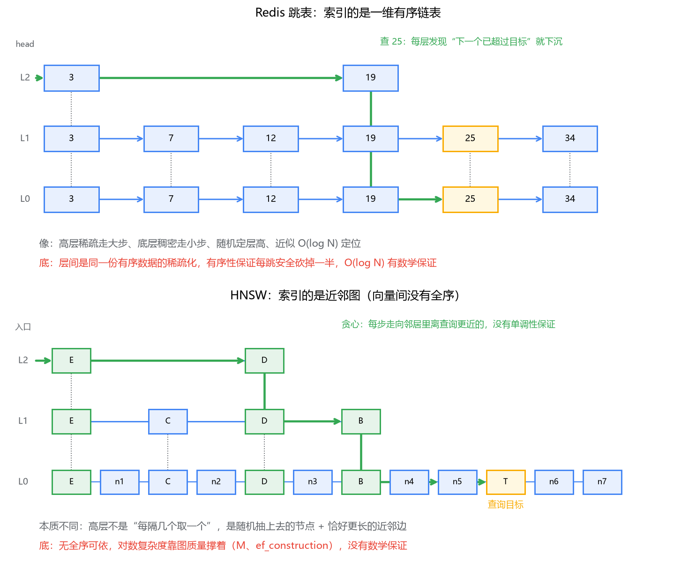

# 03 运行机制分册

对应专栏三 7 篇。这一册回答"凭什么"：凭什么快、凭什么省、挂了怎么办。ES 和 Milvus 的内部世界差异很大，分两套讲，最后做横向对照。

---

## 上半部：ES 的四个机制

### 1. 倒排索引内部结构：内存和磁盘的分界线画在哪

**term dictionary 怎么组织**。朴素方案（磁盘上有序数组+二分）死于量级：term 上亿，二分 ≈ 27 次随机 IO。B+ 树没这问题是因为二分发生在 16KB 页内（页在 buffer pool），跨页走矮树。改进 = 学 B+ 树架内存路由层，但路由层必须小到常驻内存不心疼。

**FST（有限状态转换器）** 的两重压缩：

1. 在 trie 共享前缀的基础上**再共享后缀**（mop/pop/stop/top 共用 "op" 路径）；
2. **稀疏**：只索引通往磁盘词表每个 block 的入口词，不收录每个 term。

查找三段：内存 FST 定位 block（不比较不二分）→ 磁盘顺序读 block（对 SSD/page cache 友好）→ block 内小范围查找。

**对照 B+ 树的两个本质不同**：① B+ 树非叶子层必须**全量**路由（每 key 一条，一步不能省），FST 允许稀疏、允许 miss（miss 代价只是多读一个小 block）——"允许不精确"换体积可控；② B+ 树同一结构管定位又管存储，ES 是**两层结构、两份文件、两个介质**（FST 常驻内存，词表和 posting list 待磁盘）。另外 ES 不自管缓存，全靠 mmap 交给 OS page cache——JVM 堆别给太大，否则挤占 page cache。

**posting list 怎么压缩**。常用词的 posting list 动辄上千万 doc id。两条天然纪律换两层压缩：严格升序 → **delta 编码**（存差值）；组内小幅差值 → **Frame of Reference**（按 128 个一组，整组按最大值的位宽打包位流；组里混进一个大数整组被拉高）。组合查询的交并集用 **roaring bitmap**（高 16 位分桶，稀疏用数组/稠密用位图/连续用 RLE）。B+ 树世界里没有"一个 key 挂几千万行"的形态，所以 MySQL 没有这套东西。

**doc values：聚合排序为什么不用倒排**。倒排回答"含这个词的文档有哪些"，回答不了"每篇文档的这个字段值是多少"（方向反了，硬掰=组合爆炸）。所以写入时**按列再存一份**（segment 的一部分，mmap 进 page cache）——和 Parquet/ClickHouse 同思想。text 字段默认没有 doc values（分词后不是"一个值"）。**同一份数据存两套结构**是 ES 磁盘占用大的原因之一。（原文：专栏三·01）

### 2. 写入路径与近实时：一条写入的完整旅程

链路五步：**buffer 攒批 → refresh 造段（进 page cache 即可查，不 fsync）→ merge 收摊 → flush 落盘清 translog**。

- 写入进 memory buffer，同时追加 **translog**；这步完成即可返回（默认返回前唯一落盘动作是 translog 的 fsync）。
- 默认每 1 秒 **refresh**：buffer 内容写成 segment，进**文件系统缓存**（不 fsync）即对搜索打开。
- 默认每 30 分钟或 translog 512MB **flush**：segment fsync 落盘，清空 translog。

关键认知：**可见性的门槛是进 page cache，不是落盘**（Lucene 走 mmap，fsync 与否只影响断电后还在不在）。MySQL 的脏页对查询立即可见但"可查"语义从不交给 page cache——ES 更进一步，可见性直接建在 OS page cache 上。

**translog 对照 redo log（三处差异）**：

1. **粒度**：redo 记物理修改（某页某偏移），translog 记文档级操作（逻辑日志）；
2. **fsync 滑杆**：MySQL `innodb_flush_log_at_trx_commit` 三档 vs ES `request`（每写请求 fsync）/ `async`（每 5 秒，8.x 已废弃）——"拿持久性换吞吐"的滑杆两个系统都有；
3. **最重的 fsync 在不在关键路径**：MySQL 挪的是数据页（redo fsync 仍在提交路径）；**ES 连 segment 的生成和落盘一起挪出关键路径**——凭什么敢？因为持久性由已 fsync 的 translog 接住了，崩溃后重放补齐。MySQL 里"提交即可见即持久"绑定在同一个时刻，ES 把它拆成两个独立时刻，中间最多隔 30 分钟——用可见性换写入吞吐。

**segment 不可变的连锁反应**（整套设计的前提）：删除 = 每个 segment 配 `.del` 位图打标记，物理删除推迟到 merge；**更新 = 新写 + 旧删**（新文档走完整 refresh 链路，同一次 refresh 里生效所以不会查到两个版本）。这套追加式哲学与 LSM（RocksDB 的 memtable/SSTable/compaction）、Kafka（追加+按 retention 删整段）同族；与 MySQL B+ 树的原地修改是两个世界。和标准 LSM 也别划等号：leveled compaction 控读放大，Lucene 的 merge 更朴素（控段数、清删除标记），读放大靠"每个 segment 自身是完整索引"兜底。

日常打交道三招：`POST /_refresh` 验证是不是可见性时序问题；`?refresh=wait_for` 偶尔用；批量导入用 `refresh_interval=-1` + 副本 0 的组合。（原文：专栏三·02）

### 3. 查询执行流程：两阶段与分布式打分坑

**query then fetch**：query 阶段各分片本地算分排序、只回 doc id + `_score`（`from+size` 条），协调节点归并定榜；fetch 阶段只为上榜文档取 `_source`。思想同分库分表"局部 top N + 全局归并"，多拆一步省带宽。

**深度分页**：`from=10000, size=10` 时每个分片都要排序取前 10010 条——翻第 1001 页的代价是按全量榜算。`max_result_window=10000` 是保护。正路 `search_after`（游标，同 Kafka offset/游标分页一族，只能顺序翻）。

**分布式打分：分数为什么不可比**。BM25 要用的统计量（文档频率、平均长度）**从每个分片自己的 term dictionary 来**。"退款"在分片 1 出现 100 万次、其他分片各 10 万次——同一篇文档落在不同分片，idf 不同，分数不同。分片数从 5 变 10 = 重新洗牌，排序当然变；单分片测试环境和 5 分片线上对分数，必然对不上。

**与 MySQL 归并的本质差异**：跨库 `order by price limit 10` 无损，因为 price 是**存储的客观值**；`_score` 不是存储值，是查询时拿**环境统计量**现场算的派生值——问题不在归并算法，在度量衡每个分片不一样。平时没感觉是因为数据量大、分布均匀时局部统计 ≈ 全局的 1/N；坑集中在"数据不大却一堆分片"和"term 分布倾斜+自定义路由"。所以别过度分片。

**DFS_QUERY_THEN_FETCH**：多一轮"收集各分片统计量→汇总成全局值→带着全局统计走两阶段"。修可比性，代价是一整轮 RTT。什么时候值得开：分数被当严肃数据用（业务阈值、测试断言、跨环境复现）。普通搜索列表不值得。更根本的解法是分片数规划对。（原文：专栏三·03）

### 4. 集群与分布式：选主、路由、副本、脑裂

- **master 管户口不管搬砖**：只管元数据（cluster state：有哪些节点/索引/分片住哪），不碰任何数据读写；请求打到哪个节点，哪个就当协调节点。对照 Kafka controller，不是 MySQL 主库。排查顺序：**读写出问题查数据面，集群行为出问题才查 master**。
- **路由** `shard = hash(routing) % 主分片数`：与分库分表同模子（分片数定死不可改，扩容靠 reindex）。差异：分库分表查询大多带分片键精确路由，**ES 搜索查询不带键，只能广播全分片**——分片数直接决定查询扇出成本。自定义 routing 是后门，代价是数据倾斜。
- **副本**：写请求走主分片、**同步**并行复制到所有副本、都确认才返回（副本站在写入关键路径上，副本+1 写入吞吐再矮一截）。动机是高可用+查询吞吐，**没有读写分离**这回事。慢副本会被踢出 in-sync 副本集合（对照 MySQL 半同步超时退异步）。主分片挂了由 master 从同步副本里**动态提升**新主。
- **副本恢复**：sequence number + global checkpoint，先按序号增量补，补不动按文件重建、能复用的 segment 不重传（对照从库按 binlog 位点续传）。
- **脑裂**：靠**多数派**——两个"超过半数"必有交集，交集节点不会投两票，数学上封死两个大脑。7.0 起投票配置自动维护（之前靠人工配 `minimum_master_nodes`，配错平时正常、出事在深夜）。代价想清：凑不够多数派时集群**拒绝服务**——宁可不可用，不给脑裂开门，这是站队不是故障。
- **红了怎么查**（四步，每步背后是上面的机制）：`_cluster/health?level=indices` 定位索引 → `_cat/shards` 找 UNASSIGNED → `_cluster/allocation/explain` 听 ES 说原因 → 对号入座：磁盘水位（85/90/95 三档）、节点不够（单节点+副本=yellow 最常见）、分片数超限（默认 1000/节点）、恢复在路上（`_cat/recovery` 看进度）。（原文：专栏三·04）

---

## 下半部：Milvus 的三个机制

### 5. ANN 索引原理：HNSW 凭什么又快又准

**为什么不能像 MySQL 建 B+ 树**：谓词不同。`WHERE id BETWEEN` 利用一维有序性剪枝；"最近邻"是全部维度联合参与的条件，任何单维度的有序都回答不了整体距离（地图上按经度索引找不了直线距离最近的店）。精确方案只剩 FLAT 暴力扫——100% 召回的基准尺子，几万条以内别嫌它朴素。

**IVF：先聚类，再只扫几个桶**。k-means 把空间聚成 nlist 个簇（"簇心 → 向量列表"，名字借自倒排索引）。查询：算到全部簇心的距离（1024 次，便宜）→ 挑最近的 nprobe 个桶 → 桶内暴力扫。计算量缩 60 倍量级。k-means 在 IVF 里被**降格为空间划分工具**——没人关心簇的语义，所以数据分布变了理想做法是重建索引（不像 B+ 树插入即生效）。召回损失出在**边界点**：真近邻被划到第 17 近的桶而 nprobe=16。nprobe=nlist 退回 FLAT，nprobe=1 最快最惨，中间滑动。

**HNSW：给近邻关系修路**。"圈地"之外的流派"修路"：向量=城市，相邻城市间修边，查询=从入口贪心开往目标。朴素近邻图两个坑：路网直径大（横穿图拐弯多）、陷进局部洼地。突破是**分层**：节点随机定层高（金字塔），高层稀疏走大步快速逼近、底层稠密精确贪心。



**对照跳表（最容易产生虚假理解的地方）**：共享"高层稀疏、底层稠密"的形，本质完全不同——跳表索引**有序链表**，每层是同一份有序列表的稀疏化，有序性给硬保证（下一步砍掉一半，O(log N) 有数学底）；HNSW 索引**近邻图**，高层节点是随机抛硬币上去的，边走哪条由贪心决定，无单调性保证——**O(log N) 是经验行为，图修得好才成立**。所以 M（每节点边数）和 efConstruction（建图候选队列）伤不起，HNSW 建索引出名的慢（每点插入都是一次完整贪心搜索）。查询侧 ef = 贪心"回头看"的候选队列长度，ef≥top-k。

HNSW 的账单：存原始向量+图结构（1000万×768维≈28.6GB 再加图），**硬伤是删除**——摘点断路，修路费比重建高，Milvus 打 tombstone 标记等 compaction。

**PQ/SQ 把内存账算回来**。PQ 乘积量化：768 维切 m 段（如 96×8 维），每段小 k-means 聚 256 个质心（1 字节编号），向量 3072 字节 → 96 字节（32 倍）；查询距离变成查表求和。有损：差异被压进同一质心的两段距离贡献归零，**召回必降**；补救= PQ 粗筛 top-k×10 + 原始向量重排。SQ 标量量化：逐维 float32→int8，4 倍压缩几乎不伤召回（HNSW_SQ8/IVF_SQ8）。

回到三角：所有调参都是边上滑动——nprobe/ef 用延迟换召回，PQ/SQ 用召回换内存，rerank 先花内存换召回再花延迟换回一点。RAG 判断：千万级以内内存买得起闭眼 HNSW（ef 从 64 起），上亿 IVF_PQ+rerank。真正的坑是**不度量就调参**。（原文：专栏三·05）

### 6. 存算分离架构：节点为什么敢随便挂

**动机**：向量数据大（亿级 286GB+）、索引重建慢（HNSW 每点插入都是搜索），数据绑节点的老方案三头算不过账：副本成本线性涨（K 副本 K 份内存）、扩缩容=搬上百 GB、故障恢复小时级。转念：**检索是只读计算，要的不是数据所有权是可用性**——把"存"剥出去。

五类角色：

| 角色 | 干什么 | 类比 |
|------|--------|------|
| proxy | 无状态入口：校验、鉴权、拆解、归并 | 网关 |
| coordinator（root/data/query/index 四件套） | 只决策不干活：DDL、segment 封口、查询负载分配、索引任务调度 | K8s 控制平面 |
| query/data/index node | 纯算力：检索 / 攒数据落盘 / 建索引 | worker |
| 对象存储（S3/MinIO） | 一切的真相：sealed segment、索引文件 | — |
| log broker（Kafka/Pulsar，单机内置 RocksMQ） | 写入第一落点+增量传播 | **像 Kafka 但不是 Kafka 的用法** |

**log broker 与 Kafka 的本质差异**（整套架构的关键积木）：业务系统里 Kafka 的消息是"通知"，数据真相在 MySQL，丢一段可容忍；Milvus 里**消息就是数据本身**——没 flush 成文件的增量只存在于这条日志里。它把存储从有状态里剥出来：data node 和 query node 都只是这条共享日志的消费者，消费者挂了换个实例从头订阅，数据不丢不搬家。（对照 MySQL 主从是"把数据搬到每台机器"，这里是"所有机器按需消费同一条流"。）

**一条向量的旅程**：insert → proxy 写进 log broker → **客户端拿到成功返回**（此刻对象存储里还没有它）→ data node 消费攒进 **growing segment**（增长期间即可查）→ 攒到上限（512MB 量级）data coord 下令 **seal** → 整块 flush 到对象存储成 **sealed segment**（不可变，谁读谁拉）→ index node 建索引写回对象存储。

查询节点双视角：**sealed 走本地缓存（没有穿透对象存储）；growing 直接订阅日志增量流**。这解释了两件事：①为什么 Milvus 写入**立刻可查**——ES 的近实时靠 refresh 造段，Milvus 把这一步做没了，增量传播不走文件生成、走日志订阅；②为什么一致性可以按请求调——查询节点看增量靠追日志，"追到哪个时间点才执行查询"就成了可谈的条件。

**一致性四档的本质**：每条写入带时间戳，查询带 GuaranteeTs，差别就是 GuaranteeTs 怎么定——Strong=追平全部；Bounded=允许落后一小窗（较新版本默认）；Session=自己会话写的必须可见；Eventually=消费到哪查到哪。**存算分离把一致性从部署属性变成了请求参数**。RAG 选型：批量导入用 Bounded/Eventually；用户"上传后马上提问"用 Session；Strong 留给查不到刚写就算事故的场景。

代价：对象存储延迟高（几十毫秒，靠本地缓存救，命中率差尾延迟难看）；运维复杂（十来个角色，生产数据量单机放得下别硬上分布式）；log broker 在写入关键路径上。（原文：专栏三·06）

### 7. 一次检索的完整旅程：search 进了集群之后

旅程五步：

1. **proxy 接请求**：校验、解析表达式。问 query coord 数据在哪些 query node 上（collection 按主键哈希分 shard，shard 按时间切 segment，每个 segment 有负责人）。**查询向量没有分片键——没法路由只能广播**（对照分库分表的路由是"裁剪"，这里是"规划要打扰谁"）。partition 是唯一的裁剪手段。
2. **局部检索**（计算最重、参数生效处）：每个 query node 对自己每个 segment 独立检索——sealed 走索引（ef/nprobe 在此生效，**30 个 segment 就跑 30 次，参数调大是每次都变深**），growing 暴力扫（量级小，用小规模精确扫描换"增量立即可查"），删除靠 tombstone 跳过。输出本节点 top-k。
3. **标量过滤下推**：表达式在 segment 内求值成 **bitset**，向量检索在 bitset 约束下进行（边生成候选边掩码）。对照 MySQL 的 ICP（索引条件下推）；本质差别：**B+ 树能用标量条件直接定位起点，向量索引结构完全不感知标量**——HNSW 的图按向量距离建、IVF 的桶按向量聚，"tenant_id 是什么"对它们是黑盒，过滤只能掩码不能帮索引少走一步。所以**高选择性过滤（只剩 1%）应该改用 partition**——物理隔离，filter 留给选择性不高的软条件。
4. **proxy 多路归并**：R 份有序 top-k 做小顶堆归并（O(k·logR)）——归并排序的 merge 原语。**成立的前提是距离全局可比**：0.35 在 A 节点和 B 节点是同一个含义（不依赖局部统计量）。所以 **Milvus 没有 ES 的分布式打分坑，也不需要二次回表**（query node 是整行持有者，字段随结果返回）。
5. 组装应答。

慢查询两大嫌疑人：**参数给猛了**（ef=1000）、**segment 碎片化了**（每段固定开销 × 段数；compaction 的意义除了清删除标记就是砍这个）。另一个抖动源：growing segment 暴力扫——**P99 延迟和写入吞吐长一个形状** = flush/seal 跟不上写入，该调攒批参数或加 data node。（原文：专栏三·07）

---

## 横向对照：两套内部世界的同与不同

| 问题 | ES 的答案 | Milvus 的答案 |
|------|-----------|--------------|
| 写入后多久可查 | 近实时（refresh 1s，可见性=进 page cache） | growing segment 立即可查，范围由一致性级别决定 |
| 持久性兜底 | translog（WAL） | log broker（消息即数据） |
| 不可变+标记删除 | segment + .del + merge | sealed segment + tombstone + compaction |
| 分布式归并的可比性 | **分数不可比**（统计量分片本地）→ DFS 补丁 | **距离天然可比** → 无坑 |
| 路由 | 搜索无分片键，广播全分片 | 查询向量无分片键，广播全 shard；partition 可裁剪 |
| 扩容 | 加节点；容量扩容靠 reindex（主分片数不可改） | 加节点；数据在共享存储不搬家 |
| 过滤怎么生效 | bool filter → bitmap 缓存，与算分解耦 | 表达式 → bitset，segment 内下推掩码 |

同构的部分认一遍（见总纲"老朋友"清单）：WAL、不可变+标记删除+后台合并、局部 top N+全局归并、广播扇出。

## 最后，总结

ES 机制四篇是一笔"内存贵、磁盘慢"的总账：FST 用稀疏路由换常驻内存，posting list 用升序纪律换压缩，doc values 为正排需求再存一份列存；写入路径把"贵"全挪出关键路径（translog 接持久性、page cache 即可见），segment 不可变换来读省心、代价是删除标记和 merge；查询两阶段省带宽，但分布式打分因统计量分片本地而不可比，DFS 用一轮 RTT 换度量衡统一；集群靠 master 管户口、多数派防脑裂，红色排查四步由机制推出来。Milvus 机制三篇是另一笔账：ANN 因高维无全序而必然有损，HNSW 与跳表形似神异（经验对数 vs 数学对数），量化用召回换内存；存算分离靠"log broker 消息即数据"把存储从有状态剥出，一致性因此变成按请求调的进度参数；一次检索=广播扇出+segment 局部检索+多路归并，归并成立只因距离全局可比。

```text
━━━━━━━━━━ 一页纸背诵版（ES 机制）━━━━━━━━━━
□ FST = trie 共享前缀 + 再共享后缀 + 稀疏索引(只索引 block 入口)
  · vs B+树：B+树全量路由，FST 允许 miss；两层结构两份文件两介质
  · ES 不自管缓存 → JVM 堆别大，靠 OS page cache(mmap)
□ posting list：升序→delta 编码；组内小差值→FOR 位打包(128个一组)
  · 交并集：roaring bitmap；filter 结果缓存位图
□ doc values：聚合排序要"文档→字段值"，倒排方向答不了 → 列存一份
□ 写入五步：buffer攒批→refresh造段(进page cache即可查不fsync)→merge→flush(30min/512MB)清translog
  · 可见性门槛=page cache；持久性门槛=fsync，两者被拆开
□ translog vs redo：粒度(逻辑vs物理)、滑杆(request/async vs 1/2/0)、最重fsync位置(ES全挪走)
□ segment 不可变：删除=.del位图、更新=新写+旧删、merge 物理回收；LSM 家族
□ 两阶段：query(只回id+score, from+size条)→fetch(只为上榜者取_source)
  · 深分页：每分片排前from+size；max_result_window=10000；正路 search_after
□ 分布式打分：统计量分片本地→分数不可比；别过度分片；DFS=多轮RTT换全局统计
□ master 管元数据不碰数据(类比Kafka controller)；路由 hash%主分片数不可改
  · 副本：同步复制站写入关键路径；in-sync 集合踢慢副本；动态提升新主
  · 恢复：seq+global checkpoint，增量补→文件级重建能复用不重传
  · 脑裂：多数派(两超半数必有交集)；7.0 自动；凑不够多数派=拒服(设计)
  · 红色排查：health定位索引→_cat/shards找UNASSIGNED→allocation/explain→磁盘水位/节点数/分片上限/恢复中
━━━━━━━━━━ 一页纸背诵版（Milvus 机制）━━━━━━━━━━
□ 无 B+ 树：谓词是全维度联合参与，单维有序剪不了枝 → ANN 必然有损
□ IVF：k-means 分 nlist 桶，查 nprobe 桶；损失在边界点；数据分布变要重建
□ HNSW：分层近邻图，贪心导航；vs 跳表=形似神异(经验O(logN)靠图质量)
  · M/efConstruction 建时定，ef 查时调(≥top-k)；删除=硬伤(tombstone)
□ PQ 切 96 段×256 质心=32倍压缩伤召回(补救:粗筛+原向量重排)；SQ float32→int8 几乎无损
□ 五角色：proxy网关/coordinator四件套(控制平面)/三worker/对象存储(真相)/log broker
  · log broker vs Kafka：消息即数据本身，不是通知；消费者挂了换实例重订阅
□ growing(订阅日志即可查)→seal(512MB)→sealed(不可变落对象存储)
□ 一致性四档=GuaranteeTs 怎么定：Strong追平/Bounded落后一窗(默认)/Session自己写的可见/Eventually
  · RAG：批量导入 Bounded/Eventually；上传即问 Session
□ 检索旅程：proxy广播扇出→segment局部检索(sealed走索引/growing暴力扫)→bitset下推→多路归并
  · 距离全局可比→无 ES 打分坑、无需二次回表
  · 向量索引不感知标量→高选择性过滤改用 partition
  · 慢查询：参数给猛了 / segment 碎片化；P99 跟写入同形状=growing 积压
━━━━━━━━━━━━━━━━━━━━━━━━━━━━━━━━
```
