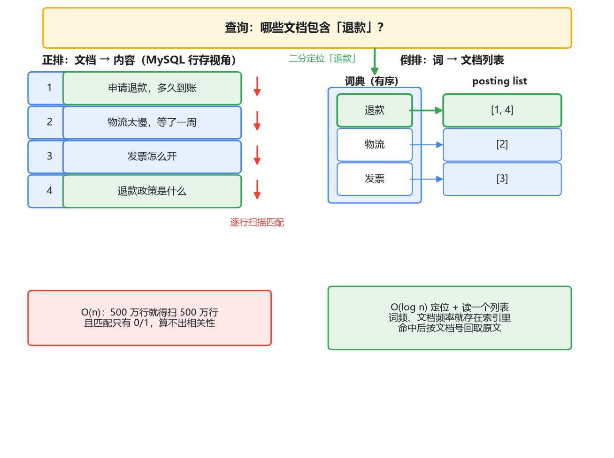
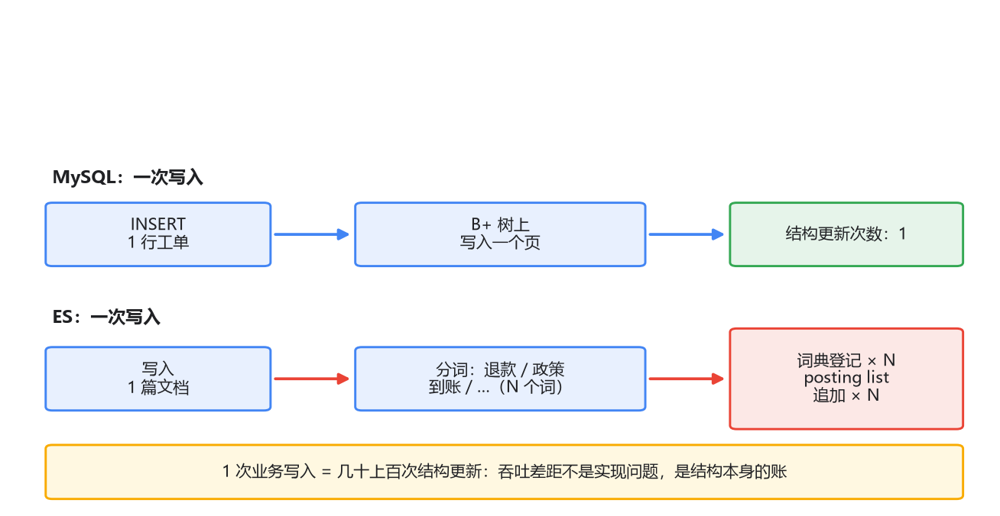

# 01 为什么是 ES：从 MySQL LIKE 说起

假设你接手了一套客服工单系统。某天产品经理找过来：页面上加个搜索框吧，客服想搜历史工单，比如输入"退款"，把提到退款的工单都捞出来。

你打开库一看：work_order 表，500 万行，content 字段存工单正文。作为一个后端老手，你的第一反应大概率是：这不就是个模糊查询吗，两行 SQL 的事。

三天后功能上线，第四天慢查询日志里它天天霸榜。而比慢更麻烦的问题，这时候还没暴露出来。

这一篇我们就从这条 SQL 走起，看它到底卡在哪、一路怎么换方案，最后落到 ES 的立身之本——倒排索引上。

## 一、第一版：LIKE，两行 SQL 就上线

搜索最朴素的实现，谁都想得到：

```sql
SELECT * FROM work_order
WHERE content LIKE '%退款%'
ORDER BY created_at DESC
LIMIT 20;
```

测试环境两千条数据，毫秒级返回，一切美好。上了生产，500 万行，这个查询要跑好几秒（具体随行数和行大小浮动），DBA 的慢查询告警先找上门。

为什么慢？你在 MySQL 上已经是老手，答案信手拈来：content 上就算建了索引，`%退款%` 这种**前导通配符**也用不上。B+ 树是把索引列的值排好序存的，`LIKE '退款%'` 能顺着索引定位到以"退款"开头的那段区间，范围扫一把就完；而 `%退款%` 意味着匹配串可能出现在任何位置，起点定不下来，索引废掉，只能把 500 万行 content 一行行读出来挨个做子串匹配——全表扫描。就算 content 列上有二级索引，顶多做成全索引扫描省掉回表，逐条匹配的量级一点没变。

如果只是慢，加机器、加缓存，咬咬牙也许还能扛。但这个方案还有一个更根本的问题，加多少机器都解决不了。

客服搜"退款"，匹配出 8000 条，按什么排？上面那条 SQL 按创建时间倒序，返回的是"最新的提到退款的工单"。可客服想要的，是"最像在问退款的工单"。这两者不是一回事：一条三百字都在投诉物流、结尾顺嘴提了句"另外退款怎么还没到账"的工单，按时间排可能压过一条通篇都在讲退款政策的工单。

"最相关"需要一个**相关性得分**：这条文档和查询词有多匹配？给每条结果算个分，按分排。可 LIKE 的执行过程里根本不存在"匹配程度"这个概念——匹配就是匹配，布尔值，非 0 即 1。你拿什么算分？

到这里，两个问题摆上了桌：

1. `%xx%` 这种匹配模式决定了只能全表扫，数据量一大就死；
2. 逐行匹配的结构给不出相关性，排序无从谈起。

第一个问题逼你换索引结构，第二个问题逼你重新想"匹配"这件事本身。有意思的是，它们最终指向同一个解法。

## 二、第二版：MySQL 全文索引

其实 MySQL 自己也知道 LIKE 干不了搜索的活，它内置了另一套东西：**全文索引**（FULLTEXT）。

```sql
ALTER TABLE work_order ADD FULLTEXT INDEX ft_content(content) WITH PARSER ngram;

SELECT *, MATCH(content) AGAINST('退款' IN NATURAL LANGUAGE MODE) AS score
FROM work_order
WHERE MATCH(content) AGAINST('退款' IN NATURAL LANGUAGE MODE);
```

`MATCH ... AGAINST` 不再逐行做子串匹配，它底下走的是另一套索引结构——你猜对了，就是倒排索引，我们下一节细说。而且自然语言模式下结果默认按相关性得分排序，`MATCH()` 本身还能把分选出来给你看。前面那两个问题，它都是冲着解决去的。

那为什么中文搜索场景下大家还是大规模上 ES？把 MySQL 全文索引的真实短板摆出来：

**中文支持是补丁式的。** 默认分词按空格切词，英文没问题，中文一段话没有空格，整句会被当成一个词，基本查不到东西。MySQL 5.7.6 起内置了 ngram parser（就是上面那句 `WITH PARSER ngram`），按固定字数滑窗切分：ngram 默认 token 是 2 个字，"退款流程"切成"退款 / 款流 / 流程"。能查到了，但切法是机械的：搜"开发"会把"打开发货"也匹配出来（因为"打开发货"里含"开发"这个二元组合）；搜单个字"税"，比 ngram 的 token 还短，直接匹配不到。召回和精度都不听你的。

**打分和查询几乎不可调。** 分词器没得选，权重没法加，查询语义就那几种模式。想表达"必须含退款，政策可有可无但含了加分"这种意图，表达不出来。而真实搜索需求里，这种半精确半模糊的组合才是常态。

**扩展有天花板。** 全文索引长在单表里。数据涨到要分库分表的那天，跨分片检索怎么合并、打分怎么归一，都得自己搭。

但话要说公平：如果数据量在百万级以内、搜索只是个辅助功能、不想为此引入新组件，MySQL 全文索引完全够用，少一个 ES 集群就少一份运维成本。要不要上 ES，本身是个权衡，不是技术先进与否的问题。

我们这条线继续往下走，前提是：搜索是系统的核心功能，中文，要打分，数据量还会涨。这时候你需要一个专门为"检索"这门手艺造的引擎，也就是 Elasticsearch。但先别急着装它——你得先搞懂它立身的那块基石。搞懂了倒排索引，ES 的一切才不是魔法。

## 三、倒排索引：把数据换个方向存

回头想想 LIKE 为什么慢：数据是按"文档"组织的，每个文档是一整段不可分割的文本。要回答"哪些文档含有'退款'"，只能把每个文档都打开看一遍。**数据组织的方向，决定了查询的成本。**

那换个方向呢？写入文档的时候多做一步：把正文切成一个一个词（这一步叫**分词**，怎么切、切错了怎么办，是第 04 篇的主角），然后反过来记录"每个词出现在哪些文档里"。同一份数据，两种组织方式长这样：



左边是**正排**：文档指向内容，这是 MySQL 行存的视角。它回答"5 号文档的内容是什么"很快——按主键一查就到；回答"哪些文档含退款"很慢，只能逐行扫。右边是**倒排**：词指向文档列表。同一个问题变成两步：先在词典里定位"退款"，拿到它背后的文档编号列表 [1, 5, 9]，结束。词典是排好序的，可以像查字典一样二分定位；500 万文档还是 5000 万文档，这一步的成本几乎不变，变的只是列表长短。

这个"词 → 文档列表"的结构就叫**倒排索引**（inverted index）。词的集合叫**词典**（term dictionary），每个词背后那份按文档号排好的列表叫 **posting list**。ES 底层的 Lucene，整座大厦就建在这三样东西上。

你可能会说：这不就是给 MySQL 加个"词 → 主键"的二级索引吗？我自己建一张表 word → doc_ids，查询 JOIN 一下不也行？思路完全正确，很多团队的搜索早期就是这么干的。但有两个东西，你自己很难顺手做出来。

第一个是**打分**。回头看第二个问题（没法按相关性排序）：要算"文档 d 和查询词 t 有多匹配"，最朴素的两个统计量，一是 t 在 d 里出现了几次（出现 5 次的通常比出现 1 次的相关），二是 t 总共出现在多少个文档里（越稀有的词越有区分度，"的"字谁都有，"退款"不是）。注意这两个数存在哪：词频挂在 posting list 的每个条目上，文档频率挂在词典的每个词上——倒排索引顺手就把算分的原料放在了手边。而正排结构里这些统计量要现算，等于把所有文档再扫一遍。所以倒排索引不只是"找得快"，它是把"找"和"算分"需要的东西一起组织好了。这才是 LIKE 结构性给不出的东西。

第二个是**合并**。真实查询很少只有一个词。"退款 政策"两个词，各自取出 posting list [1, 5, 9] 和 [5, 9, 12]，求个交集得到 [5, 9]，就是两个有序列表的归并，线性搞定。多词组合查询的效率从这里来。

至于词典内部用什么结构（FST）、posting list 怎么压缩，这些留到专栏三拆。现在记住"词典 + posting list"这个骨架就够了。

## 四、倒排不是免费午餐

讲了这么多好处，按惯例要把代价摆全，不然这篇就成了软文。

**写入放大。** MySQL 插入一行，本质是往 B+ 树的某个位置写一个条目，一次写入动一两个页。而一篇文档进倒排索引，先分出几十上百个词，每个词都要在词典里登记（可能是新建，也可能是追加），再在对应的 posting list 上追加文档号。一次业务写入，放大成几十上百次索引结构的更新。



所以 ES 的写入吞吐和 MySQL 不是一个量级，写入密集的场景得靠 bulk 攒批写（第 07 篇讲）。这不是实现不精，是结构本身的账。

**空间。** 倒排索引，加上后面算分、排序要用的辅助列存结构，加起来比原文还大是常态。同一份内容在 ES 里占的磁盘通常比 MySQL 多。分词切出来的冗余，都实打实记在账上。

**可见性延迟。** 还有一个和 MySQL 心智差异很大的点：文档写进 ES 后，要等下一次 refresh（默认 1 秒）才能被搜到。习惯了"事务提交即可见"的你会觉得反直觉。这不是 bug，是为写入吞吐做的取舍——攒一批一起构建索引，比来一条构建一次便宜得多。机制细节同样留在专栏三。

把这些放一起看，结论很清晰：**倒排索引用写入时的额外开销，换查询时的快速定位和算分原料。**这是一笔拿写入吞吐和空间换查询能力的交易。所以工程上的标准姿势是：MySQL 继续当 source of truth，管事务、管一致性；把需要被搜索的数据异构一份到 ES，专管检索。就像你不会指望 Redis 替你管外键，也别指望 ES 替你管事务。

## 最后，总结

这一篇从一条慢 SQL 出发，走完了"为什么要换引擎"的完整推理：

- `LIKE '%退款%'` 前导通配符废掉 B+ 树，只能全表扫；更根本的是，逐行匹配给不出相关性，"最相关的排前面"无从谈起。
- MySQL 全文索引配上 ngram parser 能顶一阵，但中文分词机械、打分不可调、难扩展。要不要上 ES 是权衡：搜索只是辅助功能就不必上，是核心功能就躲不开。
- 倒排索引把"文档 → 词"翻转成"词 → 文档"：查一个词变成一次词典查找加 posting list 读取；词频、文档频率这些算分原料就存在索引里；多词查询是 posting list 求交。
- 代价是写入放大、更大的空间占用、秒级可见性延迟。所以 ES 是检索引擎，不是数据库，主数据留在 MySQL。

地基有了。但倒排查找能命中的前提，是查询切出的词和写入切出的词是同一个词——切词这件事，完全由分词器决定。它是个隐形的、威力巨大的角色，第 04 篇专门讲。在那之前，下一篇先把 ES 装起来，把 index、document、mapping 这些核心概念对着 MySQL 过一遍，边动手边建立体感。
