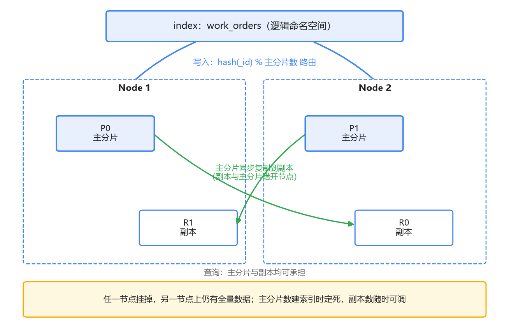

# 02 核心概念与上手：拿 MySQL 对照着入门

上一篇我们想通了为什么搜索这件事 MySQL 干不好，倒排索引又凭什么干得好。这一篇动手：把 ES 装起来，建索引、写数据、发查询，把 index、document、mapping、shard、replica 这五个词真正用一遍。

学一门新存储，你的本能反应大概是：先拿它和 MySQL 对着看，库对库、表对表，概念地图一画，上手就快。这个方法对，但只对一半——ES 里有几个概念长得像 MySQL 的某个东西，骨子里却不是，照着 MySQL 的直觉去用，会踩坑。所以这一篇的写法是：对照着讲，讲到每一处都停下来问一句"哪里一样、哪里不一样"。

## 一、先把 ES 跑起来

工欲善其事，先跑个容器。Docker 一条命令：

```bash
docker run -d --name es \
  -p 9200:9200 \
  -e discovery.type=single-node \
  -e xpack.security.enabled=false \
  docker.elastic.co/elasticsearch/elasticsearch:8.14.3
```

三个参数解释一下。`discovery.type=single-node` 是告诉 ES 你就单节点跑，别费劲做集群发现。`xpack.security.enabled=false` 是关掉安全认证——**注意这是版本敏感的**：7.x 的镜像默认不开认证，8.x 起默认开启（自带 HTTPS 和随机密码），本地学习图省事可以直接关掉，生产环境千万别这么干。内存方面，ES 是个吃内存的主，给 Docker 分个 4G 以上再启动，不然它起得慢或者干脆起不来。

起来之后验证一下：

```bash
curl http://localhost:9200
```

返回一段 JSON，里面有集群名、版本号，还有那句著名的 tagline——"You Know, for Search"。

到这里有个值得停一秒的观察：你有没有发现，我们还没装任何客户端？ES 的对外接口就是 HTTP + JSON，增删改查全是 REST 请求。这意味着 curl、Postman、任何语言的 HTTP 库都能直接操作它，学习门槛比装一堆 SDK 低得多。后面所有操作，curl 就够了。

## 二、五个概念，对照 MySQL 过一遍

先把对照表摆出来，然后逐个说哪里对得上、哪里对不上：

| MySQL | Elasticsearch | 像不像 |
|-------|---------------|--------|
| 表 | index | 像，但有一个单词陷阱 |
| 行 | document | 像，但 schema 松紧天差地别 |
| 列定义 | mapping | 半像：默认不写，它替你猜 |
| 分库分表里的分片 | shard | 骨子里像，但原生 vs 中间件 |
| 从库 | replica | 半像：都有副本，读写策略相反 |

**index：最需要先掰正的单词。**在 MySQL 世界里 index 是"索引"，指 B+ 树那种加速结构。到了 ES，**index 是一个容纳数据的容器**，地位上更接近一张表：`orders` 这个 index 装着所有订单文档。而 MySQL 意义上那种"加速用的索引"（倒排索引），在 ES 语境里是 shard 内部的存储结构，你日常操作根本碰不到它。刚从 MySQL 过来的人看到 `PUT /orders` 建了个 index，第一反应容易理解成"给 orders 表建了个索引"——完全拧了。这里还有段历史：ES 早期（6.x 及以前）index 下面还有一层 type，index 像 database、type 像 table；7.x 把 type 废弃，8.x 彻底移除。所以网上老教程里"index 对应 database"的说法已经过时，**现在就按 index ≈ 表 来记**。

**document：像行，但自由得多。**一条 document 就是一个 JSON 对象，主键叫 `_id`。你可以显式指定，也可以让 ES 自动生成。和 MySQL 行最大的区别是：行是一堆定死的列，document 是一棵随意的 JSON 树，可以有嵌套、有数组。这个"自由"是有代价的，代价在 mapping 那里说。

**mapping：像表结构定义，但默认态度完全相反。**MySQL 的表必须先 DDL 后插数，列类型定得死死的；ES 默认（**动态映射**，dynamic mapping）是先插数、后猜类型——第一条文档进来，ES 扫一眼每个字段的值，number 就 long，带引号就 text，长得像日期就 date，当场替你把 mapping 定下来。方便是方便，坑也埋在这里，第四节专门讲。

**shard 和 replica** 是分布式的部分，单机阶段先建立概念，第五节展开。

## 三、用 REST 走一遍增删改查

场景沿用上一篇的工单系统。建一个 `work_orders` 索引，插一条工单，改它，查它，删它。

**建索引**（相当于 `CREATE TABLE`，但我们不定义列，让动态映射先干活）：

```bash
curl -X PUT http://localhost:9200/work_orders
```

**插入一条文档**，指定 `_id` 为 1：

```bash
curl -X POST http://localhost:9200/work_orders/_doc/1 -H 'Content-Type: application/json' -d '
{
  "content": "客户申请退款，问多久到账",
  "status": "processing",
  "agent": "王客服",
  "created_at": "2026-10-29"
}'
```

不指定 `_id` 就用 `POST /work_orders/_doc`，ES 自动生成一串。这里有个 MySQL 直觉会骗你的点：**用 PUT 或 POST 对着同一个 `_id` 再写一次，不是报错，而是整篇覆盖**——旧文档没了，换成你新发的这份。相当于默认执行了 `REPLACE INTO`。想防止误覆盖，加 `?op_type=create`，`_id` 已存在时会返回 409 冲突；ES 内部还有基于 `_seq_no` 的乐观并发控制，原理和 CAS 一个意思，用到再说。

**按 id 查**：

```bash
curl http://localhost:9200/work_orders/_doc/1
```

**局部更新**，只改 status：

```bash
curl -X POST http://localhost:9200/work_orders/_update/1 -H 'Content-Type: application/json' -d '
{ "doc": { "status": "resolved" } }'
```

注意 ES 的 update 语义和 MySQL 的 `UPDATE ... SET` 也不完全一样：`_update` 是取出文档、合并你给的片段、再整体写回，并非原地改某个字段。所以"把 status 是 processing 的所有文档改成 resolved"这种条件批量更新，得走别的路（update by query），而且性能上别指望它像 MySQL 一样便宜——想想上一篇的写入放大。

**删除**：

```bash
curl -X DELETE http://localhost:9200/work_orders/_doc/1
```

到这里增删改查通了。但真正的搜索——"找出所有提到退款的工单"——用的是另一套东西：`_search` 和查询 DSL。那是下一篇的主角，这里先把地基概念补完。

## 四、动态映射：最舒服的坑

现在回头看 mapping。动态映射乍用之下非常贴心：不用写 DDL，数据扔进去就能查。我们来复现一个典型的翻车现场。

往 `work_orders` 灌历史数据，第一条里 `phone` 字段写的是数字 `13800001234`（JSON 里忘了加引号）。ES 扫一眼：数字，推断为 `long`，mapping 定了。之后所有数据里 `phone` 都是字符串 `"138-0000-1234"` 这种带横线的格式，写入直接报 `mapper_parsing_exception`——字符串解析不成 long。你翻了半小时日志才发现根因在第一条数据上。

更麻烦的变种是它不报错：如果后来的值是 `"13800001234"`（带引号的纯数字），ES 会默默做一次类型强转然后收下。等你从监控上发现 phone 查询行为不对时，错误类型已经陪着几百万条数据住进索引了。

然后是最硬的一条：**mapping 里的字段类型不可变**。发现 phone 定错了想改？没有 `ALTER INDEX ... MODIFY` 这种东西，唯一的路是新建一个 mapping 正确的索引，把数据 **reindex** 搬过去。对照 MySQL：`ALTER TABLE` 改列类型虽然重，可能锁表、要重建，但路是通的；ES 连这条路都没有。

为什么设计得这么绝？回想上一篇的倒排索引：字段类型决定了它进什么索引结构——数字走数值编码（BKD 树），文本才分词进词典和 posting list。类型一改，整套物理结构等于重造，原地改不如重写。**schema 宽松只是表象，底层结构对类型的依赖一点没松。**

所以实践上的姿势是分场景：日志、探索性数据、字段乱七八糟的第三方数据，动态映射省心；**但凡是要长期服务的业务索引，先手写 mapping 再灌数据**，并且把 `dynamic` 设成 `strict`（多余字段直接报错）或 `false`（多余字段只存不索引）。上线前 `GET /work_orders/_mapping` 亲自过一遍，确认每个字段的类型和你想的一致——这一步在 MySQL 世界里你天然会做（DDL 是显式的），在 ES 世界里因为"它替你猜了"，反而最容易漏。

顺带补两个同样容易骗到 MySQL 直觉的点。一是**可见性**：上一篇说过文档写入后默认要等约 1 秒的 refresh 才能被**搜索**到；但按 `_id` GET 单条文档是实时的，写完立刻能查到。一个近实时一个实时，分清楚，不然你会以为自己见鬼了。二是**事务**：ES 没有跨文档事务，没有回滚。单文档的写入是原子的，多文档操作要么靠 bulk 尽量攒批，要么在上游保证一致性——这也是为什么上一篇说主数据留在 MySQL。

## 五、shard 与 replica：分库分表的原生版

最后两个词，是 ES 分布式的那一面，单机阶段先把概念立住。

**index 是逻辑概念，shard 才是物理实体。**你建了 `work_orders` 这个 index，它并不对应一个巨大的存储结构，而是被切成 N 份，每一份叫一个**主分片**（primary shard）。每个分片就是一个功能完整的迷你搜索引擎（一个 Lucene 实例），有自己独立的倒排索引。写入时按 `hash(_id) % N` 把文档路由到某个分片——这个公式你应该觉得眼熟，就是分库分表按主键取模的那一套。

对照一下就知道差别在哪：MySQL 要按取模拆 16 个库，你得在应用层或中间件层（ShardingSphere 这类）自己实现路由、聚合、归并；ES 生下来就内置了这一切，对使用者透明。**一样的思想，一个靠外挂，一个长在身体里。**

**replica** 是主分片的副本，作用和 MySQL 主从的从库类似：主分片挂了，副本顶上（高可用）；查询可以由主分片或副本任一承担（读吞吐）。但也有个关键差异值得点出来：MySQL 的读写分离是一个架构决策——主库扛写、从库扛读，是你主动把读流量导过去的；ES 里写请求永远只进主分片、由它同步给副本，查询打主分片还是打副本是内部均衡策略，你不用管也基本管不着。

两个参数的"可变性"也不一样，这个差异值得记住：**主分片数建索引时定死，事后不能改**——路由公式里有 N，改了 N，老文档按新公式找不到家，和分库分表取模扩容的难题一模一样。要扩只能走 split API（只能整数倍扩）或 reindex 搬家。而**副本数随时可调**，`number_of_replicas` 是个动态参数，因为副本不参与路由，加一个副本只是让主分片多复制一份数据出去。

单机玩的时候这些都不用操心，而且有个版本细节：**7.x 起新建索引默认就是 1 个主分片、0 个副本**（更早的版本默认 5 个主分片）。所以你在单节点上建索引不会看到黄色的分片告警，真给单节点索引配上副本，副本会一直处于 unassigned 状态——没有第二个节点可放。



这张图把整体关系收个口：一个 index，2 个主分片，每个带 1 个副本，部署在 2 个节点上，副本和主分片刻意错开节点——主分片所在的节点挂了，另一个节点上还有完整的数据副本顶着。

## 最后，总结

这一篇把 ES 的五个核心概念用 MySQL 过了一遍秤：

- **index ≈ 表**，但这个单词在两个世界意思几乎相反，MySQL 的"索引"在 ES 语境里是 shard 内部的倒排结构。
- **document ≈ 行**，是自由的 JSON；**mapping ≈ 列定义**，但默认是动态映射替你猜类型——字段类型不可变，猜错了只能 reindex。业务索引要手写 mapping，把 `dynamic` 收紧。
- 增删改查全是 REST：`_doc` 指定 id 写入是覆盖不是报错，`_update` 是取出-合并-写回，按 id GET 实时、搜索近实时，没有跨文档事务。
- **shard ≈ 分库分表的分片**，路由公式同款，但 ES 原生内置；主分片数事后不可改，副本数随时可调；**replica ≈ 从库**，高可用加读吞吐，但读写分离不是你的决策。

数据进去了，概念立住了，下一篇讲真正的重头戏：查询 DSL。为什么在 text 字段上用 term 查询十有八九什么都查不到？这个坑，几乎每个从 MySQL 过来的人都会踩一遍。
