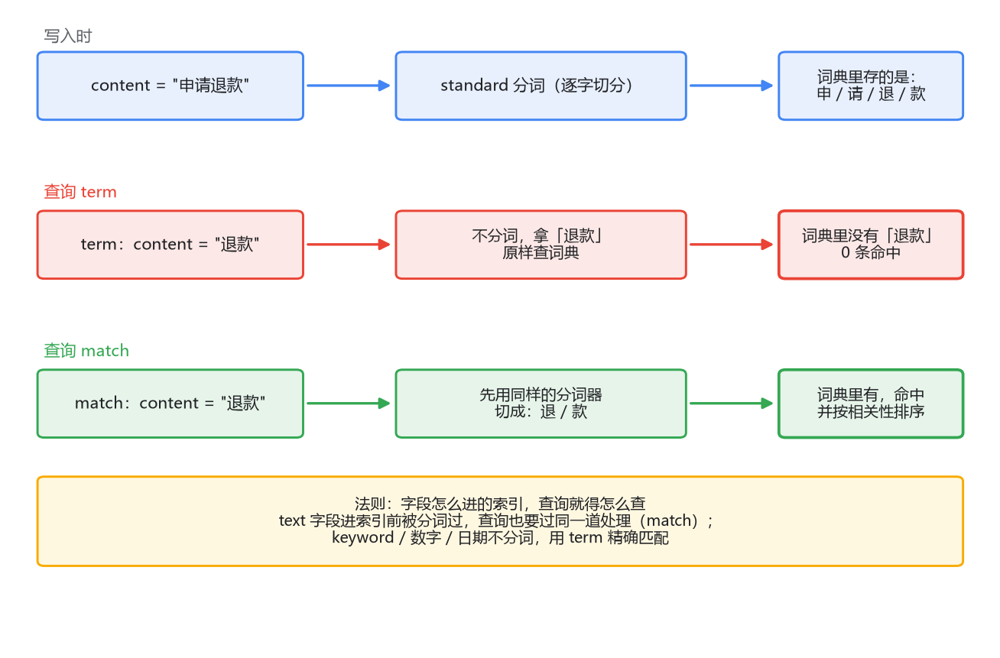
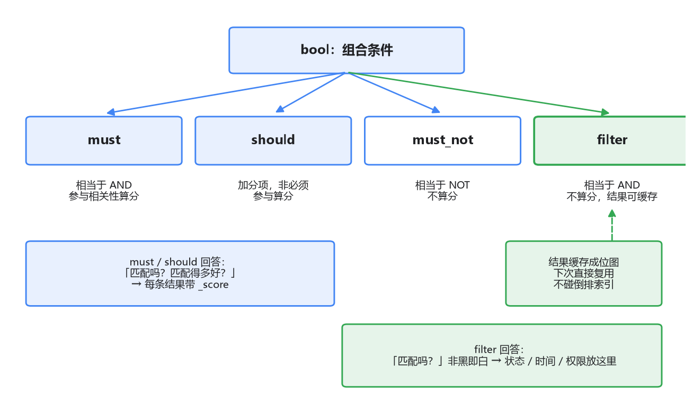

# 03 检索 DSL：查询写不对，一切白搭

工单搜索功能该排上日程了。数据已经灌进 ES，现在要实现那个最核心的接口：输入关键词，返回最相关的工单。

你打开 ES 文档，看到查询要发 JSON 到 `_search`，结构大概是 `{"query": {...}}`。行，照着 MySQL 的直觉，第一个查询你八成会这么写：查 status 等于 processing 的工单，用 `term`；查正文包含"退款政策"，还是用 `term`——在 MySQL 里这俩不都是 WHERE 条件吗，顶多一个等值一个 LIKE。

上线一测，第二个查询返回 0 条。数据明明在，手动 GET 都能看到正文里白纸黑字写着"退款政策"，搜索就是搜不到。你把查询条件改成"退"，居然能查到了。

这是 ES 新手命中率最高的坑，没有之一。这一篇就把这个坑的来龙去脉，连同 DSL 里几对容易混淆的查询，一次讲清。

## 一、term 查不到：字段进的索引和你查的不是同一个东西

先给结论，再解释：**term 是拿你给的值原封不动地去词典里查；match 是先把你给的值过一遍分词器，再拿切出来的词去查。**

回想上一篇的地基：text 字段写入时，ES 会先分词，**进倒排索引的是分词之后的词**。默认的 standard 分词器对英文做小写化、按词切分，对中文是逐字切分（这个行为是第 04 篇的主角，这里先记住结论）。所以：

```json
// 写入：content = "申请退款，多久到账"
// 进倒排索引的词是：申 / 请 / 退 / 款 / 多 / 久 / 到 / 账（还有小写化等处理）
```

这时你用 `term` 查 `content: "退款"`——它拿"退款"这个完整的词去词典里找，词典里根本没有"退款"这个词，只有"退"和"款"两个单字。查不到，返回 0 条。而查"退"能命中，因为词典里真有"退"。

英文场景同理更隐蔽：写入 `title: "Refund Policy"`，standard 分词器存进去的是 `refund` 和 `policy`（小写化了）；用 term 查 `"Refund"`，词典里没有大写开头的 `Refund`，一样 miss。



所以那条法则要背下来：**字段怎么进的索引，查询就得用同样的方式查。**text 字段进索引时被分词、被小写化过，查询时也得做同样的处理才能对上——这就是 match 干的事。而 term 不做任何处理，它默认你给的值就是词典里的原样。

那 term 是给谁用的？给**不分词的字段**。上一篇讲过，ES 里 keyword 类型的字段不分词、整个值作为一个词进词典——status、订单号、标签这类枚举和标识值，天生就该用 keyword 存储，查询天生就该用 term：

```json
{ "query": { "term": { "status": "processing" } } }
```

这条能命中，是因为 status 是 keyword，写入时"processing"原样进了词典，term 拿"processing"去查，严丝合缝。

一个必然的推论：**同一个值，存成 text 还是 keyword，决定了你能怎么查它。**业务里常见的做法是一个字段两种都存（动态映射对字符串字段默认就是 text + keyword 子字段双存），模糊匹配走 text，精确匹配走 `字段名.keyword`。这个设计第一次看很绕，想通了上面这条法则就觉得顺理成章。

## 二、match 家族：分词之后的讲究

term 搞清楚了，match 看起来就是"会分词的 term"。基本形态：

```json
{ "query": { "match": { "content": "退款政策" } } }
```

默认 standard 分词器把"退款政策"切成"退""款""政""策"四个字，四个词分别去查，**命中文档只要含其中任意一个，结果按相关性排序返回**。也就是说，match 默认是 OR 语义。这经常不符合预期：搜"退款政策"，一篇只含一个"策"字的文档也会被捞回来。想收紧成 AND：

```json
{ "query": { "match": { "content": { "query": "退款政策", "operator": "and" } } } }
```

四个词都得命中才返回。OR 和 AND 之间还有中间档，`minimum_should_match` 可以指定"至少命中几个"或百分比，长查询里常用。

但你很快会遇到下一层需求：不但要这几个词都出现，还得**挨在一起、按这个顺序**出现——"退款政策"是个固定搭配，"政策……退款"顺序颠倒的文档不该算命中。这时用 **match_phrase**：

```json
{ "query": { "match_phrase": { "content": "退款政策" } } }
```

它能做到"顺序敏感"，靠的是倒排索引里存的另一份信息：每个词在文档中的**位置**（position）。match 只问"这个词在不在文档里"，match_phrase 还问"这些词的位置是不是连着的、顺序对不对"。所以 phrase 查询比 match 贵，也所以"退款政策"在 standard 分词下匹配的是"退、款、政、策"四个字连续出现——恰好等价于包含"退款政策"这个子串，属于单字切分下歪打正着的正确。

match_phrase 还有个 `slop` 参数，允许词之间隔几个位置（"退款 的 政策"，slop=1 就能命中）。一句话总结这一家子：**match 管词在不在，match_phrase 管词挨不挨着，slop 管能容忍多不挨着。**

## 三、bool：把条件组合起来

真实查询从来不是单条件。SQL 里的 `AND / OR / NOT`，在 DSL 里对应 **bool 查询**的四个子句：

```json
{
  "query": {
    "bool": {
      "must":     [ { "match": { "content": "退款政策" } } ],
      "filter":   [ { "term":  { "status": "processing" } } ],
      "must_not": [ { "range": { "score": { "gte": 5 } } } ],
      "should":   [ { "match": { "agent": "王客服" } } ]
    }
  }
}
```

逐个对照 SQL 理解：`must` 就是 AND，条件必须满足；`must_not` 就是 NOT，必须不满足；`should` 大致像 OR 的加分版——文档满足 should 不是必须的，但满足了相关性得分会更高；`filter` 是"必须满足但不参与算分"，它是四个子句里最特别的，值得单独开一节。

should 有个容易踩的行为细节：**bool 里只有 should、没有 must/filter 时，默认至少满足一个才返回结果**（相当于 OR）；**一旦有了 must 或 filter，should 就退化成纯加分项**，一个都不满足也照样返回。想要"必须命中几个 should"的效果，显式加 `minimum_should_match`。这个默认行为不知道的话，查询结果会显得很随机。

## 四、query 与 filter：算不算分，天差地别

现在正面回答那个问题：filter 和 must 都是"必须满足"，为什么要分成两个？

因为它们回答的问题不同。`must` 回答"匹配吗？匹配得多好？"——它参与**相关性打分**（BM25，第 05 篇展开），每个命中文档都会得到一个 `_score`。`filter` 只回答"匹配吗？"——**非黑即白，不算分**。

status 等于 processing、创建时间在某区间、属于某租户，这类条件天生没有"匹配程度"可言：一个文档要么是 processing 要么不是，谈不上"更 processing 一点"。把它们放进 filter，ES 就知道这些条件与得分无关。

不算分带来两个实打实的好处。第一是**快**：算分要读词频、文档频率做一串计算，不算分就省掉了。第二是**能缓存**：filter 的结果与排序无关、只取决于"哪些文档满足条件"，ES 可以把它缓存成位图（bitmap，一串 0/1，第 i 位为 1 表示文档 i 命中），下次同样的 filter 进来直接复用位图，连倒排索引都不用碰。数据不怎么变的场景下，这层缓存的收益非常大。



于是组合的章法就出来了：**"要不要分"决定一个条件放 query 还是 filter，而不是"要不要 AND"。**文本相关性条件（match、match_phrase）放 must/should，因为它们需要算分；状态、时间范围、权限、租户隔离这些"过滤器"条件一律放 filter。该交税的条件才交税，免税的条件一分都不多交。

回头看开头那个接口的完整形态：搜"退款政策"，限定处理中的工单、最近 30 天、排除已拉黑的客服：

```json
{
  "query": {
    "bool": {
      "must":   [ { "match_phrase": { "content": "退款政策" } } ],
      "filter": [
        { "term":  { "status": "processing" } },
        { "range": { "created_at": { "gte": "now-30d" } } }
      ],
      "must_not": [ { "term": { "agent.blacklisted": true } } ]
    }
  }
}
```

对照你写 SQL 的手感：must 是带算分的 WHERE 条件，filter 是能走索引且能缓存的 WHERE 条件，must_not 是 NOT。结构还是那个结构，只是"条件"在这里被分成了参与排名的和不参与排名的两类——这是 SQL 世界里不存在的一层概念。

## 最后，总结

这一篇把查询 DSL 里最容易写错的几处过了一遍：

- **term 拿原值查词典，match 先分词再查。**text 字段进索引的是分词后的词，所以在 text 上用 term 十有八九查不到；term 的正确对象是 keyword、数字、日期这些不分词的字段。法则：字段怎么进的索引，查询就得怎么查。
- **match 默认 OR**，用 `operator: and` 或 `minimum_should_match` 收紧；**match_phrase** 靠位置信息做到顺序敏感，`slop` 控制容忍度。
- **bool 四子句**：must 是 AND 且算分，must_not 是 NOT，should 是加分项（注意有无 must 时默认行为不同），filter 是 AND 但不算分。
- **filter 不算分，所以结果可缓存成位图**。状态、时间、权限这类非黑即白的条件一律放 filter，算分的位置留给真正需要排名的文本条件。

到目前为止我们一直默认用 standard 分词器，而它把中文拆成单字这件事，其实一直在悄悄影响你的查询效果——单字命中太多、固定搭配查不准。下一篇就正面处理它：换 IK 分词器，以及那个比 term 查不到更隐蔽的坑——索引分词和搜索分词不一致。
