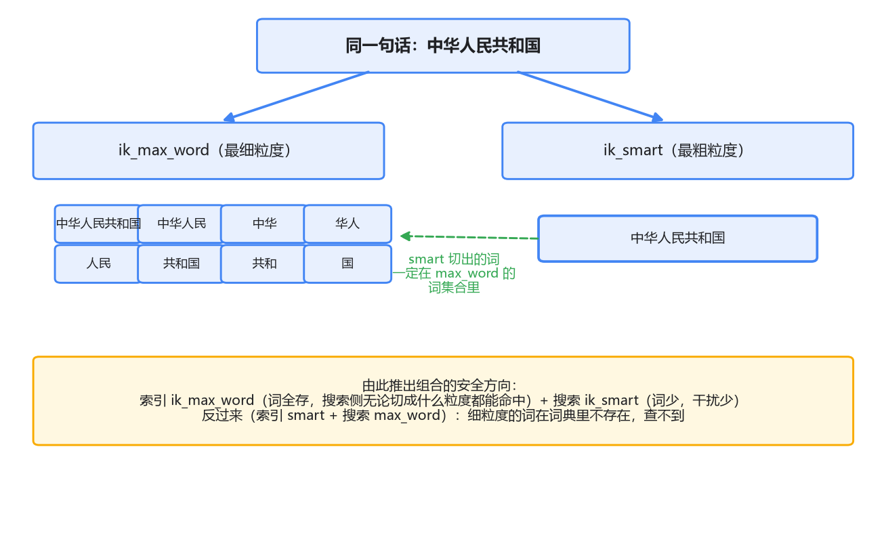
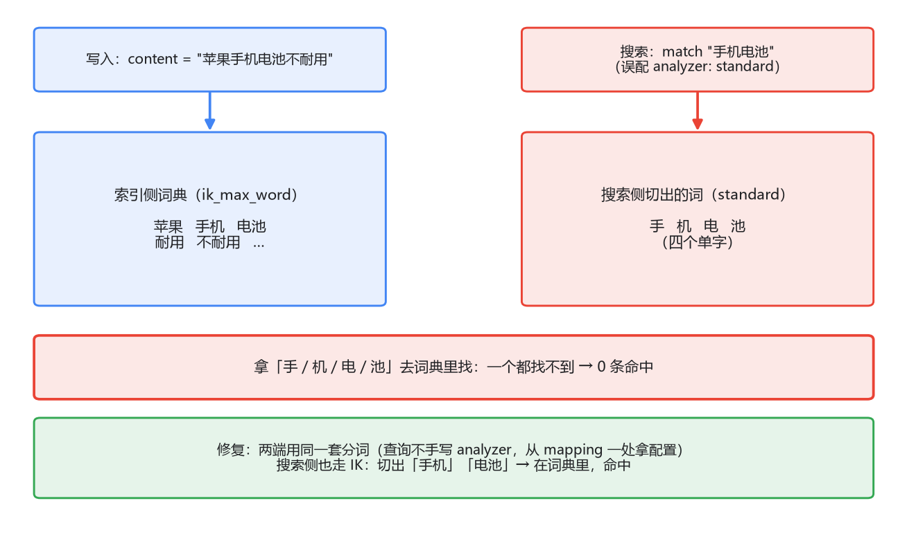

# 04 中文分词：查不到的第一嫌疑人

工单搜索上线了两周，客服开始提反馈：搜"退款"出来的结果里混着一堆"付了款想退货""商品下架了款也退不回来"的工单。你检查查询语句，没问题——上一篇刚学的 match，语义正确。检查数据，也没问题，这些工单确实和"钱"有关。

问题出在上一篇顺手带过的那个事实上：默认的 standard 分词器把"退款"切成了"退"和"款"两个字。match 是 OR 语义，一篇正文只要含"退"字或"款"字就算命中——"付了款想退货"里恰好两个都有，还匹配得特别"好"。单字切分，等于把中文搜索的精度打回了摸奖水平。

这一篇讲透中文分词：standard 为什么这么切、换上 IK 之后 max_word 和 smart 怎么选、怎么用 `_analyze` 当场验证，以及那个比查不到更隐蔽的经典坑——索引分词和搜索分词不一致。

## 一、standard 为什么把中文拆成单字

先还 standard 一个公道：它不是 bug，它是按规范办事的。

standard 分词器底层遵循的是 Unicode 官方的文本切分标准（UAX #29）。这套规则的基本思路是按"词边界"切分：英文单词之间有天然边界——空格和标点，切起来干脆利落；而中文、日文这类表意文字，在 Unicode 的定义里**每个汉字就是一个独立的字符单元**，字与字之间没有边界信息。于是 standard 忠实地一字一切。

这里面的深层原因是：**英文的"词"是书写系统的一部分，中文的"词"是认知的一部分。**"refund"写成这样就是完整的词，写在纸上自带边界；"退款"写在纸上是两个字，"退"到哪算一个词结束、"款"从哪算一个词开始，纸上看不出来，只有懂中文的人脑子里知道。分词，就是把这个认知过程交给程序做——靠词典、靠规则、靠统计模型。这是个专门的研究方向，不是 ES 默认分词器顺手能捎带的活。

所以解法明确：给 ES 换一个懂中文的分词器。中文场景事实上的标准选择是 IK。

## 二、IK：max_word 和 smart 怎么选

IK 是一个分词器插件，先装上（版本必须和 ES **完全一致**，主版本小版本都不能差，这是插件机制决定的）：

```bash
docker exec es bin/elasticsearch-plugin install \
  https://github.com/medcl/elasticsearch-analysis-ik/releases/download/v8.14.3/elasticsearch-analysis-ik-8.14.3.zip
docker restart es
```

装完就有两个分词器可用：`ik_max_word` 和 `ik_smart`。它们的区别用同一个例子看最清楚，拿"中华人民共和国"这句话：



**ik_max_word** 是最细粒度切分，把词典里能匹配上的词尽量都切出来：中华人民共和国 / 中华人民 / 中华 / 华人 / 人民 / 共和国 / 共和 / 国。一串嵌套的词全进倒排索引。

**ik_smart** 是最粗粒度切分，做智力题一样挑最长的那条切分路径：就一个词，中华人民共和国。

怎么选？先看一个事实：对同一段文本，**smart 切出的粗词，一定包含在 max_word 切出的词集合里**（max_word 是"全都切"，smart 是"挑一种切法"，挑出来的自然在全集中）。由此推出两个方向完全不同的组合：

- **索引用 max_word，搜索用 smart**：索引侧把所有可能的词都存了，搜索侧无论怎么切、用户输入无论包含哪种粒度的词，都能在词典里找到——召回有保障；搜索侧切得粗，词少，干扰项也少。这是最常用的组合。
- **反过来，索引用 smart、搜索用 max_word**：索引里只存了粗粒度的词，搜索切成一堆细粒度的词去查，词典里没有——查不到。这是个能稳定复现的事故配置。

在 mapping 里这么配：

```json
PUT /work_orders
{
  "mappings": {
    "properties": {
      "content": {
        "type": "text",
        "analyzer": "ik_max_word",
        "search_analyzer": "ik_smart"
      }
    }
  }
}
```

注意这里出现了两个新面孔：`analyzer`（写入时用）和 `search_analyzer`（查询时用），不配 search_analyzer 时默认和 analyzer 相同。这两个参数，就是下一节那个大坑的门。

## 三、经典坑：索引分词和搜索分词不一致

倒排索引的匹配前提，第 03 篇说过：**查询切出来的词，必须和写入切出来的词是同一个词，才能在词典里碰头。**analyzer 和 search_analyzer 分管这两端，一旦两端不一致——不是那种刻意的 max_word 配 smart，而是无意的不一致——查询就会静悄悄地查不到，不报错、不告警，返回 0 条，一切看起来正常。

复现一个最典型的现场。索引建好了，content 用了 ik_max_word，写入一条工单：

```json
{ "content": "苹果手机电池不耐用" }
```

索引侧切出：苹果 / 手机 / 电池 / 耐用 ……（假设这些词都在词典里）。搜索侧本来该走 ik_smart，但某天排查问题时，同事在查询里**显式指定了 analyzer**（match 查询支持这个参数），或者新同事照着网上的入门文章用了默认的 standard 查询：

```json
{ "query": { "match": { "content": { "query": "手机电池", "analyzer": "standard" } } } }
```

standard 把"手机电池"切成手 / 机 / 电 / 池 四个单字，拿这四个字去词典里查——词典里存的是"手机""电池"这样的词，没有一个单字。0 条命中。



这个坑的讨厌之处在于它的**不对称性**：写错了 analyzer，写入不会失败，查询不会报错，监控全绿，只有用户知道"搜不到东西"。而等你意识到是分词的问题时，可能已经过了排查链路、排查数据、排查查询语法的整整一天。

不一致是怎么被引进来的？几条常见路径，按出现频率排：

1. **查询端显式指定了 analyzer**，和字段 mapping 配的不一样——就像上面的例子，常见于从别的项目复制的查询代码、Kibana 里调试时手动加的参数。
2. **reindex 之后两端不同步**。mapping 的分词器和字段类型一样不可变，想换 IK 只能新建索引搬数据。新索引配了 IK，但代码里的查询模板还是老索引时代的写法（比如老的 custom analyzer 名字），指向的分词行为已经变了。
3. **term 查询天然绕过分词**。第 03 篇讲过，term 从不分析查询串。在 IK 索引的 text 字段上用 term 查"手机"，只有当"手机"恰好作为一个完整词条被索引过时才命中——碰巧能查到的时候更是把人忽悠住，以为没问题。

防御姿势说穿了很朴素：**让两端只从一处拿配置**。analyzer 组合只在 mapping 里定义，查询代码里永远不写 analyzer 参数；要换分词器就连同查询端一起过一遍。搜索分词这件事，任何"就地手调一下"都是隐患。

## 四、_analyze：现场调试的第一工具

坑讲完了，讲怎么抓。ES 提供了 `_analyze` 接口，把一段文本过一遍指定分词器，切出来的词直接吐给你看。**分词问题永远先 _analyze，再谈别的。**

三种用法，一层比一层接近真相：

```json
// 1. 直接指定分词器：看某个分词器的基本行为
POST /_analyze
{ "analyzer": "ik_max_word", "text": "退款政策" }

// 2. 指定索引里的字段：看这个字段查询时会怎么分词
//    （配了 search_analyzer 就用它，否则用 analyzer）
POST /work_orders/_analyze
{ "field": "content", "text": "退款政策" }

// 3. 显式点名分词器：对照 mapping 里 analyzer 配的那个，看写入侧行为
POST /work_orders/_analyze
{ "analyzer": "ik_max_word", "text": "退款政策" }
```

返回的 JSON 里 `tokens` 数组就是切出来的词，每个词还带位置（position）和起止偏移，match_phrase 顺序问题的排查也靠它。

排查"查不到"就变成一个三步流程：

1. 拿 3 号用法看**写入侧**：这篇文档的正文切出了哪些词？你搜的词在里面吗？
2. 拿 2 号用法看**搜索侧**：你的查询串在这个字段上会被切成什么？
3. 两边一对照：**写入侧的词集合里，找得到搜索侧切出的词吗？**找不到，就是不一致，顺着 mapping 和查询代码找是谁动了 analyzer；找得到还查不到，问题才在别处（term 用错字段、数据没刷新、查询语法）。

这三步走完，"查不到"的排查就有了章法——分词不一致这个第一嫌疑人，用两个 _analyze 就能当场定罪或排除，不用再猜。

## 最后，总结

- standard 按 Unicode 词边界切分，中文没有词边界信息，于是逐字切；match 的 OR 语义再一放大，精度稀碎。根源是中文的"词"是认知问题，需要专门的中文分词器。
- **IK 两个粒度**：ik_max_word 全都切、ik_smart 挑最粗的。smart 的词必在 max_word 的集合里，所以**索引 max_word + 搜索 smart** 是安全组合，反过来就是事故配置。
- **索引分词与搜索分词不一致**是最隐蔽的坑：不报错、返回 0 条。常见来源：查询里手写 analyzer、reindex 换分词器后两端不同步、term 天然绕过分词。防御姿势是两端只从 mapping 一处拿配置。
- **_analyze 是第一工具**：指定 analyzer 看写入侧、指定 field 看搜索侧，两边对照，词集合对不上立刻现形。

到这里，检索这条线你会建索引、会写查询、会调分词了。但还有一块没讲：`_score` 到底怎么算出来的，为什么这条文档排第一、那条排第五。下一篇讲相关性打分（BM25 的直观版），以及怎么用 boost 和 function_score 把"官方文档永远置顶"这类业务规则塞进排序里。
