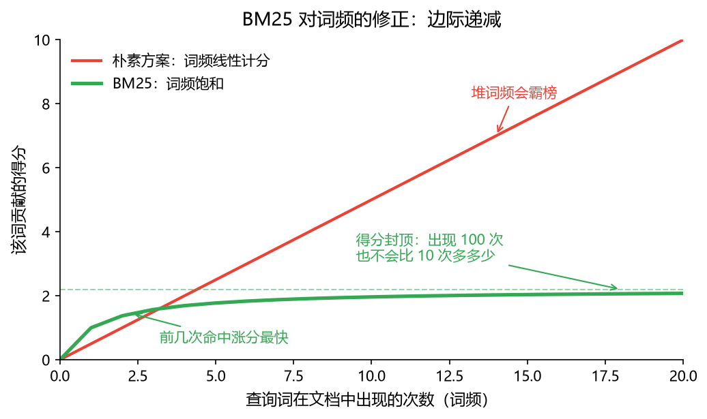
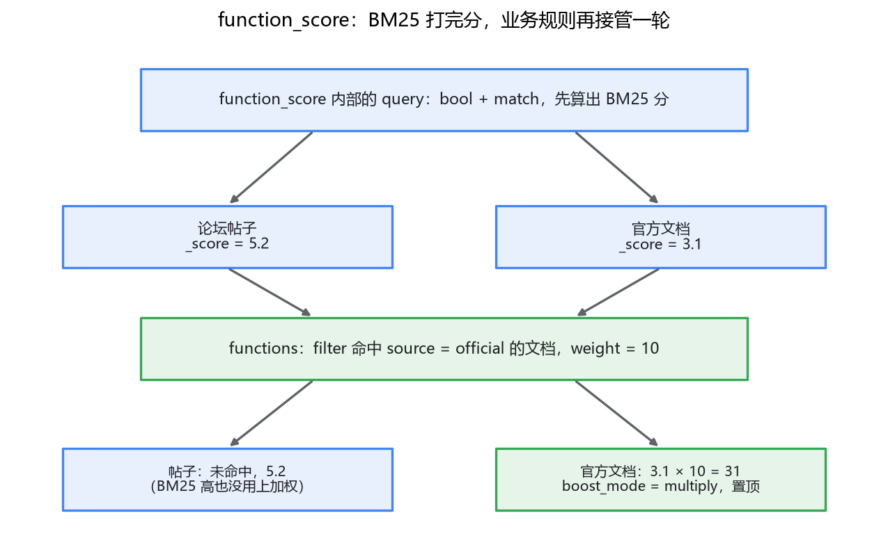

# 05 相关性打分：让好结果排前面

## 搜出来 800 条，用户只看前 10 条

前面几篇我们把"查得到"的问题解决了：倒排索引代替 LIKE 全表扫，IK 分词器让中文按词而不是按字拆。但搜到只是及格线。用户搜"退款政策"，命中 800 条文档，第一屏放哪 10 条，决定了他觉得这个搜索好不好用。想想你自己用搜索引擎的习惯：基本不翻第二页。第 11 名和第 800 名，在用户眼里没有区别。

在 MySQL 里做这件事你没得选——`LIKE '%退款%'` 出来的结果，要么 `ORDER BY id`，要么 `ORDER BY created_at`，排序依据和"这条结果跟查询有多相关"毫无关系。最新的一条不一定是最想看的。

ES 不一样。每条命中的文档都带一个 `_score` 字段，默认就按它从高到低排。于是问题来了：这个分数是怎么算出来的？是玄学吗？如果是，我们怎么在它之上叠加业务规则——比如知识库里官方文档必须排在论坛帖子前面？

这一篇就回答这两个问题：先看清 `_score` 从哪来，再学会干预它。

## 一、`_score` 从哪来：BM25 的直觉版

ES 8.x 的默认打分算法叫 **BM25**（5.0 之前是 TF-IDF，BM25 是它的升级版）。要看懂它，不需要公式，先想一个朴素的问题：如果让你来给"文档和查询词有多相关"打分，你会怎么打？

最直觉的办法：数词频。搜"退款"，文档 A 里"退款"出现了 5 次，文档 B 里出现了 1 次，A 大概率更相关。这就是 **TF**（Term Frequency，词频）——出现得越多越相关。

但这个朴素方案马上会翻车。你可能会说，那出现 50 次的文档是不是 50 倍相关？显然不是。一篇车轱辘话来回说"退款"的文档，会靠堆词频霸榜。BM25 对 TF 做了一个关键修正：**边际递减**。出现第 2 次比第 1 次涨分明显，出现第 10 次比第 9 次几乎不涨——词频曲线是"先陡后平"的饱和曲线，不是直线。这符合直觉：一个词出现 10 次说明文档确实在讲它，但出现 100 次并不能说明更多东西了。

光看词频还不够。搜"退款政策"时，"退款"和"政策"两个词的分量一样吗？设想索引里几千篇文档都提到"政策"，只有几十篇提到"退款"——那"退款"这个词的区分度高，命中它比命中"政策"值钱得多。一个在所有文档里都出现的词（比如分词后的"的"）几乎没有区分度。这就是 **IDF**（Inverse Document Frequency，逆文档频率）：**越稀有的词，权重越高**。有点像在人群里喊"穿红衣服的先生"和喊"穿衣服的先生"的区别——前者能帮你定位到人，后者什么也没说。

还有一个因子：文档长度。一篇 10 万字的年报里提到一次"退款"，和一句话的 FAQ 直接写着"退款流程"——即使词频相同，你也会觉得 FAQ 更相关。BM25 会给长文档的得分打折，短文档里命中同样的词，含金量更高。

到这里，BM25 的直觉版就齐了：

> **TF（词频，越多次越相关，但有饱和）× IDF（稀有词更值钱）× 长度折扣（短文档命中更值钱）**

至于完整的公式、k1 和 b 两个参数各控制什么、怎么调，我放到专栏四第 2 篇拆开讲——那时你要在 RAG 里做混合检索，BM25 的分数要和向量检索的分数合并，必须懂到参数级。现在有这个直觉，日常使用完全够了。



## 二、亲眼看一眼分数：explain

知道了原理，还是会有觉得分数诡异的时候：明明觉得文档 A 该排前面，怎么是 B 第一？这时候别猜，ES 提供了 `explain`，把打分过程摊开给你看：

```json
GET /kb/_search
{
  "explain": true,
  "query": { "match": { "content": "退款" } }
}
```

返回的每个命中里会多出一段 `_explanation`，长这样（节选）：

```json
"_explanation": {
  "value": 2.2035,
  "description": "weight(content:退款 in 42) [PerFieldSimilarity], result of:",
  "details": [
    { "description": "score, computed as boost * idf * tf from:", "value": 2.2035 },
    { "description": "idf, computed as log(1 + (N - df + 0.5) / (df + 0.5)) from:", "value": 1.8452 },
    { "description": "tf, computed as freq / (freq + k1 * (1 - b + b * dl / avgdl)) from:", "value": 1.1944 }
  ]
}
```

idf 是多少、tf 是多少、这篇文档长度和平均值之比，全在里面。平时不用看，但排序诡异时，这是第一现场——先看分数差距是出在 idf（这个词本身太常见/太稀有）还是 tf（对方词频占优），再决定怎么调。

另外提一句 filter 的事，第 03 篇讲过：放在 `filter` 里的条件不参与打分也不被计入打分上下文，只有 `query`/`must`/`should` 里的才影响 `_score`。这也是为什么"状态过滤用 filter、相关性用 must"不只是风格问题——它直接决定分数怎么来。

分布式环境下打分还有一个坑：IDF 和词频的统计在各个分片上可能不均，同一个词在不同分片算出的权重不一样。这个坑和它的解法（`DFS_QUERY_THEN_FETCH`）放在专栏三讲查询执行流程时展开，这里先知道有这回事。

## 三、业务要插队：boost

到这里，打分是"纯文本相关性"的：BM25 只认词频和稀有度，不知道哪篇文档是官方的、哪篇是用户随手发的帖子。但真实业务几乎一定要干预排序。做 RAG 知识库最典型的一条：**官方文档的答案优先于论坛帖子**——权威性是检索质量的一部分，BM25 不管这件事。

最轻量的干预手段是 **boost**（加权）。比如让标题命中比正文命中值钱三倍：

```json
GET /kb/_search
{
  "query": {
    "bool": {
      "should": [
        { "match": { "title":   { "query": "退款流程", "boost": 3 } } },
        { "match": { "content": { "query": "退款流程" } } }
      ]
    }
  }
}
```

一篇正文只沾点边的文档，分数很难追上一篇标题正中命中的文档——因为后者的 BM25 得分先乘了个 3。思路很简单：**BM25 算文本相关性，boost 在它之上乘一个业务系数**。

顺带排个坑：你可能在网上见过在 mapping 里给字段设 `boost` 的写法（索引期加权），那个早已废弃，现在统一在查询期写——查询期加权不用重建索引就能调，这是它活下来而索引期死掉的原因。

两个使用上的提醒。第一，boost 的数值没有公式可算，经验做法是从 2~5 起步，拿几组真实查询对比排序效果再调，它是个相对量，不是要精确到小数点的科学常数。第二，`_score` 只在同一次查询内有意义：换个查询词、深翻一页，分数的绝对值就对不上了。所以别拿 score 当监控指标、别跨查询比大小，它唯一的用途就是排序。

boost 能干的事，本质都是"乘一个固定系数"。但有些业务规则它表达不了，比如：不管 BM25 算出多少分，官方文档必须置顶——"乘系数"是相对调整，"置顶"是绝对规则。这就要请出更重的武器了。

## 四、更重的业务规则：function_score

**function_score** 是 ES 专门为"在相关性打分之上叠加业务逻辑"准备的查询类型。它的执行过程分两步：先照常执行内部 query 算出 BM25 分数，再对每条命中执行你定义的 functions，把结果和原始分数合并。官方置顶的需求这样写：

```json
GET /kb/_search
{
  "query": {
    "function_score": {
      "query": {
        "bool": {
          "should": [
            { "match": { "title":   { "query": "退款流程", "boost": 3 } } },
            { "match": { "content": { "query": "退款流程" } } }
          ]
        }
      },
      "functions": [
        {
          "filter": { "term": { "source": "official" } },
          "weight": 10
        }
      ],
      "boost_mode": "multiply",
      "score_mode": "sum"
    }
  }
}
```

读法：query 部分和原来一样，先算文本相关性；然后每条文档过一遍 functions——`source` 是 `official` 的，分数乘以 10。`boost_mode` 决定函数结果怎么和原分数合并（multiply / replace / sum……），`score_mode` 决定多个 function 之间怎么合并。

置顶要求"绝对"，就把 `boost_mode` 设成 `replace`：官方文档的最终分数直接等于 weight，和 BM25 多少分没关系了。



除了 filter + weight 这种打标签式的加权，function_score 还内置了几个常用的函数，你大概率用得上：

- **field_value_factor**：拿文档里的某个数值字段参与算分。比如论坛帖子按点赞数放大分数——赞越多的帖子越靠前。这和 boost 的区别在于，系数不再是拍脑袋定的常数，而是数据本身。
- **gauss / decay 函数族**：按某个数值做衰减，最常见的是时间。新闻类搜索里"三天前的热搜"和"三年前的旧闻"不该同权重，用 `gauss` 以发布时间为原点衰减，越新分越高。知识库也一样：文档有版本迭代时，旧版本文档应该往下压，不然用户搜到的可能是已经作废的流程。

代价也要说清楚。function_score 一旦叠了两三层，score_mode、boost_mode 组合起来，最终分数没人能口算出来，出了"为什么这条排第一"的客诉，排查成本翻好几倍。所以我的建议是分寸感：能用 boost 解决的别上 function_score，上了 function_score 的，把规则限制在一两条、写进代码注释。排序是业务决策，不是炫技的地方。

还有一层提醒是给 RAG 场景的：这个专栏的终点是把检索结果喂给大模型，排序直接决定塞进上下文的资料质量。上游排序调好一分，下游生成质量就稳一分，这比在 prompt 上抠字划算得多。

## 最后，总结

这一篇回答了"结果按什么顺序排"：

- `_score` 不是玄学，默认来自 **BM25**：词频要饱和（堆词频没用）、稀有词更值钱（IDF）、短文档命中含金量更高（长度折扣）。完整公式和 k1/b 调参放在专栏四第 2 篇，做混合检索时再拆。
- 排序诡异时用 `"explain": true` 看打分明细，别猜。
- 业务干预分两级：**boost** 是给某类查询结果乘系数，轻量；**function_score** 是完整的业务加权框架，filter 打标、字段数值、时间衰减都行，但复杂度上去了，规则要克制。
- 对 RAG 来说，排序质量直接决定喂给模型上下文的质量，值得花心思。

到这里，"搜索"这条线凑齐了：查得到（DSL）、拆得对（分词）、排得好（打分）。但 ES 的本事不止搜索。产品经理马上会来找你：每个分类下有多少条命中？哪些关键词被搜得最多？——这类统计需求，ES 还有一个专门的战场：聚合分析。下一篇讲它。
