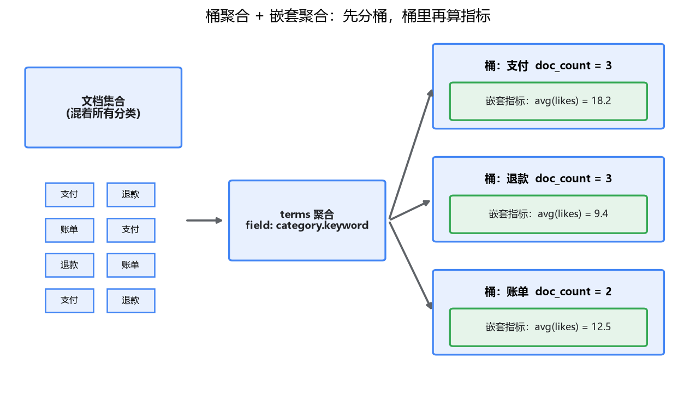
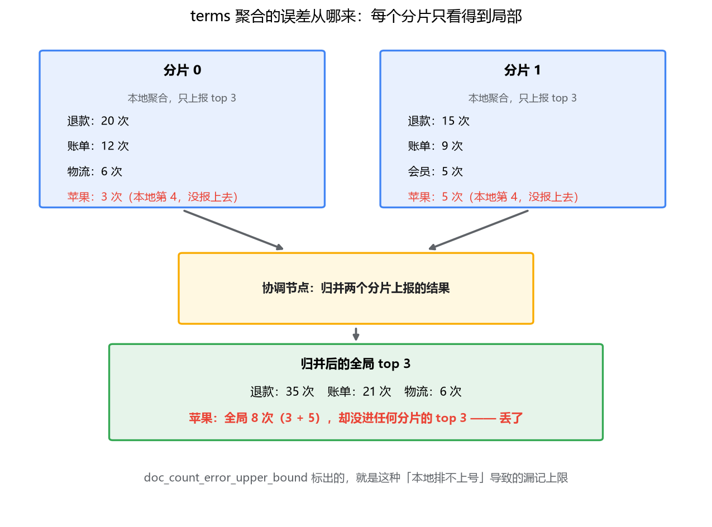

# 06 聚合分析：搜索之外的第二战场

## 搜索上线之后，需求才刚开始

假设知识库搜索服务上线了，检索也调得差不多了。第一周还没过，产品经理带着两个需求来了：后台要看"每个分类下有多少条文档"，运营要看"最近 7 天每天新增多少条内容"。

你的第一反应是 `GROUP BY`——毕竟统计这事 MySQL 干了二十年。但等一下，数据在 ES 里，不在 MySQL。摆在面前的路有两条：要么把数据同步一份到 MySQL 再统计，要么写个脚本把 ES 的数据拉出来在应用里自己数。两条路都别扭：为几个报表把数据搬一遍，链路多一截，一致性多一份烦恼。

其实还有第三条路，而且 ES 本来就是为此设计的：**聚合（aggregation）**。很多人把 ES 当纯搜索引擎用，只发挥了它一半的本事——ES 同时也是一个实时分析引擎，统计这种事就地就能干，数据一份不用搬。

这一篇讲聚合：先从最简单的"算个数"讲起，到分桶统计，再到搜索和统计合并成一次请求。最后有一个你迟早会撞上的疑问：terms 聚合的返回里，为什么藏着一个叫 `doc_count_error_upper_bound` 的误差字段？

## 一、指标聚合：先从"算个数"开始

最简单的统计需求长这样：这批文档的点赞数平均是多少？最高多少？对应的 DSL：

```json
GET /kb/_search
{
  "size": 0,
  "aggs": {
    "avg_likes": {
      "avg": { "field": "likes" }
    }
  }
}
```

返回里 `aggregations.avg_likes.value` 就是平均数。这类聚合叫**指标聚合**（metric aggregation）——输入一批文档，输出一个数。常用的几个：`avg`、`max`、`min`、`sum`，还有一个 `stats` 一次把均值、最值、个数全给你。

对照 MySQL 就是 `SELECT AVG(likes) FROM docs`，概念上没任何新东西。但有个值得咂摸的差异：在生产 MySQL 上，你敢对一张千万行的表随手跑全表聚合吗？大概率不敢，DBA 会先找你。而在 ES 里这种操作是日常——聚合的设计目标就是在搜索这个量级的数据上实时跑，它的底层用的不是一行行扫文档，而是列式存储的 doc values（细节在专栏三第 1 篇讲）。

另外提一个你可能在 Redis 里见过的老朋友：`cardinality`，统计去重后的个数，比如"有多少个不同的作者发了帖"：

```json
"aggs": {
  "distinct_authors": {
    "cardinality": { "field": "author_id" }
  }
}
```

去重在分布式环境里是个昂贵操作，`cardinality` 用的是 HyperLogLog++ 算法——和 Redis 的 `PFCOUNT` 同一个思想：不精确存储每个元素，而是用概率结构估算基数，牺牲一点点精度换来极小的内存开销。返回的是近似值，精度由 `precision_threshold` 参数控制（默认 3000，这个数以内接近精确）。这个"用近似换性能"的选择，这一篇后面还会再遇到一次。

## 二、桶聚合：把文档分而治之

指标聚合回答的是"这批文档整体怎么样"，但产品经理的需求往往是"按 X 分组后各怎么样"。这就需要**桶聚合**（bucket aggregation）：按某种规则把文档扔进一个个桶里，桶本身就是一个结果——每个桶带着自己的 doc_count。

最常用的是 `terms`，就是 GROUP BY 的对应物：

```json
GET /kb/_search
{
  "size": 0,
  "aggs": {
    "by_category": {
      "terms": { "field": "category.keyword", "size": 10 }
    }
  }
}
```

返回的每个 bucket 是一个 `key` + `doc_count`：`"key": "支付", "doc_count": 1234`。注意 `category.keyword` 这个后缀——第 02 篇讲过 text 字段分词后没法直接聚合，得用不分词的 keyword 子字段，这是新手聚合报 fielddata 错误的第一嫌疑人。

除了 terms，还有两个常用的分桶方式：

- **`range`**：按数值区间分桶，比如点赞数 0-10、10-100、100 以上各多少篇。SQL 里这是 `CASE WHEN` 串，这里是声明式的几个区间。
- **`date_histogram`**：按时间间隔分桶，"最近 7 天每天新增多少条"就是它，间隔设 `day` 就行。用 SQL 写是 `DATE_FORMAT(created_at, '%Y-%m-%d')` 再 GROUP BY 那一串，这里一行搞定。

真正让桶聚合超出 GROUP BY 表达能力的，是**嵌套**：桶里可以再放聚合，指标或者另一个桶都行。比如"每个分类下文档的平均点赞数"：

```json
"aggs": {
  "by_category": {
    "terms": { "field": "category.keyword" },
    "aggs": {
      "avg_likes_in_bucket": {
        "avg": { "field": "likes" }
      }
    }
  }
}
```

先按分类分桶，每个桶内部再算一次平均点赞。SQL 里这对应 `GROUP BY category` 加 `AVG(likes)`，还没分出高下；但如果需求变成"每个分类下、每个作者各发了几篇、平均点赞多少"——SQL 要两层 GROUP BY 拼接，聚合 DSL 就是桶里再套一个桶，结构和需求一一对应。



## 三、搜索 + 聚合：一次请求完成

到目前为止的聚合都是对全索引做的。但别忘了那个更常见的场景：产品经理要看的是"搜'退款'**命中的**文档里，每个分类各多少条"——统计范围是搜索结果，不是全库。

ES 里这件事不需要两次请求，`query` 和 `aggs` 天然住在同一个请求体里：

```json
GET /kb/_search
{
  "query": {
    "match": { "content": "退款" }
  },
  "size": 0,
  "aggs": {
    "by_category": {
      "terms": { "field": "category.keyword" }
    }
  }
}
```

query 先圈定范围（命中"退款"的文档），聚合在圈定的范围内进行，文档列表和统计结果在同一个响应里返回。翻译成 SQL 大概是 `SELECT category, COUNT(*) FROM docs WHERE content LIKE '%退款%' GROUP BY category`——但 SQL 版本要全表扫，而且如果你的搜索数据源就是 ES，你还得把查询结果倒腾回 MySQL 才能 GROUP BY。

`"size": 0` 值得单独一提：它表示"我不要命中的文档列表，只要聚合结果"。报表场景一律加上，省掉序列化几百条文档的开销。

把这里的执行顺序在脑子里过一遍也有好处：**先 query 圈范围，再在范围内聚合**，聚合看到的是过滤后的结果集。如果报表里还想放一个"全库各分类的总量"当占比的分母，ES 提供了 `global` 桶——把聚合包在它里面，就跳过 query 的限制对全索引算。一个请求里，局部分母和全局分母可以一起拿。

这就是"第二战场"的意思：同一份数据、同一个索引、一次请求，搜索和分析一起做了。Elasticsearch 官方把这类用法叫"search + agg"，日志分析（ELK 的看板本质上全是聚合）、电商的搜索页左侧分类导航（搜"手机"后显示"手机壳 3200 / 充电器 1800"），用的都是这一套。

## 四、doc_count_error_upper_bound：分布式聚合的代价

现在说你迟早会撞上的那个疑问。跑一次 terms 聚合，返回里除了 buckets，还跟着这么两个字段：

```json
"by_category": {
  "doc_count_error_upper_bound": 42,
  "sum_other_doc_count": 0,
  "buckets": [ ... ]
}
```

`doc_count_error_upper_bound`：桶的 doc_count 最坏情况下可能少记这么多。第一次看到的人反应都差不多——我要的是精确统计，你给我一个"可能有误差"？

这不是 bug，是分布式聚合的结构性代价。我们来看它是怎么来的。

假设 kb 索引有 2 个分片，聚合请求到了协调节点。协调节点面前有个选择：要把全索引的文档拉到自己这里统一统计吗？那等于把整个索引在网络上搬一遍，聚合还没开始，集群先被数据搬运压垮了。实际的做法是：**每个分片各自在本地聚合，只把本地的 top N 发回来，协调节点把各分片的结果归并出全局 top N**。

数据不出门，只出结果——这个设计本身没问题。问题出在：**每个分片只看得到自己的局部数据**。



看个具体的例子（上图）：两个分片，聚合要全局 top 3。"苹果"这个词全局出现了 8 次，按理稳进前三——但它在分片 0 上出现 3 次、排本地第 4；在分片 1 上出现 5 次、排本地第 4。两个分片各自上报 top 3，"苹果"都不在其中，归并结果里它就消失了。它的 8 次 doc_count，一次都没被算进去。

对照 MySQL 想一下为什么它没这个问题：单机 GROUP BY 时，数据在同一台机器上，统计者看得到全量，每个分组都数得清清楚楚。分布式环境下"每个分片只看得到局部"是结构性的——除非把数据搬到一个地方，否则精确和延迟必须二选一。ES 选择了延迟，误差就是这个选择的账单。

那什么时候该在意这个误差？我的判断标准是**这个数字拿去做什么**：

- 看趋势、做导航、出报表：top 几个桶的 count 偏差通常很小（头部词条在各个分片上分布相对均匀），近似完全够用，`cardinality` 也是同一哲学下的设计。
- 计费、对账、审计：别依赖 terms 聚合的 doc_count。这类需求要么查单分片索引（单分片没有归并，天然精确），要么换一套精确的方案。

如果误差在意但不致命，还有一个花钱买精度的旋钮：`shard_size`。它控制每个分片上报多少条，默认是 `size × 1.5 + 10`。调大它，每个分片报得更多，"苹果"在本地排第 4 也能被报上去，误差随之变小——代价是网络上多传一些、归并多算一些。注意只是变小，不是归零：局部视角的问题，加名额只能缓解，不能根治。还有一点容易忽略：桶之间的先后顺序本身也可能因误差而颠倒，两份聚合结果对比时，记得把这层近似算进去。

顺带把另一个字段也说了：`sum_other_doc_count` 是没进 top N 的桶加起来的文档数，它不是误差，是"没上榜的还有这么多"的正常陈述。

## 最后，总结

这一篇把 ES 的另一半本事——聚合——讲完了：

- **指标聚合**出一批文档的数：`avg` / `max` / `stats` / `cardinality`（近似去重，HyperLogLog 思想，同 Redis 的 PFCOUNT）。
- **桶聚合**把文档分组：`terms` 对应 GROUP BY，`range` 和 `date_histogram` 按区间与时间分桶；桶里还能嵌套聚合，结构和需求一一对应。
- **搜索 + 聚合一次请求**：query 圈范围，aggs 出统计，`"size": 0` 只留统计结果。这是 ES 作为分析引擎的核心用法。
- terms 的 doc_count 是**近似值**，`doc_count_error_upper_bound` 标着最坏误差——根因是分片各自聚合再归并，每个分片只看得到局部数据。看趋势无所谓，对账别用它；`shard_size` 能花钱买精度，但买不到精确。

到这里，ES 的"会用"就齐了：建索引、写查询、调分词、控排序、做统计。但前六篇里你一直在敲 curl，真实的服务是 Java 写的——怎么把 ES 正经地接进 Java 项目，客户端怎么选、批量写入怎么快，下一篇收这个尾。
