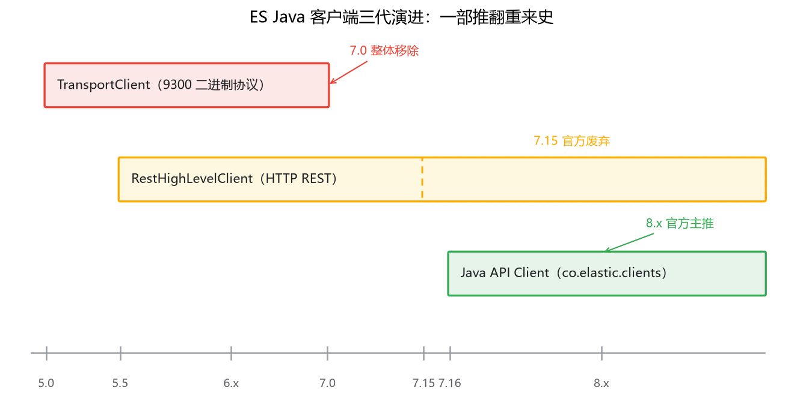
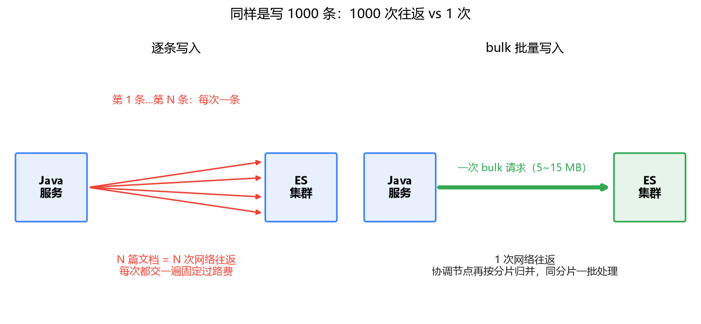

# 07 Java 客户端集成

## 前六篇都在敲 curl，真实服务是 Java 写的

到这里，你已经会用 REST 完成 ES 的增删改查、写 DSL、调分词、控排序、做聚合——但全程靠 curl 和 Kibana。真实项目里，RAG 服务是 Java 写的：文档入库走 Java，检索走 Java，到时候你要面对的是 Maven 依赖、连接池、批量写入这些工程问题。

而且第一个坑就藏在选依赖这步。去 Maven 中央仓库搜 elasticsearch，跳出来好几个 artifactId；网上教程一半还在用 `RestHighLevelClient`，另一半说它废弃了。同事两年前写的老代码里用的客户端，官网文档里已经搜不到了。这一篇就把这件事掰清楚：哪个客户端该用，连接怎么管，批量写入怎么快。

以 ES 8.x 为准，涉及版本的地方我会标出来。

## 一、先分清三代客户端

ES 的 Java 客户端史是一部"推翻重来"史，三代客户端对应三段时期：

- **TransportClient**：最老的一代，走 9300 端口、节点间的二进制协议，客户端会把自己当成集群的一个节点混进集群。ES 7.0 已经把它整个移除了。老代码里看到它，没有任何犹豫的理由，这是彻底的过去式。
- **RestHighLevelClient**（坐标 `org.elasticsearch.client:elasticsearch-rest-high-level-client`）：5.5 引入，走 HTTP REST，曾经的标准答案。但从 7.15 起官方宣布废弃——还能编译能跑，但官方不再投入，新特性不跟。你现在搜到的中文教程大量是它写的，抄之前先看一眼发布时间。
- **Elasticsearch Java API Client**（坐标 `co.elastic.clients:elasticsearch-java`，下文简称 Java API Client）：7.16 前后推出，与 RestHighLevelClient 的废弃同步，是 8.x 的官方主推。注意包名——从 `org.elasticsearch.client` 换成了 `co.elastic.clients`，两边的 API 完全不兼容，不存在无痛替换。

这一篇的代码全部用 Java API Client。

三代客户端的时间线长这样：



有人会问：Spring 项目是不是直接上 Spring Data Elasticsearch？它 5.x（对应 Spring Boot 3.x）的底层已经切到 Java API Client 了。能用，但我的建议是检索场景直接用官方客户端。原因你在前几篇应该已经体会到了：打分、boost、function_score、聚合嵌套，这些 DSL 是精细活，多一层 Repository 抽象，细节反而不好控制。Spring Data 适合的是把 ES 当"又一个数据库"做简单 CRUD 的场景——RAG 检索不是这种场景。

还有一个常见疑问值得先答：Java API Client 的版本要和 ES 服务端版本严格一致吗？建议保持同版本（客户端 8.x 配服务端 8.x）。它的 API 随服务端特性演进，跨大版本混用容易踩到字段对不上的问题。

## 二、连上集群：连接管理

先看怎么建一个客户端：

```xml
<dependency>
    <groupId>co.elastic.clients</groupId>
    <artifactId>elasticsearch-java</artifactId>
    <version>8.13.4</version>
</dependency>
```

```java
RestClient restClient = RestClient.builder(
        new HttpHost("es-node1", 9200, "http"),
        new HttpHost("es-node2", 9200, "http")
).build();

ElasticsearchClient client = new ElasticsearchClient(restClient);
```

结构是两层：底下是**低层客户端 RestClient**，一个通用的 HTTP 封装；上面的 `ElasticsearchClient` 在它之上加上了请求构建和 JSON 序列化。你平时操作的是上层，但超时、认证这些传输层配置在下层。

第一件要交代的事：client 是线程安全的，全局建一个，当成单例用。它底层是 Apache HttpAsyncClient，内部自带连接管理和线程池。如果你每次请求 new 一个，等于每次都建一套 HTTP 客户端——连接没复用，线程池在泄漏，流量一上来先把自己压垮。

管理它的心智模型是什么？你可能会想到 HikariCP 那样的数据库连接池。像的地方是"都要复用、都是单例"；本质不同的是池化背后的东西。MySQL 的连接是**有状态的会话**——事务上下文、字符集、会话变量都挂在连接上，建连成本高，所以必须池化。ES 走的是无状态的 HTTP，一次请求一次响应，连接上不挂任何会话状态；池化复用的只是 TCP 连接，省的是握手开销。所以它的正确类比不是 HikariCP，而是你调第三方 REST 服务的那个 HttpClient——只是恰好由客户端帮你管了。

几项生产上必做的配置：

```java
RestClient restClient = RestClient.builder(
        new HttpHost("es-node1", 9200, "http"),
        new HttpHost("es-node2", 9200, "http")
).setRequestConfig(cfg -> cfg
        .setConnectTimeout(2000)    // 建连超时
        .setSocketTimeout(10_000)   // 等响应超时，重查询要放宽
).build();
```

多节点地址传进去，客户端会轮着用，把请求摊到各个节点上，不会把流量全压给一个协调节点。另外有个可选的 **sniffer**（`elasticsearch-rest-client-sniffer` 依赖）：定时从集群拉取节点列表，自动更新可用地址。在 K8s 这类 Pod IP 经常变的环境里值得开，细节以官方文档为准。

## 三、基本读写：lambda DSL

写入一条文档：

```java
Map<String, Object> doc = Map.of(
        "title", "退款流程说明",
        "category", "退款",
        "likes", 12
);

client.index(i -> i
        .index("kb")
        .id("doc-001")
        .document(doc)
);
```

检索就用 lambda DSL，把你在第 03、05 篇写的 JSON 一行行翻译过来：

```java
SearchResponse<Map> resp = client.search(s -> s
        .index("kb")
        .query(q -> q
            .bool(b -> b
                .should(sh -> sh.match(m -> m
                        .field("title").query("退款流程").boost(3.0f)))
                .should(sh -> sh.match(m -> m
                        .field("content").query("退款流程")))
            )),
        Map.class);

for (Hit<Map> hit : resp.hits().hits()) {
    System.out.println(hit.id() + " -> " + hit.score() + " -> " + hit.source());
}
```

和手拼 JSON 字符串比，这个写法的好处是编译器站在你这边：字段名拼错、类型传错，编译期就报，而不是等线上搜索报 400。lambda 一层套一层，对应 DSL 的 JSON 一层套一层，写熟之后可以互相照着读。

更新和删除同套路：`client.update(...)`、`client.delete(d -> d.index("kb").id("doc-001"))`，不展开。

## 四、bulk：批量写入为什么快

场景很直接：知识库初始化，要往 ES 灌 100 万篇文档。你写的第一版代码多半是这样：

```java
for (Doc doc : allDocs) {
    client.index(i -> i.index("kb").id(doc.getId()).document(doc));
}
```

能跑，但慢得没有道理。慢在哪？每一篇文档都是一次完整的 HTTP 请求：一次请求-响应往返、一次 JSON 反序列化、ES 端走一遍完整的单条索引路径。假设单次往返 2 毫秒，100 万篇光网络排队就是半小时起步——而这 2 毫秒里，真正的"写索引"工作可能只占零点几毫秒，剩下全是每次都要交的固定过路费。

**bulk** 就是为砍掉这笔过路费设计的：把一大批写操作打包进一次 HTTP 请求。先看它的协议长相——bulk 的请求体是 NDJSON，一行操作指令、一行文档数据，交替排列：

```
{"index": {"_index": "kb", "_id": "doc-001"}}
{"title": "退款流程说明", "category": "退款"}
{"index": {"_index": "kb", "_id": "doc-002"}}
{"title": "账单核对指南", "category": "账单"}
```

Java API Client 里的写法：

```java
BulkRequest.Builder br = new BulkRequest.Builder();
for (Doc doc : batch) {
    br.operations(op -> op.index(idx -> idx
            .index("kb")
            .id(doc.getId())
            .document(doc)));
}
BulkResponse result = client.bulk(br.build());
```

为什么快？两笔账。

第一笔在客户端和服务端之间：**一批一次网络往返**。这招你应该不陌生——Kafka 的 producer 攒 batch 发送、Redis 的 pipeline，本质都是同一件事：把每条消息固定的往返开销摊到一批上。100 万次往返变成几千次，省下的就是纯赚的。

第二笔在 ES 集群内部：bulk 请求先到一个协调节点，协调节点把这批操作**按目标分片归并**——属于同一分片的操作合成一包，发给那个分片。对每个分片来说，收到的也是一次批量请求，而不是几千次单条请求。



批量大小怎么定？官方的经验建议是按**物理大小**而不是条数估：单次 bulk 从 5~15 MB 起步试，观察吞吐和延迟再调。批太大反而坏事——协调节点和各分片要在内存里攒住整批数据，太大会顶内存、超时，而且一旦整批失败，重试的成本也跟着变大。稳妥的做法是在应用里做一个攒批器：凑满 N 条或 M MB 就发一次。

还有一件必须交代的事：bulk 的成功是**部分成功**。一批 1000 条里，990 条成功、10 条因为映射冲突或分片压力失败，是常态——bulk 响应的 HTTP 状态码是 200，坑就藏在这里。必须逐条检查：

```java
for (BulkResponseItem item : result.items()) {
    if (item.error() != null) {
        // 记日志、进重试队列，只重试失败的那几条
    }
}
```

只看整批的返回状态就当万事大吉，是批量写入里最经典的翻车姿势。

最后提一句吞吐的另一半：灌库这种一次性大批量场景，配合把索引的 `refresh_interval` 调大（甚至临时设成 -1），写入吞吐还能再上一个台阶。为什么调它有用、代价是什么，涉及 ES 的写入路径，专栏三第 2 篇专门讲。

## 最后，总结

这一篇把 ES 接进了 Java 服务，也是"会用"篇的收尾：

- 客户端选型一句话：新项目用 `co.elastic.clients:elasticsearch-java`（7.16+/8.x 官方主推）；RestHighLevelClient 7.15 起废弃，只在维护老代码时打交道；TransportClient 7.0 已移除，看到就计划迁走。Spring Data Elasticsearch 适合把 ES 当数据库 CRUD 的场景，检索精细活直接用官方客户端。
- **连接管理**：client 线程安全，全局单例。它池化的只是无状态的 HTTP 连接，类比 HttpClient 而不是 HikariCP；超时和多节点轮询是生产必配项。
- **bulk 快的本质**：一批一次网络往返 + 协调节点按分片归并，和 Kafka producer、Redis pipeline 是同一个思想。批量按 5~15 MB 起步试；bulk 是部分成功，必须逐 item 检查错误。
- 写入吞吐的另一半在 refresh_interval，专栏三见。

到这里，专栏一完结：倒排索引、DSL、分词、打分、聚合、Java 集成，ES 这条关键词检索的地基打完了。接下来换另一块地基——向量检索和 Milvus。为什么关键词搜不到"意思相近"的内容，embedding 又是怎么把一段话变成一串数字的，专栏二第一篇从这个问号开始。
