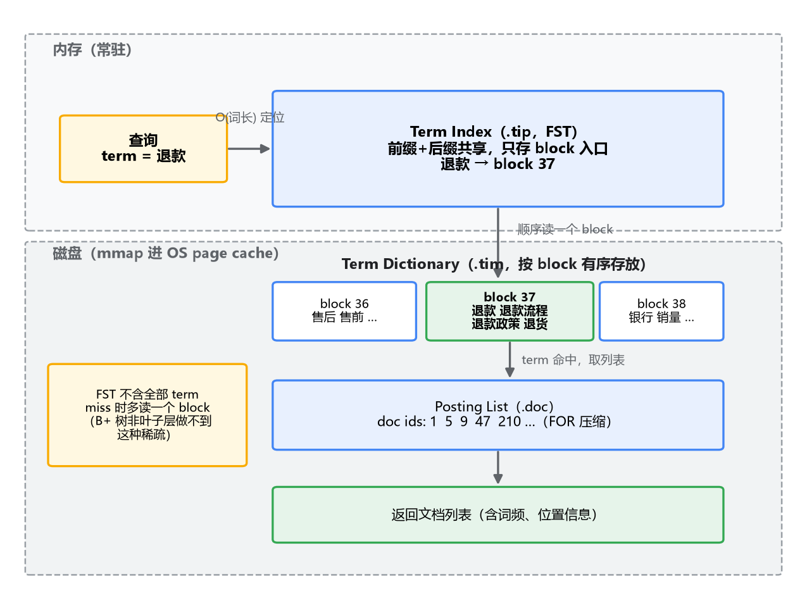
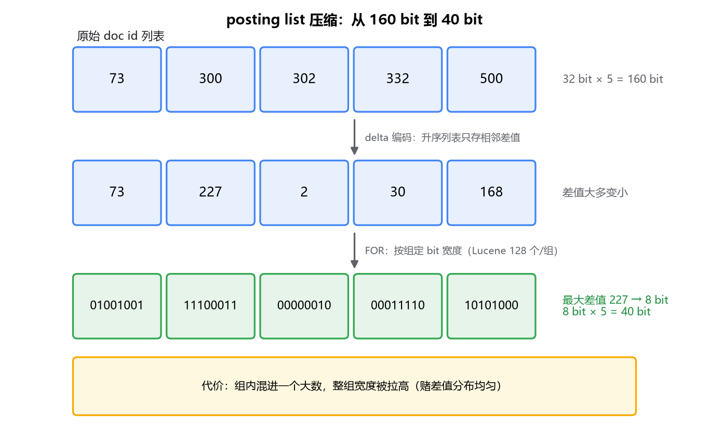
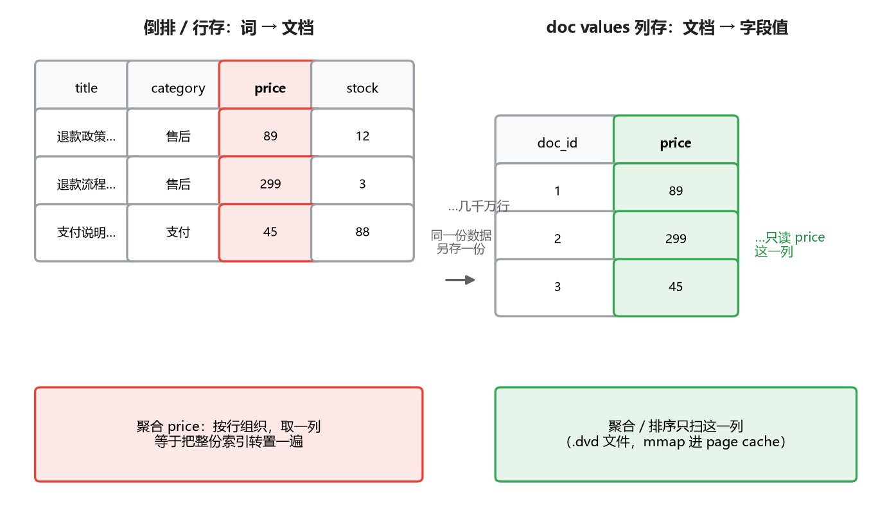

# 01 倒排索引内部结构：term dictionary、posting list 和 doc values

## 一笔 SQL 工程师算不平的账

写 MySQL 出身的人，对"索引"的想象非常具体：一棵 B+ 树，三到四层，根节点常驻内存，一次主键查询顶多三四次磁盘 IO。带着这个想象打开 ES，你会遇到一笔算不平的账：一个几亿文档、几百 GB 的索引，查一个 term，耗时毫秒级，而且这毫秒里大头还是网络和结果组装。

按 B+ 树的账算不出来。几百 GB 的数据，不管怎么组织，从一个词条定位到它的文档列表，凭什么比 MySQL 一条 `where name = 'xx'` 还快？

答案你早就知道：倒排索引。但专栏一讲的倒排只到"词到文档的映射"这一层概念，再往下就含糊了——这个映射本身也是要占地方、要被查找的，它凭什么又快又省？这一篇我们拧开盖子看三样东西：**term dictionary**（词表）怎么组织、靠什么常驻内存；**posting list**（文档列表）这个动辄几千万个 doc id 的大列表怎么压缩；以及为什么除了倒排，ES 还要给字段再存一份列式结构 **doc values**。

三样东西看着不相干，其实都在回答同一个问题：内存贵、磁盘慢，几十亿个词条怎么塞进这对矛盾里。全程拿 MySQL 做对照，但每个对照我都会点出哪里像、哪里本质不同——似是而非的类比是理解这件事最大的坑。

## 一、term dictionary：内存和磁盘的分界线画在哪

### 朴素方案是怎么死掉的

倒排索引的底座是一张排好序的词表。最朴素的实现：把索引里所有去重后的 term 排序，存成磁盘上的一个有序数组，查询时二分查找。

你第一反应可能是"这不就是 B+ 树的叶子层吗"，没什么毛病。问题出在量级上。一篇文档分词后几十个 term，几亿篇文档去重之后，term 数轻松上千万到亿级。二分一次要 log₂(一亿) ≈ 27 次比较，而磁盘上的二分是随机跳着读的，27 次就是二十多次随机 IO。

奇怪的是，B+ 树同样靠二分，为什么它没这个问题？因为 B+ 树的二分发生在一个 16KB 页的内部，页大概率躺在 buffer pool 里，二分本身不碰磁盘；跨页的定位才走树，树矮，所以总共三四次 IO。你直接在磁盘上铺一个亿级有序数组，等于把"页内有序、页间靠树路由"这层设计全丢了，只剩裸二分。IO 从常数级变成对数级，朴素方案到这里就死了。

改进方向你其实已经想到了：学 B+ 树的非叶子层，在磁盘词表之上架一层内存里的路由。这层路由的要求只有一个：足够小，小到常驻内存不心疼。

### 从 trie 到 FST：小，是怎么小出来的

最直觉的路由结构是 trie（前缀树）：term 按字符逐个插入，公共前缀共享路径，"退款"和"退款政策"就共享"退款"那一段。但 trie 有个致命伤：它只共享前缀。term 上亿之后，就算每个节点压到几个字节，节点总量还是个大数字，常驻内存依然吃力。

Lucene 的选择是 **FST**（Finite State Transducer，有限状态转换器）。它在 trie 的基础上多共享了一样东西：后缀。

拿 mop、pop、stop、top 这四个词举例。trie 里每个词都得有自己的尾巴，mop 一条、pop 一条、stop 一条；FST 里，"op" 这段路径被四个词共用，"以 p 结尾"只存一份。前缀和后缀两头一挤，同样的路由信息，FST 的体积经常能比 trie 小一个量级。而且 FST 的边上带输出值（在我们这个场景里，输出就是磁盘词表 block 的编号），输出同样参与共享，又省一块。

再叠加第二重压缩：term index 本来就是稀疏的。它不需要收录每个 term，只需要收录通往磁盘词表每个 block 的入口。Lucene 把词表按 block 组织（一个 block 里几十个 term，有序），FST 只索引 block 的入口词。两重压缩叠加的结果是：一个巨大索引的 term index，常驻内存的开销只占索引总体积的很小一块（经验上常被引用为个位数百分比，随数据分布浮动）。

于是查找路径变成三段，画出来是这样：

内存里走 FST，按词长线性定位到 block（不比较、不二分）；到磁盘顺序读这个 block（顺序读，对 SSD 和 page cache 都友好）；block 内小范围查找，命中就顺着记录拿到 posting list，没命中就确认这个词不存在。

### 对照 B+ 树：哪里像，哪里本质不同

把 term index 和 B+ 树的非叶子层放在一起看，相似的地方很明显：都是"索引的索引"，都很矮，都靠常驻内存换查找速度。但有两处本质不同，恰恰是这两处决定了两者长得完全不一样。

第一，**B+ 树的路由是全量的，FST 的路由是稀疏的**。B+ 树非叶子层必须给每个 key 留一条路由，否则就定位不到那一行，一步都不能省。FST 允许 term 不在内存索引里，反正定位到 block 后还要读 block 确认，miss 的代价只是多读一次小 block。这个"允许不精确"换来了体积可控，是 B+ 树做不到的。

第二，**B+ 树是同一个结构管定位又管存储**，非叶子层和叶子层是一棵树，一起在磁盘上、一起靠 buffer pool 缓存。而 ES 是两层结构、两份文件、两个存储介质：FST 常驻内存，词表和 posting list 待在磁盘。分界线画得清清楚楚。

还有个容易忽略的对照点：MySQL 的缓存是自管的 buffer pool，ES 不自管缓存，term index 和 segment 文件全靠 mmap 交给 OS page cache。这也是为什么调优建议 ES 的 JVM 堆别给太大——数据根本不在堆里，堆大了反而挤占 page cache。

## 二、posting list：几千万个 doc id 的压缩问题

term dictionary 只负责告诉你"这个词存在"，真正干活的是它挂着的 **posting list**：一个 term 出现在哪些文档、每篇出现几次（词频）、出现在字段的什么位置（用于 match_phrase）。我们先只看第一样，doc id 列表。

这个列表的规模容易低估。一个常用 term 的 posting list 可以有上千万个 doc id，一个索引里几十万个 term。如果每个 doc id 老老实实存 32 位整数，磁盘开销和查询时拉列表的 IO 都是灾难。别忘了查询时 posting list 是成批拉出来做交并集的，不压缩的话内存带宽先扛不住。

好消息是 doc id 有两条天然的纪律：**严格升序**，而且通常**分布相对密集**（段内 doc id 连续分配，见下一篇）。两条纪律可以各换一层压缩。

第一层，**delta 编码**：不存绝对值，存差值。列表 [73, 300, 302, 332, 500]，变成 [73, 227, 2, 30, 168]。相邻文档挨得越近，差值越小，需要的位数越少。

第二层，**Frame of Reference（FOR）**：把 delta 值按组打包，每组看最大差值需要几个 bit，整组统一按这个宽度排成位流。上面那组最大值 227 需要 8 个 bit，五个数就只需要 40 bit，5 字节；原始存法要 20 字节。Lucene 实际按 128 个一组做这件事。

FOR 的代价也摆在那：只要组里混进一个大数，整组的宽度都被拉高。它赌的是"同一 term 命中的文档在 doc id 空间里分布得比较匀"，这个赌注在 Lucene 的场景里基本成立，但不是数学保证。

你可能会问：MySQL 怎么没有这套东西？因为 B+ 树的世界里不存在这个形态。B+ 树的叶子是"行"的组织方式，一个 key 对应的匹配行散落在叶子链表各处，靠回表或索引覆盖拿数据，从来没有"一个 key 挂着几千万行的连续大列表"这回事。规模问题不同，解法自然也是新的。

### 组合查询：roaring bitmap

再往前走一步。真实查询很少只有一个条件，`status=published AND category=退款` 要把两个 posting list 求交集。而且 filter 类条件的结果是可以缓存的（ES 的 query cache），缓存什么形态最好？

答案你可能见过：**roaring bitmap**。它把 32 位 doc id 按高 16 位分成 65536 个桶，每个桶的低 16 位按疏密选三种存法：稀疏就用有序短数组，稠密就用位图，大片连续就用 run-length 只记起止。本质是个自适应结构：doc id 随机稀疏时不浪费空间，稠密时求交直接上位运算，连续区间一个 (start, length) 就打发了。Druid、ClickHouse 这些分析型系统里也能见到它，算是"doc id 集合"这个问题的业界公约数。

到这里，检索的读路径就齐了：FST 定位词表，词表挂 posting list，posting list 压缩存放、按位运算求交并。但 ES 的故事只讲了一半——搜索之外还有聚合和排序，它们走的是完全另一套结构。

## 三、doc values：聚合和排序为什么不用倒排

先看一个场景。商品索引，几千万文档，你要按 category 分桶统计每个分类的均价，或者搜索结果按 price 排序。这两个需求的共同点：它们要问的是"每篇文档的这个字段值是多少"。

而倒排索引回答的是反方向的问题："含这个词的文档有哪些"。词指向文档，不指向字段值。方向反了，硬掰是掰不回来的。

硬掰会是什么样？按 price 聚合，就把 price=100 的 posting list 拉出来、price=101 的拉出来……对每个 distinct 值拉一次列表再合并。值的数量乘上文档数量，组合爆炸；而且 price 这种字段每个文档一个值，等于整个索引被转置一遍。这条路在结构上就是错的。

所以需要一份"正排"：文档到字段值的映射。ES 早期的实现叫 **fielddata**，思路是查询时现场把倒排翻过来装进 JVM 堆。听起来省了写入，代价却很重：堆内存占用巨大（几千万文档 × 每个字段一份），第一次聚合要现场构建很慢，GC 被大对象压垮。这个方案如今默认关闭，开着的字段访问时会直接给你一个警告。

现在的答案是 **doc values**：写入文档的时候，就把字段值按**列**存一份，落到磁盘（segment 文件的一部分），查询时按需 mmap 进 page cache。列存的好处你熟：按行存，取一列要扫全表；按列存，取一列只读那一列的文件，同类型数据连续摆放，压缩也容易。这和 Parquet、ClickHouse 是同一个思想。

和纯列存数据库的差别在于服务对象：分析型数据库整个表都是列存，ES 是倒排为主、列存为辅，**同一份数据存了两套结构**。这也是 ES 磁盘占用经常比你预期大的原因之一，你付的是"一次写入、两种查询都快"的钱。

两个实践层面的细节。第一，text 字段默认没有 doc values：text 分词后一个字段变成一串 term，没法作为一个值进列存（真要存也是数组，语义和成本都不对）。聚合和排序通常落在 keyword、数字、日期上，这些类型默认开启。第二，doc values 是 segment 的一部分，随 segment 一起生成、一起不可变——这句话现在还看不出分量，下一篇讲写入路径时它会变得很关键。

## 最后，总结

这一篇拆了倒排索引的三层家底：

- **term dictionary** 的核心是内存和磁盘的分界线：FST 用前缀加后缀共享、加稀疏索引，把路由层压到能常驻内存的体积。对照 B+ 树的非叶子层，像在"都是矮的路由"，本质不同在"B+ 树必须全量路由，FST 允许稀疏、允许 miss"。
- **posting list** 靠两条纪律换两层压缩：升序换 delta 编码，组内小幅差值换 Frame of Reference 位打包；filter 交并再叠 roaring bitmap。B+ 树世界里没有这种"一个 key 挂几千万行"的形态，所以这套手段在 MySQL 里没有对应物。
- **doc values** 是给聚合和排序准备的列存，因为倒排的方向（词到文档）天然回答不了"每篇文档的字段值"。同一份数据存两套结构，是 ES 磁盘占用的一个重要来源。

把这些结构想象成一台已经装配好的机器：FST 在内存里待命，词表和 posting list 在磁盘上排好，doc values 静静躺在 segment 里。那么问题来了——机器装配是什么时候发生的？写入一个文档到它能被查到，中间隔着什么？这就是下一篇要讲的：写入路径，以及那句著名的"近实时"到底"近"在哪。
