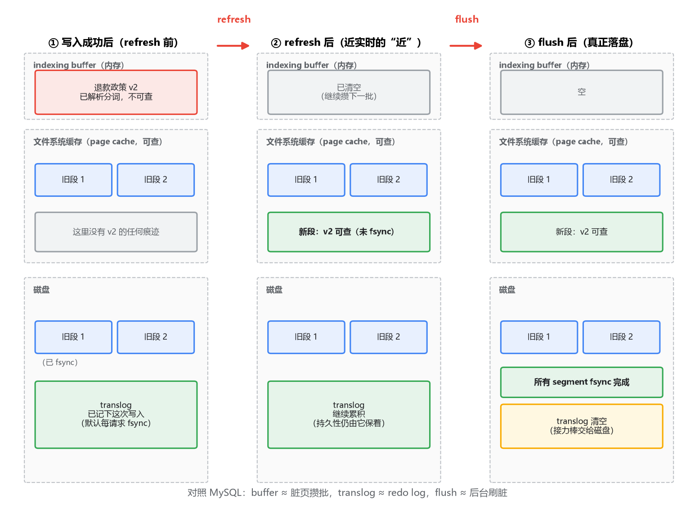
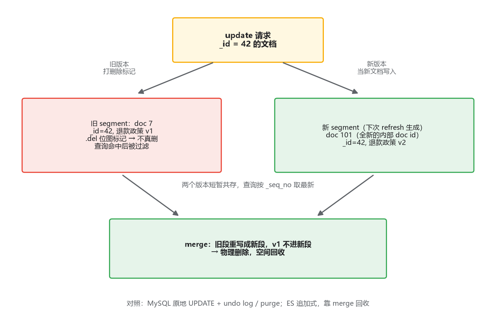

# 02 写入路径与"近实时"：一条写入从落账到可查

## 写入成功了，却查不到

先还原一个几乎人人会撞上的场景。你往 ES 里写入一条文档：

```json
POST /products/_doc
{ "title": "退款政策 v2", "category": "售后" }
```

返回 201 Created，写入成功。紧接着你搜 `title:退款`，结果集里没有它。你的第一反应是代码有 bug，检查了半天，什么都没错。过一秒再搜，它出现了。

这不是 bug，也不是玄学，是 ES 的**近实时**（Near Real-Time）设计：写入成功和文档可见，是两个刻意分开的时刻。中间隔着的那段路，就是这一篇的主角：memory buffer → refresh → segment → merge。路上还有一位不怎么露面但关键时刻救命的角色，translog。

这一篇我们把这四步串成完整链路，并拿 MySQL 的 redo log 反复对照。两者共享同一个思想（WAL），但有三处关键差异，其中一处正是"为什么 ES 敢把 fsync 挪出关键路径"的答案。

## 一、先问朴素的问题：为什么不能写一条、查一条

把 ES 想象成 MySQL：每写入一条文档，就把上一篇讲的那些结构——FST、term dictionary、posting list、doc values——现场生成好，落盘 fsync，然后返回成功。这样写入成功即可见即持久，最符合直觉。

问题还是出在上一篇的账上：那套结构是为读优化到极致的产物，生成它是有成本的。一条一建，等于每秒几万次地重新装配一台精密机器，吞吐直接崩掉。MySQL 面对同款难题的答案你熟：一条 insert 也不会当场把 B+ 树的脏页刷盘，而是只在 redo log 里追加一小段顺序记录，脏页攒着由后台慢慢刷。把贵的那一步推迟，先记一笔便宜的账——ES 的思路和这是同一个。

但推迟到哪、推迟成什么样，两个系统给出了不同的答案，根源在它们承诺的语义不同：MySQL 的世界里"提交"意味着"持久，崩溃也不丢"，可见性和持久性在提交这一刻绑定完成；ES 的世界里"写入确认"不承诺"立即可见"，也不要求"可见"必须以"落盘"为前提。这两次解绑，就是后面所有设计的出发点。

## 二、一条写入的完整旅程

### 第一步：进 memory buffer，同时记 translog

文档到达后，ES 做两件事：解析、分词，把结果放进**indexing buffer**（内存里攒着，此时尚不可搜索）；同时把这次操作追加进 **translog**（transaction log，顺序写的小日志）。这一步做完，写入请求就可以返回了——默认配置下，返回前唯一的落盘动作是 translog 的 fsync（一笔顺序小写入），索引结构本身一没生成、二没落盘。

### 第二步：refresh，从"攒着"到"可查"

默认每 1 秒（`refresh_interval`），一次 refresh 发生：buffer 里的内容被真正写成上一篇讲的那些结构，形成一个 **segment**；segment 写进**文件系统缓存**（注意，不调用 fsync），随即对搜索打开。从这一刻起，新文档可查。

这里藏着全文第一个关键认知：**可见性的门槛是进 page cache，不是落盘**。为什么敢这样？因为 Lucene 读 segment 文件走的是 mmap，OS 保证进程能读到 page cache 里的最新内容，fsync 与否只影响"断电后还在不在"，不影响"现在读不读得到"。MySQL 的对照是：buffer pool 里的脏页对查询同样立即可见（同进程内存嘛），但 MySQL 从没把"可查"这个语义交给 page cache——它的数据页就住在自管内存里。ES 更进一步，把可见性直接建在 OS 的 page cache 上，自己的 JVM 堆里反而几乎不存数据。

### 第三步：flush，补上真正的持久化

segment 一直待在 page cache 里也不是事。默认每 30 分钟，或者 translog 攒到一定大小（默认 512MB），一次 **flush** 发生：把所有 segment fsync 到磁盘，然后清空 translog。持久性在这一步才真正完成交接：flush 之前，数据的安全由 translog 保着；flush 之后，接力棒交给磁盘上的 segment。

### 三态全景

把这条链路按时间切成三个状态摆在一起看：



对照着 MySQL 想一遍：translog 之于 segment，非常像 redo log 之于 buffer pool 脏页。修改先落便宜的账（translog / redo），贵的动作（segment fsync / 刷脏页）推迟批量做；崩溃恢复时重放日志（translog / redo）把丢失的部分补回来。WAL 的思想在两个系统里是同构的。

但有一个差异从图里就能看出来：MySQL 刷脏页和事务提交是解耦的，可 redo 的 fsync 默认发生在**每个事务的提交路径上**（`innodb_flush_log_at_trx_commit=1`）；而 ES 的 translog 默认也是每个写请求 fsync 一次，segment 的 fsync 却被推迟到 30 分钟一次的 flush。同样是"贵的那步"，MySQL 挪的是数据页，ES 连 segment 落盘一起挪了，而且挪得远得多。它凭什么敢？这个问题我们放第四节，先把链路走完。

### 第四步：merge，收拾不可变堆积的烂摊子

每秒一个 segment，一天下来就是八万多个。上一篇说过，每个 segment 都是自带 FST、词表、posting list 的完整索引，查询要在所有 segment 上各查一遍再归并——段数越多，每次查询越贵，打开的文件句柄和常驻内存也越多。

所以后台的 **merge** 持续在做一件事：挑大小相近的段（tiered 策略），合并成一个新段。注意合并是**重写**：新段写好后，旧段文件整体删除。这里先埋个伏笔——"旧段整体删除"这个动作，和文档的删除有微妙的关系，下一节展开。

至此链路走完：buffer 攒批，refresh 造段，merge 收摊，translog 兜底，flush 交棒。五个角色各管一段。

## 三、translog 对照 redo log：三处差异

把 translog 和 redo log 并排放着，相似处一眼可见：都是先记日志再动数据（WAL），都是顺序追加，都是崩溃恢复的依据。真正值得抠的是三处不同。

第一处，记的粒度不同。redo log 记的是数据页的物理修改（某页某偏移改了什么），重放是幂等的物理动作；translog 记的是文档级操作（"index 一篇 _id=42 的文档，内容是……"），恢复时按序重放这些操作，重建 Lucene 的内存状态。一个像物理日志，一个偏逻辑日志。

第二处，fsync 的默认位置像，可选档位也像。MySQL 提供经典的三档：`innodb_flush_log_at_trx_commit` 设 1 是每事务 fsync，设 2 是只进 cache 每秒刷，设 0 是交给后台。ES 的 translog 也有对应滑杆：`index.translog.durability` 默认 `request`，每个写请求返回前 fsync 一次（bulk 一次算一个请求，所以批得越狠 fsync 摊得越薄）；调成 `async` 则每 5 秒 fsync，崩溃时最多丢 5 秒，这个姿势和 `=2` 几乎一模一样。要说明的是，`async` 这个档位在 ES 8.x 已被标记废弃（具体动机和行为以你所用版本文档为准），但"拿持久性换吞吐"的滑杆本身一直都在，只是官方现在更希望你从 bulk 批量、refresh 间隔这些地方找吞吐。

第三处，最重的 fsync 在不在关键路径上。MySQL 的事务路径上有一次 redo fsync，数据页刷盘被推给后台，这是它能挪的全部；ES 的写入关键路径上，segment 的生成（贵）和落盘（更贵）都被挪出去了，一个交给 refresh 延迟，一个交给 flush 延迟。

那回到那个问题：**为什么敢？** 因为持久性有人接住了。写入返回成功的前提是 translog 已经 fsync（默认档位），这笔账记在了一个顺序小写入上，便宜；segment 只要还在 page cache，能查；断电了 page cache 丢了，没关系，重启后重放 translog，把没落盘的操作补回来。"可查"和"已持久"从 MySQL 的同一个时刻，被拆成了两个独立的时刻，中间隔着最多 30 分钟——你用可见性换来了写入吞吐，而这两样在 MySQL 的事务语义里根本不许分开。

顺带把崩溃恢复也对照掉：MySQL 重启，用 redo 重放，把没刷的页补回来；ES 重启，丢弃 cache 里未 fsync 的 segment，用 translog 重放，把没 flush 的操作补回来。同构到几乎可以互换笔记。

## 四、segment 不可变的连锁反应

refresh 每秒造一个段、merge 才能删段，这套玩法成立的前提是：**segment 一旦生成，内容永不修改**。上一篇提过这句"doc values 随 segment 一起不可变"，现在看它的分量了。不可变买来了三样东西：生成后无需任何维护、mmap 读不需要锁、page cache 里的内容永远和磁盘最终一致（只是早晚问题）。但代价也很直接——删除和更新都没法原地做。

先看删除。上一篇讲过，posting list 是 delta 编码加 FOR 位打包的紧凑结构，还有排序的词表、FST。从里面"抠掉"一个 doc id 等于整个重写，一次删除付一次重写的钱，不成立。ES 的做法是每个 segment 配一个 `.del` 位图文件，删除就是在位图上打个标记，term 照样能查到这篇文档，只是结果返回前被位图过滤掉。真正的物理删除发生在 merge：旧段重写成新段时，打了标记的文档不进去，空间就此回收。

更新呢？没有更新。一次 update 等于一次"新写 + 旧删"：同一 `_id` 的旧版本打上删除标记，新版本作为新文档写进 buffer（还拿到一个全新的内部 doc id），走一遍完整的 refresh 链路。有个细节值得注意：删除标记和新文档是在同一次 refresh 里生效的，所以你不会同时查到两个版本——refresh 之前查到的是旧版，之后是新版。更新也"近实时"，坑和可见性是同一个。



这三个动作摆开，你大概已经闻到熟悉的味道了：**这是 LSM-tree 的家族**。你熟的 RocksDB 就是这个套路：内存 memtable 攒批，刷成不可变的 SSTable，后台 compaction 合并回收。Lucene 的 buffer → segment → merge 与之几乎同构，Kafka 的"纯追加日志 + 按 retention 删整段"也算近亲。和 MySQL 对照则是两个世界：B+ 树是**原地修改**的结构，靠 undo log 回滚、靠 purge 后台清理，空间基本原地复用；Lucene 是**追加式**结构，写快读省心，代价是删除靠标记、更新靠重写、空间靠 merge 回收。没有哪一边免费。

和标准 LSM 也别划等号，有一处差异值得知道：leveled compaction 的层级设计，一个重要目标是控制读放大（控制一次点查要碰几个文件）；Lucene 的 merge 策略更朴素，主要是控制段的数量、物理清掉删除标记，读放大靠的是"每个 segment 本身是完整可查的索引"来兜底。所以别把 RocksDB 的层级行为直接套到 ES 身上，段数、merge 触发条件、IO 模式都有差别。

merge 本身也有代价。重写文件是实打实的 IO 和 CPU，大段合并时很重，可能挤占查询资源。一个实用的排查经验：如果集群在写入高峰期出现周期性的查询毛刺，merge 是嫌疑人之一——Lucene 对 merge 有调度和限流机制（控制并发合并数等，参数随版本变动，以官方文档为准），写入和查询打架时可以先从它查起。

## 五、回到开头的现象：怎么和近实时打交道

现在可以给开头那个"写入成功却查不到"一个完整的解释了：你搜索的时刻，refresh 还没发生，文档还在 buffer 里。不是 bug，是设计。日常和它打交道，记住三件事。

第一，确认是不是 refresh 的问题，别急着怀疑代码：`POST /products/_refresh` 手动触发一次再查，文档出现了，就是可见性时序问题，代码没问题。顺手看一眼 `refresh_interval` 的实际值——有些历史调优会把它改成 30 秒甚至更长，你不一定知道。

第二，要更强的可见性保证时，写请求带 `?refresh=wait_for`：等这次 refresh 完成才返回。代价是写入延迟直接抬到秒级，偶尔用（比如后台管理改完配置要立刻可见）没问题，当作常规操作就是自讨苦吃。

第三，批量导入的经典调优组合：`refresh_interval` 调成 `-1`（关掉自动 refresh），副本数临时设为 0，导完改回来再手动 refresh。逻辑很简单——导入阶段不需要可见性，就把可见性的开销全免掉；副本的写入放大也一并免掉。这是"用可见性换吞吐"在工程上最标准的一次应用。

## 最后，总结

这一篇把写入到可见的链路走完了：

- **链路五步**：buffer 攒批 → refresh 造段（进 page cache 即可查，不 fsync）→ merge 收摊 → flush 落盘清 translog。可见性的门槛是 page cache，持久性的门槛是 fsync，ES 把这两个门槛拆开了。
- **translog 对照 redo log**：同样是 WAL、同样撑崩溃恢复，但粒度不同（物理修改 vs 文档操作）、fsync 滑杆不同（MySQL 三档 vs ES 的 request/async，后者 8.x 已废弃）。最重的 fsync，MySQL 挪了数据页，ES 连 segment 一起挪，因为 translog 接住了持久性。
- **segment 不可变**是整套设计的前提：删除打 `.del` 标记，更新是新写加旧删，物理回收都推迟到 merge。这套追加式哲学和 LSM、Kafka 同族，和 MySQL 的原地修改是两个世界。

段造出来了、攒起来了、也合并了，一次查询进来，怎么在这堆 segment、这一堆分片上跑出结果、排出名次？下一篇讲查询执行流程，那里埋着一个更隐蔽的坑：分布式打分。
