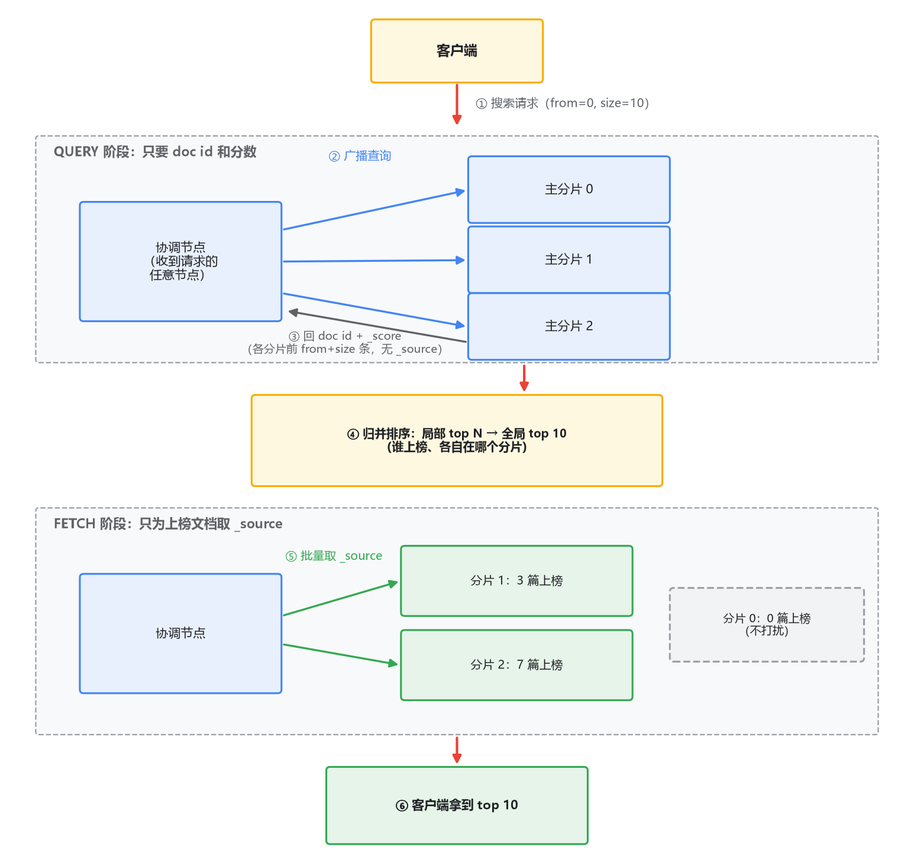
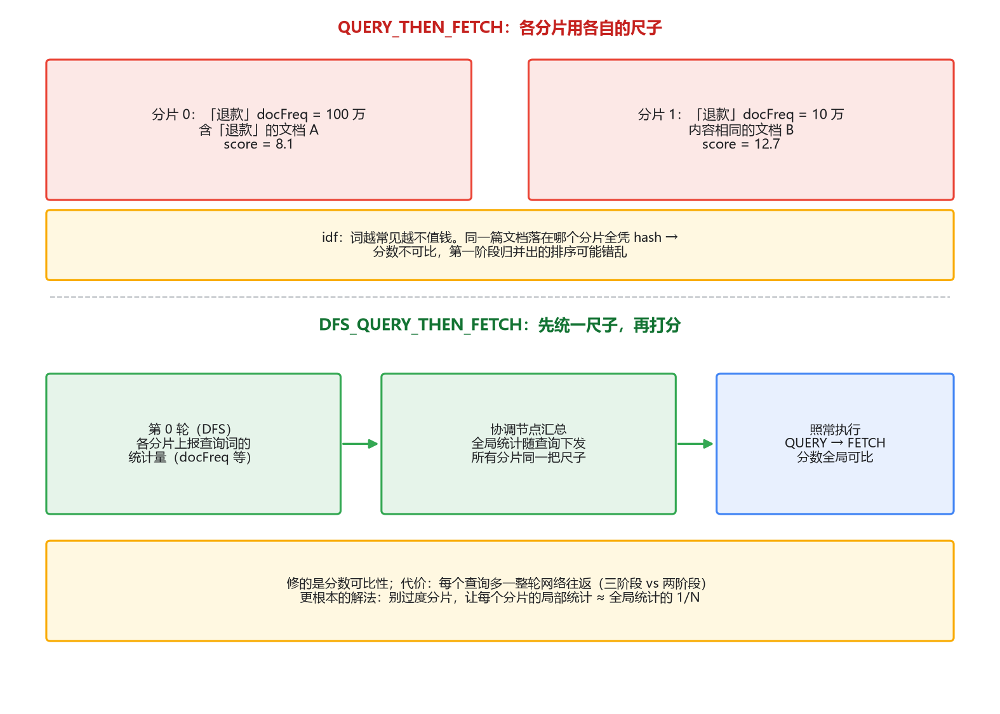

# 03 查询执行流程：两阶段，和一个隐蔽的打分坑

## 同一个查询，换个分片数，排序变了

先摆一个真实到会让团队吵架的现象。

你有一个索引，5 个主分片，查询"退款"取 top 10，结果排序好好的。后来数据要迁移，新索引 10 个分片，同样的查询、同样的文档集，top 10 的顺序变了，有的文档甚至掉出了前 10。测试同学拿着两边截图对质，开发查了半天代码，谁也没错。

再补一个更日常的版本：单分片的测试环境算出来的 `_score` 和线上的对不上，断言一直红。

这两个现象都指向同一个机制：**分布式打分**。要讲清它，得先讲清一次查询在集群里到底怎么跑——query then fetch 两阶段。这一篇按顺序讲：两阶段各干什么、为什么深度分页危险、分数为什么不可比、`DFS_QUERY_THEN_FETCH` 修的是什么代价是什么。

## 一、为什么必须是两阶段

### 朴素方案：全捞回来

一次搜索查询（有排序、要取前 N 条）发进一个 5 分片的索引，最直觉的执行方式：把查询发到 5 个分片，每个分片把命中的文档**连同 `_source` 全文**都返回，协调节点（coordinate node，任意节点都能充当，收到请求的那个就是）归并排序，取前 10 条返回客户端。

这个方案的问题一想就通：你要 10 条，每个分片可能命中几万条，全传回来是网络和内存的灾难。而且你要的是 top 10，第 11 名之后的完整文档传过来纯属浪费。

对照一个你已经会的场景：MySQL 分库分表之后做 `order by price limit 10`，没有人会把每个库的全量结果拉到应用层——每个库各取 top 10，应用层归并再取 top 10。分布式归并的通用形态就是"局部 top N + 全局归并"，ES 只是把这套做进了引擎，并且为了省带宽多拆了一步。

### QUERY_THEN_FETCH：拆成两半

**第一阶段（query）**：协调节点把查询广播给每个分片。每个分片在本地执行——遍历自己的 segment（上一篇的链路产物），算分、排序，只返回轻量结果：doc id、`_score`、排序值，条数是 `from + size` 条，不是 `size` 条（原因马上讲）。协调节点收到 5 份局部 top N，归并排序，确定最终榜单上的那 `from + size` 条都落在哪些分片。

**第二阶段（fetch）**：协调节点按分片分组，向持有上榜文档的分片发起批量请求，把这些文档的 `_source` 取回来，组装成最终结果。没上榜的文档，`_source` 一个字节都没动过。

两阶段各取所需：query 阶段用最小体积完成"谁上榜"，fetch 阶段只为上榜者付传输成本。

为什么局部要取 `from + size` 条而不是 `size` 条？因为全局前 10 名可能全挤在同一个分片上。每个分片只有拿出自己前 `from + size` 名，协调节点归并后才敢保证全局前 `from + size` 都在其中。这也直接暴露了深度分页的代价：

`from = 10000, size = 10` 时，每个分片必须老老实实排序取出前 10010 条，协调节点要在内存里归并 `分片数 × 10010` 条结果——你翻的是第 1001 页，代价却是每一页都按全量榜来算。ES 默认的 `max_result_window = 10000` 就是为这个兜底的，超过直接拒绝，不是小气，是保护。

要真翻深页，正路是 `search_after`：拿上一页最后一条的排序值当游标，每个分片只取排在这之后的 `size` 条。思想上是"记住上次读到哪"，和 Kafka consumer 用 offset 继续、MySQL 游标分页是同一家族。代价是没法跳页，只能一页页往后走——而真实的翻页需求，十个里有九个是"下一页"，不是"跳到第 800 页"。

### filter 上下文：不算分的路要单独走

第一篇埋的线这里接上：`bool` 查询里，`must` 里的条件算分（query 上下文），`filter` 里的条件不算分（filter 上下文）。不算分意味着结果只取决于"命中/不命中"，和统计量无关——于是**可以缓存**成 bitset（还记得第一篇的 roaring bitmap 吗），下次同样条件直接复用。把"状态=已发布""时间在最近 30 天"这类条件放进 filter 而不是 must，是 DSL 层面最划算的一个习惯：分数不掺和，缓存能用上，还省算分开销。

## 二、分布式打分：分数为什么不可比

两阶段本身没什么坑，坑在第一阶段里那个"本地算分"的动作上。

复习一下 BM25 的输入（专栏一讲过直观版）：一个词的打分要用到两个统计量——这个词在**多少文档里出现过**（文档频率，算 idf 用），以及字段的**平均长度**。这些统计量从哪来？从每个分片自己的 term dictionary 里来。而第一篇讲过，每个 segment 自带完整的词表，每个分片只知道自己 segment 里的事。

统计量是分片本地的，分数是拿本地统计量现算的。这句话展开就是那个坑。

假设 5 个分片，"退款"这个词在分片 1 里出现在 100 万篇文档中，在其他分片各只有 10 万篇。idf 的逻辑是词越常见越不值钱，于是同样一篇通篇讲"退款"的文档：落在分片 1，算出来的分数低；落在分片 3，分数高。文档内容一模一样，命运不同——取决于它 hash 到了哪个分片。分数不可比，第一阶段拿这些分数归并出来的"全局 top 10"，就可能有名次上的错乱。

现在可以完整解释开头两个现象了。分片数从 5 变 10，等于重新洗一遍牌：文档重新分布，每个分片本地的统计量全变，同一篇文档的分数跟着变——排序当然会动。单分片测试环境和 5 分片线上环境对分数，一个用的是全局统计，一个用的是 1/5 样本的统计，对不上是必然的。

这里要做一个和 MySQL 的对照，而且必须点透差异：分库分表后跨库 `order by price limit 10` 的归并是无损的，因为 price 是**存储的客观值**，每个库返回的都是同一个语义下的数字，归并不会错。而 ES 的 `_score` 不是存储的值，是**查询时拿环境统计量现场算出来的**，统计量又各自为政——问题不在归并算法，在分数的"度量衡"每个分片不一样。

那为什么平时没感觉？因为数据量大、term 分布均匀时，每个分片的局部统计 ≈ 全局统计的 1/N，算出来的分和全局版基本重合，误差被摊薄了。坑在两种情况下集中暴露：数据量不大却分了一堆片（每片几千条文档，局部统计的随机波动很大），以及 term 分布天然倾斜还叠加了自定义路由（比如同一类文档被 routing 到同一个分片，词频在分片间严重不均）。所以官方反复强调**别过度分片**（oversharding），这不只是管理开销问题，直接伤打分质量。

## 三、DFS_QUERY_THEN_FETCH：修什么，代价什么

知道了病根，药就好理解了。`DFS_QUERY_THEN_FETCH` 在正常的两阶段前面加了一轮：协调节点先让每个分片把查询里各 term 的统计量（文档频率等）报上来，汇总成全局值，再带着全局统计量走正常两阶段。所有分片用同一把尺子算分，分数可比了，跨分片布局的稳定性也好了。

修的是可比性，付出的是**一整轮网络往返**：三阶段对两阶段，每个查询都多一次"收集统计、下发统计"的来回。高 QPS 场景下这个延迟是实打实的，官方也明说它是为特定场景准备的，不是默认推荐。

什么时候该用？判断标准是"分数是否被当成严肃数据用"：按 `_score` 做业务阈值（低于 5 分走人工客服）、做对比实验或测试断言、要求同一文档的分数跨环境可复现——这些场景该开，开了分数才有"度量衡统一"的保证。而普通的"给用户看个搜索结果列表"，只要分片数稳定、数据量够，相对排序基本不受影响，不值得为它多付一轮 RTT。

顺序上还有个更根本的动作排在 DFS 前面：把分片数规划对。分片内文档量够大，局部统计自然趋近全局统计，坑的根源就消了大半。DFS 是给"已经倾斜了"的场景打的补丁，不是免死金牌。

## 最后，总结

- **两阶段**：query 阶段各分片本地排序、只回 doc id 和分数（`from + size` 条），协调节点归并定榜；fetch 阶段只为上榜文档取 `_source`。思想同分库分表的"局部 top N + 全局归并"，多拆一步是为了省带宽。
- **深度分页**：翻第 N 页的代价是每分片排前 `from + size` 名，`max_result_window` 是兜底；真要深翻用 `search_after`，游标思想，只能顺序翻。
- **分布式打分**：统计量分片本地、分数现场计算，两者相乘导致分数不可比。和 MySQL 归并的本质差异：`price` 是存储的客观值，`_score` 是依赖环境统计的派生值。
- **DFS**：多一轮往返换全局统计、分数可比。分数被严肃使用时才值得开；更根本的解法是别过度分片。
- filter 上下文不算分、可缓存，条件该进 filter 的别放 must。

查询这一侧讲完了，分数的分片故事也收了尾。剩下最后一块拼图：这些分片和副本散在多台机器上，谁决定它们各自住哪、节点挂了谁来扶正、两个"大脑"同时发号施令怎么办？下一篇讲集群与分布式，ES 篇就收口了。
