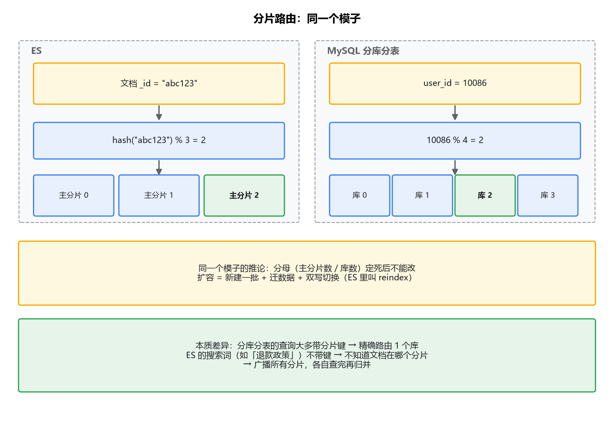
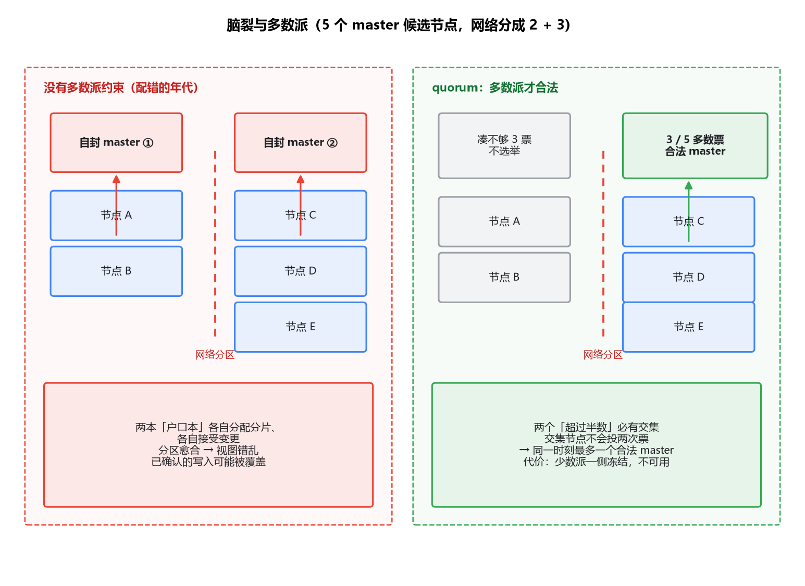

# 04 集群与分布式：选主、路由、副本和脑裂

## 周一早上，集群红了

先摆一个所有人都会遇到的场景。周一早上八点半，手机开始弹告警：`cluster status: red`。你打开 `_cluster/health`，看到 `status: red`，知道这表示有主分片没分配上。然后呢？红色从哪查起？

排查思路不是背出来的，是机制推出来的。这一篇把集群的四个机制讲透——master 是干什么的、分片怎么路由、副本怎么恢复、脑裂怎么防——最后回到"红了怎么查"，你会发现每一步排查动作背后都站着前面某一节的机制。ES 篇到这里收口。

## 一、master：管户口本的，不管搬砖

先纠一个常见误解：master 节点是集群里性能最强的机器，所有请求都要经过它。不对，而且错得离谱——**master 不参与任何数据的读写**。

master 管的是**元数据**（cluster state）：集群里有哪些节点、哪些索引、每个索引的分片各分配在哪个节点上。创建索引、删除索引、节点加入剔除、分片挪动，这些"户口本"层面的变更归它管。数据面的活儿——写入、查询、聚合——一个字节都不碰。

那一次搜索请求找谁？找谁都行。请求打到哪个节点，哪个节点就充当**协调节点**（上一篇讲过），自己去需要的分片上取数据。节点之间是网状沟通，没有中心转发瓶颈。

对照你熟的系统，这个分工最像 Kafka：controller 负责分区 leader 的分配这种元数据决策，broker 负责存数据、扛读写。MySQL 的主从反而不能这么比——MySQL 的主既管元数据又扛写入，主一挂读写全断；ES 的 master 挂了，数据面照常读写，只是不能建索引、不能挪分片、挂掉节点上的主分片不能被提升（这个限制后面讲副本时会再出现）。

这个"控制面和数据面分离"的设计，决定了后面所有故障的表现形式，也决定了排查时的判断顺序：**读写出问题，先看数据面（分片、节点）；集群行为出问题（分片不分配、索引建不出来），才看 master**。

## 二、分片路由：和分库分表一个模子，但有个后果要单独说

一个文档写进索引，落在哪个分片？公式一行：

```
shard = hash(routing) % number_of_primary_shards
```

routing 默认是文档 `_id`（可自定义）。

这个公式你闭着眼都熟：分库分表的 `user_id % 32` 和它是同一个模子。连推论都一样——**分片数一旦定下就不能改**。取模的分母变了，老文档按新分母算出来的家和旧家对不上，数据就"丢"了（其实还在，就是找不到了）。所以 ES 扩容数据容量不能加主分片数，只能建新索引重新导入（reindex），和分库分表扩容要迁移数据是同一件事，连"双写切换"的玩法都是通用的。

有一个后果和分库分表不一样，值得单独拎出来。分库分表的世界里，查询绝大多数**带分片键**：`where user_id = ?`，精确路由到一个库。而 ES 是搜索引擎，查询是"退款政策"这种词，不带任何分片键——文档 hash 到了哪个分片你根本不知道，所以**每次查询要广播给所有分片**，每个分片查完再归并（上一篇的两阶段）。这就是为什么 ES 的分片数直接决定每次查询的扇出成本，也是"别过度分片"的另一半原因。

ES 也留了后门：写入时可以自定义 routing，让同类文档强制落进同一个分片（比如按租户路由），查询时带上同样的 routing 就只查这一个分片。代价照旧是老一套：数据倾斜，某个分片又肥又忙。



顺带把副本的位置说清楚：路由公式算出来的永远是**主分片**编号，副本只是把主分片的内容抄送几份、散到别的节点上。副本数随便改，不影响公式；主分片数碰都不能碰。这也是为什么"加读能力调副本数、加容量只能 reindex"。

## 三、副本：动机和 MySQL 主从不一样

先看写入怎么流经副本。协调节点按路由公式把写请求发给主分片，主分片在本地走完上一篇的写入链路，然后把操作并行发给所有副本分片，等它们都确认后才向客户端返回成功。注意这最后半句：ES 的复制默认是**同步**的。

现在做那个必须做的对照。MySQL 主从复制的动机，你的肌肉记忆应该是两条：高可用（主挂了从顶上），加读扩展（读写分离，扛住读多写少的流量）。复制本身默认异步，主从延迟是日常运维话题。

ES 副本的动机也是两条，但内容对不上号：**高可用，加查询吞吐**。读扩展这一条要细看——MySQL 的读写分离是把查询流量分摊到从库；ES 副本分摊的是**分片级的并发查询能力**（同一个查询，多个副本中挑一个不忙的来服务），它没有"读写分离"这回事，因为副本不是从库，主从角色只对写入有意义。而写入这一头，MySQL 从库不挡主库的事务提交，ES 的副本却实打实地站在写入关键路径上：副本数从 1 调到 2，每次写入多一份同步拷贝，写入吞吐就再矮一截。副本在 ES 里是纯粹的"花钱买保险加买读能力"，对写永远是负资产。

那 ES 为什么敢用同步复制、不怕慢副本拖死写入？因为慢副本是可以被开除的。master 发现某个副本长时间失联，会把它从**同步副本集合**（in-sync allocation IDs，ES 内部维护的"数据可靠副本"名单）里踢出去，写入继续走剩下的副本，那个失联的等回来再补课（补课机制下一节讲）。MySQL 的半同步复制超时后也是退化成异步，思路同源：可靠性名单动态收缩，不让最慢的成员绑架大家。

还有一层差异在"主"的选举上。MySQL 的主是部署时定死的（除非人工切主或上 MHA/Orchestrator 这类组件）；ES 的主分片是集群**动态提升**的——主分片所在节点挂了，master 会从同步副本集合里挑一个提升为新的主分片，客户端重新路由，写入恢复。整个过程不需要人工干预，这也是"高可用"那条动机的完整形态。

## 四、副本恢复：断线重连，怎么补课

节点宕机十分钟回来了，它上面的副本分片落后了十分钟的操作。怎么把课补上，又不至于推倒重来？

对照 MySQL 你会先想到位点：从库断线重连，从上次拉取的 binlog 位点继续补；位点对应的数据已经被清了，就全量重建。ES 的机制同构，只是术语换了：每次写操作带一个**sequence number**（递增序号），主分片上维护一个 **global checkpoint**——所有同步副本都确认到的最大序号。落后的副本回来后，从自己的位点（local checkpoint）之后重放缺失的操作；重放的来源是主分片保留的操作历史。如果落后太多、要的操作已经不在保留的历史里，就退化为**文件级恢复**：这个节点上还留着的 segment 文件直接复用（不用重传），缺的文件从主分片拷贝，再对齐最新状态。

一句话概括：先试着按序号增量补，补不动就按文件重建，能复用的都复用。和 MySQL "位点续传、位点失效全量重建"是一个策略，只是 ES 把"能复用的文件不重传"做到了 segment 粒度，恢复代价更细。

这个机制还能回答一个自然的问题：为什么主分片挂了，必须由 master 从同步副本集合里提升新主，期间写入要等一等？因为提升动作本身就是一次"全班确认谁作业齐了"的过程，master 要保证提上来的副本数据是最全的，这个决策只有持有户口本的 master 能做。

## 五、脑裂：两个 master 同时发号施令

接下来是这个系列最经典的分布式事故：脑裂。

先看它怎么发生。网络把集群劈成两半：节点 A、B 一边，节点 C、D、E 一边。如果每一边都各自选出自己的 master，两边就各自持有"户口本"、各自决定分片怎么分配、各自接受元数据变更——同一个主分片可能在两边被分配给不同节点，两边都写入。分区愈合后，两本户口本对不上，轻则分片视图错乱，重则一边的数据被另一边覆盖，**已确认的写入凭空消失**。

防线是**多数派（quorum）**：只有拿到超过半数 master 候选节点投票的那一方，选出的 master 才合法。3 个候选节点要拿 2 票，5 个要拿 3 票。为什么多数派就安全？因为两个"超过半数"必然有交集，交集里的节点不会投两次票，所以同一时刻最多只有一个合法 master——数学上封死了两个大脑。



ES 7.0 之前，这道防线要**人工配置**（`discovery.zen.minimum_master_nodes`），于是留下了无数经典事故：三节点集群配成了 1，网络一裂，两边都轻松过线、各自称王。更阴的是配成 1 之后平时完全正常，出事只在网络抖动的那个深夜。7.0 之后，ES 把这道防线自动化了（voting configuration，投票配置由集群自己维护，多数派随节点加入剔除动态计算），这个参数没了，脑裂的概率大幅下降。它的共识层是自研的（term、多数派投票这些思想与 Raft 一族同源，但不是标准 Raft 实现），细节超出本专栏需要，记住"靠多数派、自动维护"就够。

自动化的代价要想清楚一件事：**多数派节点不可用时，集群会拒绝服务，而不是降级继续**。5 个 master 候选挂了 3 个，剩 2 个凑不够多数派，选不出 master，元数据操作全部冻结。这不是故障，是一致性和可用性之间坚定的站队——宁可不可用，不给脑裂开门。排障时别看到"master 选举失败"就以为是 bug，先数节点。

## 六、集群红了：一条由机制推出来的排查线

机制讲完了，回到周一早上。三色的定义一句话说完：**green** 所有分片（主和副本）都分配到位；**yellow** 主分片齐、副本缺；**red** 有主分片没分配上——red 意味着对应索引的那部分数据读写都断了，这是真事故。

排查链四步，每步背后都是前文的某节机制：

第一步，定位到索引。`_cluster/health?level=indices`，从一屏红色里找出到底是哪个（哪些）索引 red。多索引同时 red，问题大概率在集群层（磁盘、节点数）；单个索引 red，问题可能在它自己的配置。

第二步，看哪些分片没分配。`_cat/shards?v` 里搜 `UNASSIGNED`，记下分片号和它该在哪。

第三步，问 ES 本人为什么。`_cluster/allocation/explain`——这一步是关键，ES 会直接用文字告诉你分配失败的原因（"磁盘水位超了""没有满足条件的节点"）。多数时候第四步都不用走到。

第四步，对号入座。常见原因按出现频率排：

- **磁盘水位**。low 水位默认 85%，超过就不再往该节点分配新分片；high 默认 90%，开始往外迁分片；flood_stage 默认 95%，索引被设成只读。表现就是分片 UNASSIGNED、写入报错。处理：清磁盘或加节点，等水位回落后分片自动补上。
- **节点数不够**。单节点集群建了带 1 副本的索引，副本无家可归——这是 yellow 最常见的原因，本地和测试环境几乎人手一个。要么加节点，要么把副本数调成 0。
- **分片数超限**。`cluster.max_shards_per_node`（默认 1000）到顶，新分片不让建。碎片索引太多的老集群常见。
- **节点刚回来，恢复还在路上**。注意第四节的机制：副本回来要补课，补课是 IO 活，大索引恢复几十分钟不稀奇。`_cat/recovery` 能看进度。这种情况下红色/黄色会自己变绿，你要判断的是"在恢复"还是"卡住了"。

黄灯的特殊处理：yellow 通常不致命（数据都在，只是没有副本兜底），但生产上不能放着不管——下一个节点故障就直接 red。找到原因的路子和上面一样。

## 最后，总结

- **master 管元数据不碰数据**，控制面和数据面分离；读写出问题查数据面，集群行为出问题才查 master。类比 Kafka 的 controller，而不是 MySQL 的主库。
- **路由公式** `hash(routing) % 主分片数` 与分库分表同模子：分片数定死不能改，扩容靠 reindex。差别在查询：分库分表带分片键精确路由，ES 的搜索查询不带键，只能广播全分片。
- **副本的动机**是高可用加查询吞吐，对写入是纯负资产；默认同步复制，慢副本会被踢出同步集合。对照 MySQL 主从：没有读写分离，主分片由集群动态提升。
- **副本恢复**：sequence number 加 global checkpoint，先增量补、补不动按文件重建、能复用不重传。同构于从库按 binlog 位点续传。
- **脑裂靠多数派防**，7.0 起自动维护；代价是凑不够多数派时集群拒绝服务，这是设计不是故障。
- **红色排查线**：定位索引 → 找 UNASSIGNED → `allocation/explain` 听答案 → 对号入座（磁盘水位、节点不够、分片超限、恢复中）。

到这里，ES 的检索地基——从一条数据怎么存、怎么写、怎么查，到集群怎么活——算是打完了。接下来的篇章换世界：Milvus 和向量检索。那边没有 B+ 树也没有倒排，主角换成了 HNSW 的多层图，你会发现这篇专栏反复练的那套"权衡读法"照样用得上。
