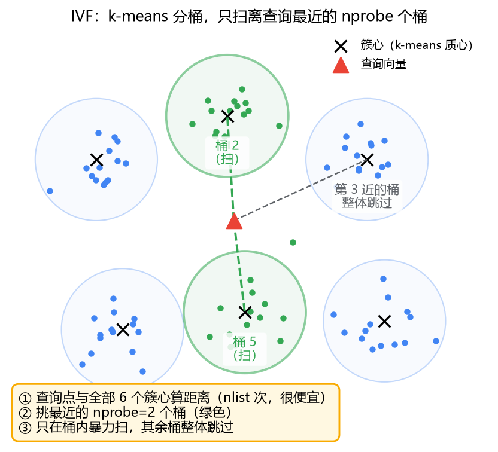
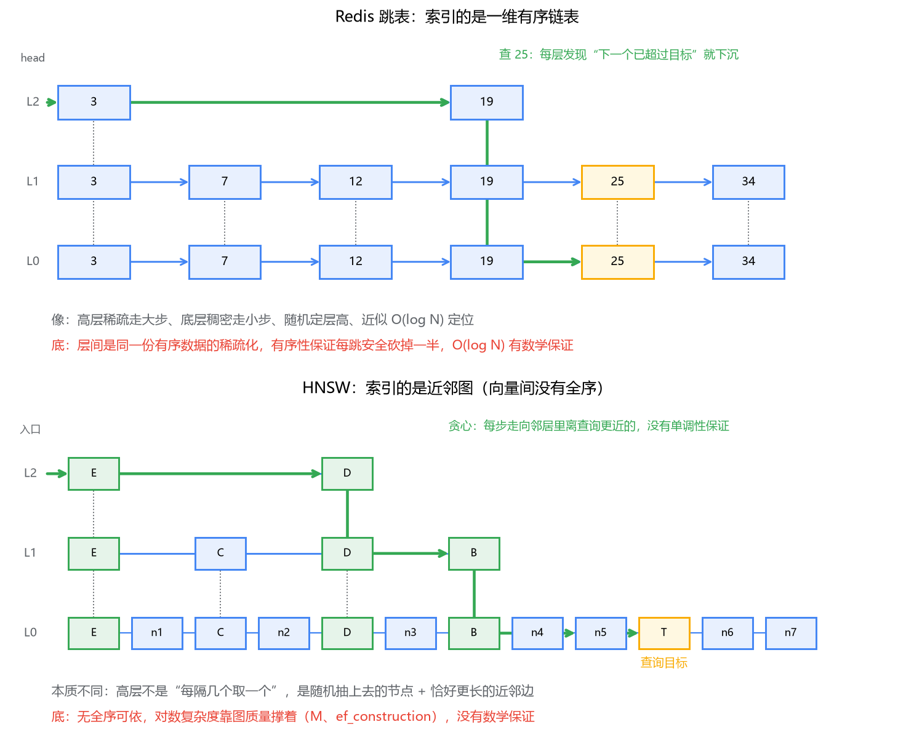
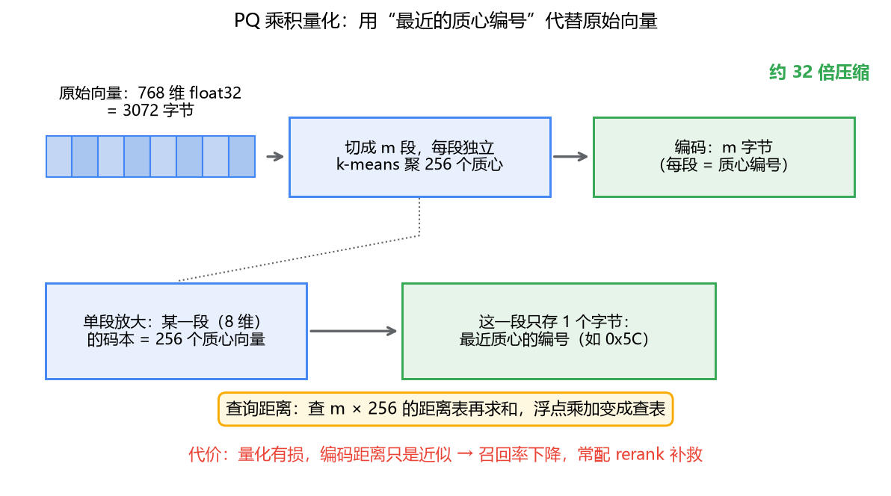

# 05 ANN 索引原理：HNSW 凭什么又快又准

## 先算一笔让人绝望的账

假设你的知识库有 1000 万条向量（768 维，bge 这类模型的常见规格），用户问了一句话，embedding 完扔给 Milvus，要找出最相似的 10 条。

最朴素的做法：拿查询向量和库里每一条算距离，1000 万次。每次距离计算是 768 次乘加，一次查询大约 150 亿次浮点运算。就算 SIMD 优化做得再好，单线程也要几百毫秒。一条查询几百毫秒，单机 QPS 也就十几，用户多起来直接死路一条。

这条路叫**精确最近邻检索（KNN）**，它的问题不在算法，在量级。怎么办？ANN 登场——**近似最近邻（Approximate Nearest Neighbor）**。思路说穿了不值钱：放弃"保证找到最近的 k 个"，只保证"大概率找到很近的 k 个"。用一点召回率，换几个数量级的速度。

你可能会说，这个交换听起来很亏，检索系统怎么能容忍"漏"？注意"漏"的是边缘结果：排在第 10 名和第 12 名的向量，相似度往往只差千分之几，塞进大模型上下文里几乎没区别。ANN 换掉的就是这部分精确性，而 RAG 恰好对此不敏感——这是它成立的前提。如果是推荐系统的精排、或者风控里"必须找到最像的那个欺诈样本"，你对召回率的要求就得往上顶，参数也得跟着调。

这一篇我们把三种主流 ANN 索引——IVF、HNSW、量化——挨个拆开，看它们各自拿什么换什么。看完你会明白，索引选型没有"最好"，只有"你在召回率、延迟、内存这个三角里站哪一格"。

## 一、为什么不能像 MySQL 那样建个 B+ 树

后端工程师的第一反应：加索引啊。B+ 树在 MySQL 里不是万能的吗？

问题出在谓词上。MySQL 索引能工作，是因为 `WHERE id BETWEEN 100 AND 200` 这种条件**利用一维有序性裁剪搜索空间**——B+ 树上走两条边就能锁定一个连续区间。而"距离查询向量最近的 k 条"是**全部 768 个维度联合参与**的条件：查询可能在任何维度上偏移，任何单个维度上的有序，都回答不了整体距离的问题。

打个比方，你在一张全国地图上找"离你直线距离最近的 10 家火锅店"，你可以给所有店按经度建索引，但"经度最接近"和"直线距离最近"是两回事——纬度不答应。维度越高，这个问题越无解。

所以向量检索的精确方案只剩一种：**FLAT 索引**，名字起得非常诚实——不建索引，全部暴力扫，配合 SIMD 指令加速。它是 100% 召回的基准（专栏二提过，别的新索引上线前都要拿它对答案）。数据量在几万到几十万条时，FLAT 完全够用，别急着上 ANN——精确、可解释、零调参。

超过这个量级，就得换思路了。ANN 的两大流派：**分桶**（IVF，查询前先圈定一片区域）和**建图**（HNSW，在数据之间修路）。我们一个个看。

## 二、IVF：先聚类，再只扫几个桶

朴素的想法：能不能先把空间切成一块一块的，查询时只扫查询点附近的那几块？

具体做法你已经会了——就是 k-means。建索引时，从数据里采样，跑 k-means 把空间聚成 `nlist` 个簇（比如 1024 个），每条向量归属到最近的簇心，同一个簇的向量放在一起，这就是一个"桶"。查询分两步走：

1. 算查询向量到全部 1024 个簇心的距离——只有 1024 次距离计算，很便宜；
2. 按距离排序，挑最近的 `nprobe` 个桶（比如 16 个），**只在这几个桶内部暴力扫**。

这就是 **IVF**（Inverted File，倒排文件，名字借自文本检索的倒排索引：文本是"词 → 文档列表"，这里是"簇心 → 向量列表"）。一次查询的计算量从 1000 万次距离，降到了 1024 + 16/1024 × 1000 万 ≈ 16 万次，缩小约 60 倍。

和 k-means 的关系要点透：k-means 在机器学习里的本职是"给无标签数据找结构"，拿去做聚类分析；在 IVF 里它被降格使用，纯粹是个**空间划分工具**，聚出来的簇没有人关心它语义上是什么，只要"每个桶内部互相靠近"就行。所以建 IVF 索引需要一次**训练**（Milvus 里会自动采样训练），数据分布变了、量级翻了几倍，理想的做法是重建索引——这一点和 B+ 树"插入即生效"很不一样。

代价呢？召回损失出在**边界点**上。一条向量离查询点很近，但恰好被划到了第 17 近的桶里，而你只扫了 16 个桶，它就漏了。`nprobe` 就是拿来调这个的：nprobe = nlist 就是全扫（召回 100%，退回 FLAT），nprobe = 1 就是只扫最近一个桶（最快，召回最惨）。实际使用是在两者之间滑动，常见的调法是画一条"召回率-nprobe"曲线，找到召回 95% 的那个点停手，再大就是拿延迟白换了。

IVF 的适用画像很清晰：数据量大、能接受 90%~95% 召回、内存紧张（它还能和后面的量化组合成 IVF_PQ）。缺点是召回上限不如图索引，而且对数据分布敏感——如果簇心采样没覆盖到真实的分布形状，桶的质量就差。

## 三、HNSW：给近邻关系修一张可导航的路网

IVF 是"圈地"，另一个流派的思路是"修路"：把每条向量看成一个城市，在相邻的城市之间修边，查询就是在图上开车——从某个入口出发，每一步开到邻居里离目标最近的城市，直到周围没有更近的了，就到了。

这个朴素版本叫近邻图，它有两个坑。一是**路网直径大**：入口在图的另一头，贪心走法要拐很多次弯才能横穿整个图。二是**容易陷进局部洼地**：当前点的所有邻居都比它远，贪心就停了，但这个"局部最近"未必是全局最近。早期方案 NSW 用多条边补救，效果一般，真正的突破是 2016 年的 HNSW——**分层**。

如果你用过 Redis 的跳表，看到 HNSW 的结构图会非常眼熟：

- 节点插入时随机决定自己的层高，概率逐层衰减，整体呈金字塔——最底层全员在场，越往上人越少；
- 查询永远从最高层的入口出发，**高层走大步快速逼近目标区域，越往下步子越细，到第 0 层做精确的局部贪心**。

"高层稀疏快速定位、底层稠密精确"，这句对跳表的描述放在 HNSW 身上一个字都不用改。但要小心，**这里恰恰是最容易产生虚假理解的地方**，两者的相似是表层的，索引的对象有本质差异。

**跳表索引的是一个有序链表。** 数据在一维上全序，层与层之间就是同一份有序列表"每隔 2^i 取一个"的稀疏化。有序性给了查找一个硬保证：在某一层发现下一个节点已经超过目标，就下沉一层——每一步都能安全地砍掉一半范围，所以 O(log N) 是有底的，数学上站得住。

**HNSW 索引的是一张近邻图。** 向量之间没有全序，"每隔 2^i 取一个"这种操作无从谈起。高层的节点不是按某种序抽样的，就是随机抛硬币上去的；高层的边也不是"跨越 2^i 个有序位置"，而是**恰好跨度更大的近邻边**。查找时走哪条边由贪心决定——哪个邻居离目标近就走哪个——没有任何单调性保证，完全可能走回头路、绕远路。

所以 HNSW 的"对数复杂度"和跳表的对数复杂度不是一回事：跳表的 O(log N) 是结构保证，HNSW 的 O(log N) 是**经验行为**——图修得好才成立。图修得好不好，取决于两个参数：`M`（每个节点最多连多少条边，边越多，绕开洼地的路越多，内存也越大）和 `ef_construction`（建索引时搜索候选队列的长度，越认真建的图质量越高，建得越慢）。这也是为什么 HNSW 建索引出名的慢：每个点插入都要从顶层入口做一次完整贪心才能找到自己的位置，插入本身就是一次搜索。

查询侧只有一个关键参数：`ef`（search 时候选队列的长度）。可以把它理解为：贪心过程中允许"回头看"的广度——ef 越大，越多看起来次优的候选被留在队列里等待翻盘，召回越高、延迟越高。ef 的下限是 top-k，上限是数据量，又是那个熟悉的滑动旋钮。

HNSW 的账单也摆在这：它要存**原始向量 + 图结构**。1000 万条 768 维向量，原始向量就 28.6GB，再加 M=16 时每个节点几十条边，内存轻松翻过 30GB。快和准它都拿走了，账留给了内存——这正是下一节要解决的问题。

还有一个和跳表不同的点值得记一笔：跳表的删除很优雅（摘掉节点、接回前后指针），**HNSW 的删除是硬伤**——从图里摘掉一个点，它的邻居们就断了路，修路的代价可能比重建还高。Milvus 2.x 的做法是打删除标记（tombstone），查询时跳过标记的行，物理清理留给后台 compaction 去做。写多删多的场景，标记会越积越多，这是选 HNSW 时要心里有数的。

## 四、PQ/SQ：把内存账算回来

先把账算清楚。768 维 float32，一条向量 3072 字节，1000 万条 = 28.6GB。这还只是裸数据，HNSW 的图结构另算。如果集群要放 1 亿条，几百 GB 起步，内存条比服务器还贵的日子就来了。

**PQ（乘积量化，Product Quantization）**的思路是"用编号代替原值"，压缩比能到几十倍：

1. 把 768 维切成 `m` 段，比如 96 段、每段 8 维；
2. 每一段单独跑一个小 k-means，聚出 256 个质心（256 正好是 1 字节能表示的范围）；
3. 一条向量不再存 3072 字节的浮点数，只存 96 个"每段最近的质心编号"——**96 字节，32 倍压缩**。

查询时的距离计算也变了味：把查询向量同样切段，预先算好"每一段到该段 256 个质心"的距离，得到一张 96×256 的距离表；之后任何一条编码向量的距离，都是查 96 次表再求和——浮点乘加变成了查表，比算原始距离还快。

天下没有免费的压缩。量化是**有损**的：768 维的全部信息，被压成 96 个质心编号，编码之间的距离只是原始距离的近似。两个本来有细微差别的向量，可能在某一段落到同一个质心上，这一段的距离贡献直接算成零——差异被抹掉了一角，**召回率必然下降**，这就是省内存的代价。实践里常见的补救是 rerank：用 PQ 粗筛出 top-k 的若干倍（比如 10 倍）候选，再拿原始向量对这批候选精算一次重排。粗筛快、精排准，两段各取所长。

**SQ（标量量化，Scalar Quantization）**温和得多：不切段、不聚簇，每个维度独立做线性映射，float32 压成 int8（范围映射到 0~255）。只有 4 倍压缩，但精度损失很小，基本不动召回。Milvus 里的 HNSW_SQ8、IVF_SQ8 用的就是它。

一句话区分：PQ 压缩猛、伤召回，给"内存是第一约束"的超大规模场景；SQ 压缩温和、几乎不伤召回，当作"顺手省四分之三内存"的默认选项。

## 五、回到那个三角

现在把三种手段放回专栏开篇立的那个三角：**召回率、延迟、内存**。

| 索引 | 召回 | 延迟 | 内存 | 一句话画像 |
|------|------|------|------|-----------|
| FLAT | 100% | O(N)，慢 | 全量原始向量 | 小数据集的保底方案，别嫌它朴素 |
| IVF_FLAT | 中，nprobe 滑动 | 快 | 全量向量 + 少量簇心 | 大数据量、内存尚可、能接受 95% 召回 |
| HNSW | 高 | 最快 | 最贵（向量 + 图） | 资源够时的默认答案 |
| IVF_PQ | 牺牲一截 | 快 | 省几十倍 | 亿级数据、内存是硬约束 |
| DiskANN | 高 | 中（磁盘 IO） | 省，图和向量落盘 | 数据放不进内存，又不想牺牲召回 |

所有调参动作，本质上都是在三角的某条边上滑动位置：`nprobe`、`ef` 调的是**用延迟换召回**；PQ/SQ 调的是**用召回换内存**；rerank 是先花内存换召回，再花延迟换回来一点。没有一个参数是"调大就好"，调之前先问自己：我的业务卡在哪条边上？

RAG 知识库这个具体场景，我的判断是：数据量在千万级以内、内存买得起，闭着眼选 HNSW，ef 从 64 起调到召回满意为止；数据要上亿、预算有限，IVF_PQ + rerank。真正的坑不在选型，而在**不度量就调参**——召回率得拿标注数据（或 FLAT 对答案）量出来，拍脑袋调 ef 是玄学。

## 最后，总结

- 精确 KNN 在大数据量下是死路：向量没有一维序，B+ 树的看家本领派不上用场，ANN 用"大概率找到很近的"换速度，而 RAG 恰好对边缘排序不敏感。
- IVF 的内核是 k-means 分桶：查询先定位最近的 nprobe 个桶，桶内暴力扫。召回损失出在边界点，nprobe 在召回和延迟之间滑动。
- HNSW 和跳表共享"高层稀疏、底层稠密"的形，但跳表索引有序链表、复杂度有数学保证，HNSW 索引近邻图、对数复杂度靠图的质量撑着——所以 M 和 ef_construction 伤不起。它的账单是内存，硬伤是删除。
- PQ 切段量化、几十倍压缩、召回受伤；SQ 逐维映射、4 倍压缩、几乎无损。补召回的老办法是粗筛 + 原始向量重排。
- 索引选型是在"召回率-延迟-内存"三角里选位置，先量再调，没有免费的午餐。

索引建好了，数据怎么放、集群怎么长，是下一篇存算分离架构要回答的问题。
