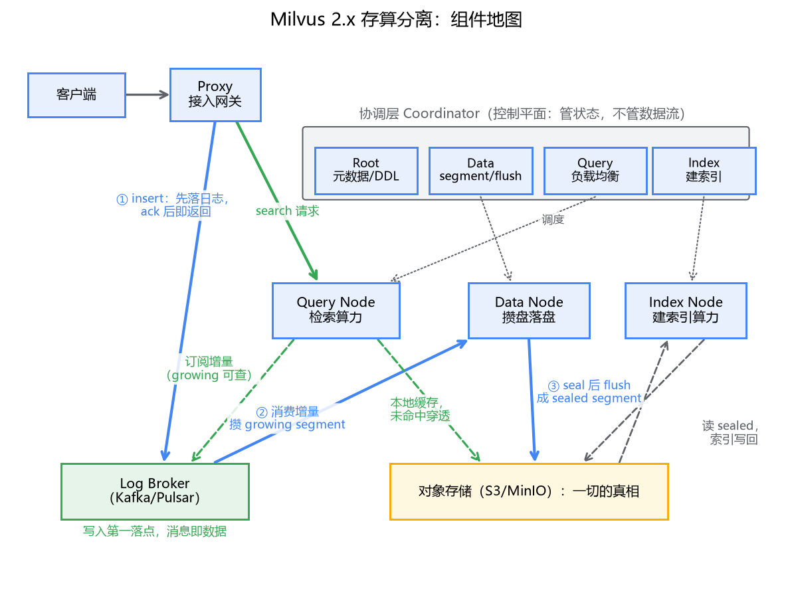
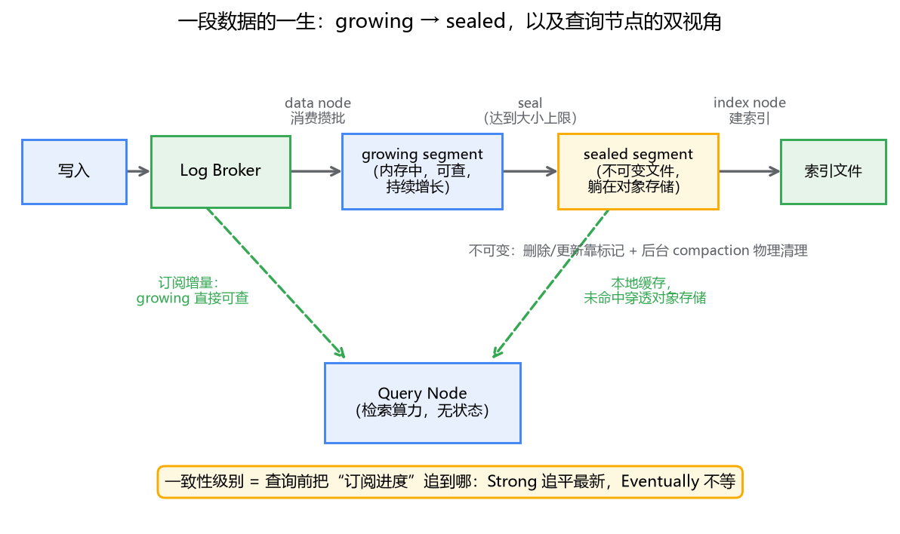

# 06 存算分离架构：为什么 Milvus 的节点敢随便挂

## 一笔算不动的副本账

先用 MySQL 的直觉算一笔账。1 亿条 768 维向量，原始数据约 286GB——这是上一篇算过的。按 MySQL 主从那套打法，数据落在节点本地盘，要扛住读流量就加只读副本，K 个副本就是 K 份完整数据。检索是内存密集型的，K 份 286GB 的内存开销，账马上就算不动了。

更难受的是扩缩容。MySQL 分库分表扩容，搬的是行；向量库扩容，搬的是上百 GB 的 segment 加上更重的索引文件——上一篇讲过，HNSW 建索引是出名的慢，每个点插入都是一次搜索。节点故障恢复同理：换一台机器，把数据和索引重新拉起来，可能是一个小时起步的事。

问题出在哪？出在"数据和计算绑死在同一个节点上"。那你反过来想：**检索这件事，计算节点真的需要"拥有"数据吗？** 查询是一次只读的算距离，不改一条数据。它要的不是数据的所有权，是数据的可用性。这是存算分离能成立的前提——Milvus 2.x 把整个架构押在了这个判断上：**把"存"从节点里剥出去，节点退化成纯算力，随便挂、随便扩，数据躺在廉价的共享存储上。**

这一篇我们把这套架构拆开看：五个角色各干什么、一条数据怎么在它们之间流转、以及为什么一致性级别在这套架构里成了"每条请求都能拧的旋钮"。

## 一、朴素方案先摆出来：像 MySQL 一样绑定

假设我们不知道存算分离，照着 MySQL 的样子做向量库：数据写在节点本地盘，主从复制，读多了加副本。

三个问题马上浮出来。第一，**副本成本线性涨**：每个能服务的副本都得持有全量数据和索引，内存翻 K 倍。第二，**扩缩容等于数据大搬家**：向量数据大、索引重建慢，弹性伸缩名存实亡。第三，**故障恢复慢**：节点挂了，接管者要把几百 GB 数据和索引重新加载，恢复窗口以小时计。

你会说，Redis Cluster 不也是数据跟着节点走吗？是，但 Redis 的数据是热数据、单 key 小，迁移是细粒度搬 slot；向量库没有"单 key"这个粒度，一个 segment 就是几百 MB 起步的整块。老思路在这个数据形态上不划算。

那换个角度：既然检索节点只是"读数据的算力"，能不能让所有算力共享同一份存储？对——这就是 Milvus 2.x 的答案。

## 二、组件地图：五类角色，各管一段

**接入层 Proxy**。无状态入口，干的是网关的活：校验请求、鉴权、把请求拆给对应的工作节点、归并结果。它不碰任何数据的真相，挂了换一个就行。

**协调层 Coordinator**。四位调度员，很像 K8s 的控制平面——管状态、不管数据流。Root coord 管元数据和 DDL（建集合、改 schema）；Data coord 决定写入的数据归到哪个 segment、什么时候 seal（封口落盘）；Query coord 决定哪些 segment 由哪些查询节点负责，并做负载均衡；Index coord 调度索引构建任务。它们各自可以多副本选主，是典型的"小状态、大脑袋"设计。

**工作层**。三种纯算力：**Query node**（查询节点）负责检索，数据从共享存储拉到本地缓存；**Data node**（数据节点）负责消费写入流、攒数据、落盘；**Index node** 负责建索引。注意这三种节点本地都没有"权威数据"，全是缓存和加工中的半成品。

**对象存储**（S3 / MinIO）。一切的真相。封口后的 segment、建好的索引文件、元数据快照，全在这里。它是共享的、几乎无限容量的、按 GB 计费而不是按内存计费的。

**Log broker**（Kafka 或 Pulsar，单机模式内置）。写入的第一落点和增量数据的传播通道。

你可能会问：为什么写入不直接写对象存储？对象存储连覆盖写都不支持，只能整文件上传，撑不住高频小写入。所以中间垫了一层追加式的日志——这个设计我们下一节细看。

这里必须把 **log broker 和 Kafka 的关系**点透。像的地方一眼可见：分区、顺序追加、消费者组、可重放，它就是 Kafka 的用法。但**角色有本质差异**：你在业务系统里用 Kafka，消息是"通知"或"待处理的任务"，数据的真相在 MySQL 里，Kafka 丢一小段消息通常可以容忍；而在 Milvus 里，**log broker 上的消息就是数据本身**——还没 flush 成文件的那部分增量数据，只存在于这条日志里，对象存储上没有。它承担的不是"传个话"，而是**把存储从有状态里剥出来的那块关键积木**：数据节点和查询节点都只是这条共享日志的消费者，消费者挂了，换个实例从头订阅即可，数据不丢、不用搬家。MySQL 主从复制是"把数据搬运到每台机器"，这里是"所有机器按需消费同一条流"——这一步想通了，整套架构就读懂了一大半。

## 三、写入路径：growing 与 sealed 的一段人生

现在跟着一条向量走一遍。

你调 `insert`，请求到 proxy，proxy 校验完把数据写进 log broker，broker 落盘确认，**客户端拿到成功返回**。注意此刻对象存储里还没有这条数据——它的第一落点是日志，不是文件。

接下来是异步的：data node 作为消费者组的一员订阅这条流，把收到的向量攒在内存里的 **growing segment**（增长中）——它在增长期间就是可查询的。攒到一定规模（segment 大小上限，2.x 默认在 512MB 这个量级，随版本有调整），data coord 下令 **seal（封口）**，data node 把它整块 flush 到对象存储，从此成为 **sealed segment**：不可变，一份文件，谁要读谁去拉。index node 再对 sealed segment 建索引，产物同样写回对象存储。

查询节点看数据是双视角的：**sealed segment 走本地缓存，缓存没有就穿透到对象存储**；**growing segment 则是自己直接订阅 log broker 的增量流**。也就是说，同一份新数据，data node 在"攒盘"，query node 在"追读"，两条消费线互不等待。

这个双视角解释了两件事。第一，**为什么 Milvus 写入后立刻就能查到**——growing segment 直接可查，不需要等任何"可见化"动作。对照 ES 会发现一个反差：ES 的近实时靠 refresh 把 memory buffer 变成可搜索的 segment，默认 1 秒可见；Milvus 反而把这一步做没了，因为增量数据的传播不走"文件生成"，走共享日志订阅。第二，**为什么一致性可以按请求调**——既然查询节点看增量靠"追日志"，那"追到哪个时间点才执行查询"就成了一个可以谈的条件。这就是下一节。

sealed 不可变这件事还有一层红利：不可变的数据天然好缓存、好复制、好建索引，这也是整个存算分离能简化的根基。代价是删除和更新都不发生在原文件上，靠删除标记（上一篇 HNSW 一节提过）加后台 compaction 物理清理，写多了之后 compaction 的 IO 是要留意的后台开销。

## 四、一致性级别：为什么能调、调的是什么

Milvus 的 consistency level 有四档：Strong、Bounded、Session、Eventually。很多文档把它们当"隔离级别"一样罗列，但真正要理解的是**背后的机制**，机制就一句话：**查询节点执行查询前，要把自己对 log broker 的消费进度追到什么位置**。

每条写入都带一个时间戳。查询请求带一个 GuaranteeTs（保证时间戳）：查询节点必须确认自己已经消费到 GuaranteeTs 之后，才能执行这次检索。四档的差别就是 GuaranteeTs 怎么定：

- **Strong**：GuaranteeTs = 最新，把所有已确认的写入全部追平才查。代价最直观——写入高峰期，每次查询都要等同步，延迟随写入流量抖动。
- **Bounded**：GuaranteeTs = 当前时间减一个容忍窗口，允许自己的视角落后一小段。延迟和新鲜度做交易。较新版本的 SDK 默认值是 Bounded（具体默认窗口随版本有调整，以你用的版本文档为准）。
- **Session**：保证"我自己这个会话写入的数据"对我可见。单客户端语义，介于两者之间。
- **Eventually**：不等，现在消费到哪就查到哪。最便宜，读到的是"稍旧"的世界。

为什么这套旋钮在 MySQL 里没有？因为在数据锁在节点本地的架构里，"节点看到的数据"就是全部，没有"消费进度"这个概念。而在存算分离里，数据从共享日志流过每个查询节点，**每个节点对世界的认知是一条可以暂停、可以追赶的时间线**——一致性第一次变成了按请求指定的参数，而不是按集群部署固定的属性。这是存算分离顺手送的一份礼物，不只是省钱。

RAG 场景怎么选？给个直接的判断：**知识库是批量导入、离线消化的，用 Bounded 或 Eventually**——文档入库差那几百毫秒的可见性，对检索质量毫无影响，没必要每次查询都付出同步代价。**用户"上传文档后马上提问"的交互场景用 Session**——这是少数必须"自己写的东西自己马上能查到"的时刻，Session 恰好就是为这个语义设计的，比 Strong 便宜。Strong 留给"查不到刚写入的数据就算事故"的场景，比如实时风控，RAG 里基本用不上。

## 五、这套架构的代价

存算分离不是免费的午餐，三个代价要心里有数。

**对象存储的延迟**。S3 这类存储单次访问是几十毫秒量级，比本地盘慢一个数量级以上。查询性能全靠查询节点的本地缓存救：热 segment 常驻内存，冷 segment 穿透到对象存储。缓存命中率不好的场景（数据远大于内存、访问又分散），尾延迟会很难看。DiskANN 这类磁盘索引就是为这个场景准备的。

**运维复杂度**。分布式部署要拉起 proxy、四位 coordinator、三类工作节点，外加 etcd、MinIO、Kafka 三件套——十来个角色。Milvus 的 standalone 模式把这些全塞进一个进程，开发环境用它就好，别在生产硬上分布式：数据量在单机内存放得下的范围内，standalone 加上对象存储做备份，比一套微服务省心得多。存算分离的收益，要等"数据大到单机放不下、或多副本扛读"时才真正兑现。

**log broker 在关键路径上**。写入的确认依赖它，它出问题写入就出问题。Kafka 本身很结实，但这意味着容量规划和监控不能只盯 Milvus 自己的组件。

## 最后，总结

- 向量数据大、索引重建慢，数据跟着节点走的传统方案在副本成本、扩容、故障恢复三头都算不过账；检索是只读计算，天然适合把"存"剥出去。
- 五类角色：proxy 网关、coordinator 四件套（K8s 控制平面式的调度层）、三类纯算力工作节点、对象存储（真相）、log broker（增量流）。
- log broker 像 Kafka 但不是 Kafka 的用法：消息即数据本身，它把存储从有状态里剥出来，消费者随便换。这是整套架构的关键积木。
- 写入先进日志、data node 攒成 growing segment（立即可查）、seal 后落对象存储成不可变的 sealed segment；查询节点双视角：缓存 + 订阅。
- 一致性级别的本质是"查询前消费进度追到哪"，存算分离把一致性从部署属性变成了请求参数。RAG 批量导入用 Bounded/Eventually，上传即查用 Session。

架构摆好了，下一篇把一条 search 请求放进去，从头到尾走一遍完整旅程。
