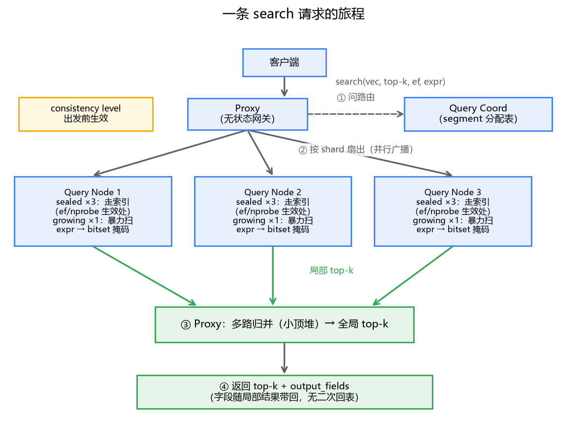
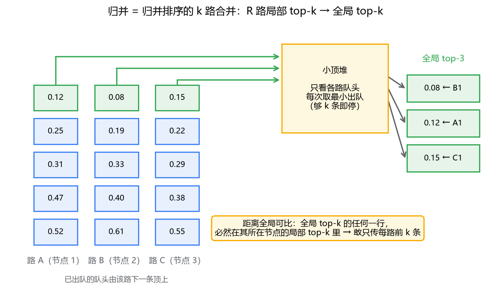

# 07 一次检索的完整旅程：search 进了集群之后

## 从一行代码开始

```python
res = collection.search(
    data=[query_vec],           # 查询向量
    anns_field="embedding",
    limit=10,                    # top-k
    param={"metric_type": "IP", "params": {"ef": 128}},
    expr='tenant_id == "shop_a"',
    output_fields=["content", "source"],
)
```

这行代码你在专栏二写过很多遍，一两百毫秒后结果回来了。但这一百多毫秒里，集群内部发生了什么？这条请求被谁接走、拆成了几份、发给了哪些节点、`ef` 和 `expr` 分别在哪个环节生效、最后 10 条结果是怎么拼出来的？

上一篇我们把架构的静态地图摆好了，这一篇让一条请求在地图上跑一遍。跑完之后你会发现，分布式向量检索的内核其实是你早就熟悉的东西：**多路有序列表的归并**——归并排序的那个归并。真正的新知识在于两头：前面怎么拆、后面为什么敢这么合。

## 一、出发：Proxy 接请求，问清楚数据在哪

请求第一站是 proxy。它做网关该做的事：校验参数、解析表达式、鉴权。然后面对一个关键问题：**这个 collection 的数据，分布在哪些查询节点上？**

回顾上一篇：collection 按主键哈希分成若干 **shard**（写入时进 log broker 的不同分区），shard 内部又按时间顺序切成一个个 segment，每个 segment 由某个 query node 负责（多副本时是一组）。这张分配表由 query coord 维护。proxy 拿到分配信息后，把请求按 shard 拆开，扇出给对应的 query node。

这里和 MySQL 分库分表的路由对照一下：分库分表的路由逻辑在客户端或代理层，靠 sharding key 算出"这个 key 在哪个库"；Milvus 的查询不带 sharding key——查询向量可能和任何 segment 里的数据相似，**没法路由，只能广播**。所以 Milvus 的"路由"不是裁剪（这次查询只去一个节点），而是规划（这次查询要去这一组节点，一个都不能少）。这也是向量检索扇出成本高的根源：数据分了 N 份，每次查询就要打扰 N 个负责人。

广播有没有缓解手段？有，**partition**。collection 之下可以再建分区，查询时带上 `partition_names`，要扫的 segment 就从"整个 collection"缩到"指定分区"。计算量是实打实省下的；至于网络扇出能省多少，取决于分区数据在查询节点上怎么分布，这点别抱太高期待。先记住这个机制，下一节讲标量过滤时会回到它——租户隔离到底用 partition 还是 filter，性能账的分歧点就在这。

具体拆法：proxy 按 shard 把请求复制成多份，发给每个 shard 的一个副本组；组内如果多个 query node 分摊了该 shard 的 segment，请求会进一步下发到组内各节点。对这条请求来说，效果就是：**并行扇出到一批 query node，每个节点只检索自己手里的 segment**。

## 二、局部检索：每个节点关起门来干自己的活

每个 query node 收到请求后，对自己负责的每个 segment 独立跑一遍检索。这里是整条链路计算最重的地方，也是你要调的参数真正生效的地方。

**sealed segment 走索引**。上一篇说过，索引是 index node 对 sealed segment 建好、放在对象存储、被 query node 缓存到本地的。HNSW 就是在图上跑贪心，IVF 就是先选桶再扫桶。`ef`、`nprobe` 就在这一步生效——注意它们是 **segment 本地检索**的参数：一个节点手里有 30 个 sealed segment，就跑 30 次独立的局部搜索，每次都用同样的 ef。参数调大，是 30 次搜索每次都变深，不是某一次变深。

**growing segment 暴力扫**。增量数据还没 seal、没建索引，只能逐条算距离。为什么可以接受？growing segment 有大小上限（几百 MB 封顶），它只是写入和落盘之间那一小段窗口的数据，量级远小于存量。用一次小规模的精确扫描换掉"增量立即可查"，这买卖是划算的。

**删除靠标记**。被删除的行带着 tombstone，检索时跳过。

每个节点把自己所有 segment 的局部结果归并一次，输出**本节点的 top-k**——一份按距离升序排列的有序列表。到这里，"局部检索"结束，球踢回 proxy。



## 三、标量过滤在哪一步介入

`expr='tenant_id == "shop_a"'` 这个条件呢？它不是"查完 top-k 再筛一遍"——那样十有八九凑不满 k 条。Milvus 的做法是把过滤表达式**下推到 segment 内部**：先对 segment 的标量数据求值，得到一个 **bitset**（一个位图，一位对应一行，1 表示满足条件），然后向量检索在这个位图的约束下进行——图搜索走到一个节点、桶里扫到一行，先看 bitset 那一位是 0 还是 1，是 0 直接跳过，不进候选。

对照 MySQL 会很亲切：这就是**索引条件下推（ICP）**的思路——把过滤从服务层推到存储引擎层，边读边筛，别把不要的行捞出来。但和 B+ 树有个本质差别要指出：**B+ 树可以用标量条件直接定位起点（tenant_id 索引一跳就到 shop_a 的区间），而向量索引结构完全不感知标量**——HNSW 的图是按向量距离建的，IVF 的桶是按向量聚的，"tenant_id 是什么"对它们是黑盒。过滤只能在候选生成的过程中做掩码，不能帮索引少走一步路。

这带来一个实践上很重要的判断：**filter 的选择性特别高时（比如只留 1% 的行），向量索引还是在全量数据的图上转，大量算力花在"走到又扔掉"上**。这种场景更好的工具是 **partition**——按 tenant 建分区，查询直接指定分区，物理上就把不相关的数据隔离了，索引也是分区各自的。filter 适合选择性不高的软条件（时间窗、状态位），partition 适合结构性隔离（租户、环境），两者不是一个东西，别混用。

（过滤的执行策略在 2.x 各版本里有"预过滤/迭代过滤"的演进细节，但"求值成 bitset、在 segment 内部生效"这个机制是稳定的。）

## 四、归并：proxy 手里的多路合并

现在 proxy 收到了 R 个查询节点返回的 R 份局部 top-k，每份是按距离升序的 k 条。要出全局 top-k。

这就是**多路归并**——归并排序 merge 阶段的原语：R 路各自有序，每次比较各路队头，取距离最小者出队，凑满 k 条停止。工程实现用小顶堆，O(k·logR)，毫秒都不到。看个三路的例子：



你可能会问：每个节点只返回自己的 top-k，万一全局第 3 名所在的行，在它那个节点上只排第 11（k=10），不就漏了？不会。**距离是全局可比的**：L2 和内积不依赖任何局部统计量，A 节点上算出的 0.35 和 B 节点上算出的 0.35 是同一个含义。既然每一行都在自己所在节点的排序里和全局任何行公平比过，那么"每路取前 k、归并再取前 k"就不会漏掉真正的前 k。数学上：全局 top-k 中的任何一行，必然是其所在节点内的 top-k（反证：它节点内若有 k 行比它近，那全局就有 k 行比它近，它就不在全局 top-k 里）。

对照 ES 篇讲过的分布式打分的坑，这里的差异一目了然：BM25 的 tf 和 idf 是分片局部统计量，分片各自的 _score 不可直接比，所以 ES 有 DFS_QUERY_THEN_FETCH 要填坑。**向量检索天然没这个坑**——分数即距离，物理意义统一，这是它分布式归并简单的根本原因。

最后一个小问题：`output_fields` 要的字段呢？query node 是"整行持有者"（growing 从日志来、sealed 从对象存储来，标量列都 load 在节点上），所以字段跟着局部结果一起返回，proxy 归并完直接组装应答，**不需要二次回表**。

## 五、把参数放回旅程

现在把你在专栏二调过的每个旋钮放回它生效的位置：

- **consistency level**：出发前生效。proxy 决定 GuaranteeTs，query node 检索前先确认订阅进度追到位（上一篇的机制）。
- **nprobe / ef**：第二步生效，segment 本地的检索深度。它乘以 segment 数量——这就是为什么 segment 碎片化会放大参数的代价。
- **expr（标量过滤）**：第二步内嵌生效，bitset 掩码。
- **limit（top-k）**：贯穿第二步和第四步，决定局部列表长度和归并规模。
- **索引类型**：第二步的根本差异，上一篇整篇讲的三角权衡。

延迟的大头永远在第二步的局部检索：网络扇出是并行的（总延迟取最慢节点），proxy 的拆分和归并都是微秒到毫秒级。所以排查慢查询，先看两件事——参数是不是给猛了（ef 1000 这种），segment 是不是碎成了几千个小段（每段固定开销 × 段数）。后者正是 compaction 除了清理删除标记之外的另一重意义：把小段合并，砍掉扇出和固定开销。

还有一个抖动来源值得单独盯：growing segment 的暴力扫。平时它小到无感，但写入高峰期 growing 又多又大，检索延迟会跟着写入曲线同频抖动。如果监控上看到"P99 延迟和写入吞吐长一个形状"，嫌疑基本就是它——说明 flush 和 seal 跟不上写入速度了，该调攒批的参数或者加数据节点了。

## 最后，总结

- 一条 search 的旅程：proxy 校验并按 shard 拆分、扇出 → 各 query node 对自己的 segment 独立局部检索（sealed 走索引、growing 暴力扫、删除靠标记）→ 各节点局部 top-k → proxy 多路归并出全局 top-k。
- 向量查询没法按 key 路由，只能广播到全部分片——路由是"规划要打扰谁"，不是"裁剪到只打扰一个"。
- 标量过滤下推成 segment 内的 bitset，在候选生成时掩码；但向量索引不感知标量，高选择性过滤应改用 partition。
- 归并就是归并排序的 k 路合并；它成立的前提是距离全局可比，所以 Milvus 没有 ES 分布式打分的坑，也不需要二次回表。
- ef/nprobe 乘以 segment 数量生效，慢查询两大嫌疑人：参数给猛了、segment 碎片化了。

到这里，专栏三 Milvus 部分的三个机制讲完了：索引凭什么快（ANN）、架构凭什么敢弹性（存算分离）、请求凭什么走通（完整旅程）。接下来该把这些地基拧进真正的 RAG 系统里了——那是专栏四的事。
