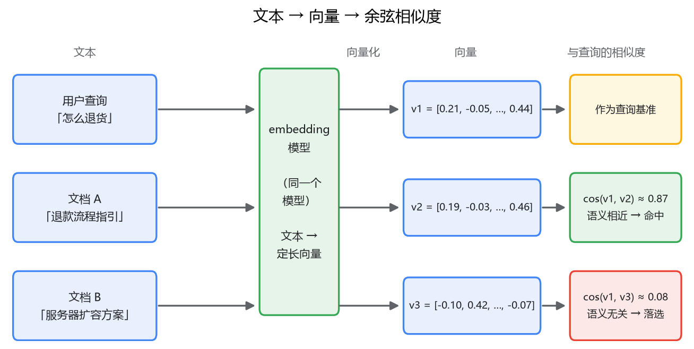
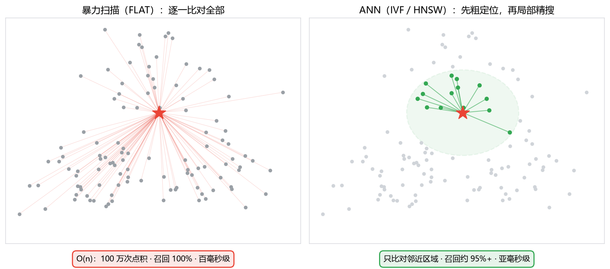

# 01 为什么需要向量检索

## 一条搜不到的退款政策

你给公司内部知识库做了个搜索功能，用的是你最熟的手段：MySQL LIKE，后来升级成 ES 全文检索。上线第一天，客服同事就来反馈：她搜"怎么退货"，什么都没搜到。

你去库里一看，那篇文档标题是《退款流程操作指引》，正文通篇写的是"退款申请""退款审核"。这篇文档就是写给这个问题看的，但一个字都没对上。

这不是个例。用户问"登录不上怎么办"，文档里写的是"账号密码校验失败的处理"；用户问"电脑开机黑屏"，文档里写的是"显示器无信号排查步骤"。你做检索这么多年，第一次被逼到墙角：**用户嘴里的词，和文档里的词，几乎永远对不上，但意思是一样的。**

这个问题有个正式的名字，叫**语义鸿沟**（semantic gap）：查询和文档之间，字面不匹配，语义匹配。关键词检索的整套机制——不管是 LIKE 还是 ES 的倒排索引——工作前提都是"query 和 doc 至少共享一个词"。这个前提不成立，检索就没有起点。

这一篇我们把这条线捋清楚：语义鸿沟为什么补不平；embedding 是怎么把"意思"变成"数字"的；变成数字之后，为什么暴力比对撑不住、必须引入 ANN。

## 一、先试朴素的补法：同义词词典为什么治不了本

你可能会说，这不就是同义词的问题吗？ES 配个同义词词典，"退货 = 退款 = 售后"，不就解决了？

能缓解，治不了本。往深想一层就明白了。

同义词表是**枚举**出来的，而用户的问法是**组合**出来的。"显示器没信号"和"电脑开机黑屏"之间没有任何一个词相同，你打算往词典里写哪条规则？"密码忘了"和"登录凭证丢失"呢？表达同一个意思的说法成百上千种，两两组合的规则写不完。就算写完了，维护也是无底洞：业务黑话、新产品名、公司内部缩写，每天都在长，词典永远追着业务跑。

更根本的一层：词典只能建立"词到词"的映射，表达不了**远近程度**。"退货"和"退款"确实近，那和"发票"呢？和"物流"呢？近多少？一张二元的同义词表装不下这种连续的语义距离。

所以问题不在工程实现，在于**关键词匹配的是字面，用户想匹配的是意思**，中间隔着一层机器翻译不过去的东西。要跨过这条鸿沟，得换个思路：想办法把"意思"本身变成可计算的东西。

## 二、embedding：把一段话变成一串数字

最朴素的思路你也能想到：给每篇文档人工打标签——主题、分类、关键词，然后按标签匹配。早期的检索系统真这么干过，但它有两个死穴：标签体系是人定义的，粒度粗、覆盖死板；标签之间表达不了远近。

换个角度想。如果能把每段文本映射成**高维空间里的一个点**，让"意思越近的文本，点挨得越近"，检索就从字符串匹配变成了纯几何问题：把用户的查询也映射成点，找出离它最近的 k 个点，完事。

问题是谁来定这个映射规则。768 个维度，人工定不出来。这一步只能交给神经网络：拿海量语料训练一个模型，让它学会"出现在相似上下文里的文本，意思相近"——"退款"周围总是出现"订单、客服、申请"，模型就把这些词的向量往一块儿压。训练完成后，模型就是一个函数：一段文本进去，出来一个定长数组（比如 768 个浮点数）。

这个数组就是 **embedding**（嵌入向量）。它不是随机数字，是模型对这段话语义的"坐标"：**方向编码了"这段话在说什么"**。语义相近的文本，向量夹角小；不相关的文本，接近正交。整个过程像图书馆按主题排架，但有个本质区别必须点破：书架的分类是人定义的几十个类目，一个维度一条规则，可解释；embedding 的"位置"是模型从几亿语料里学出来的几百维连续空间，**不可解释**——你说不出第 317 维代表什么，只能整体地看待一个向量。换来的是粒度和覆盖面：任意两段文本之间的远近都能算出来，不管它们有没有共享过一个词。

回到开头的例子。"怎么退货"和《退款流程操作指引》分别过一遍同一个 embedding 模型，得到两个夹角很小的向量——语义鸿沟在向量空间里被填平了，因为两边被翻译成了同一种语言：数字。

## 三、远近怎么量化：余弦相似度

有了两个向量，怎么算"近"？最直觉的是量直线距离（欧氏距离，L2）。但文本向量有个行业惯例：模型输出时做**归一化**，把模长统一缩放成 1。模长都相等之后，距离就只剩一个变量——夹角。于是文本场景普遍用**余弦相似度**：

cos θ = (A · B) / (|A| × |B|)

分子是两个向量的点积（对应位置相乘再求和），分母把模长除掉，只留"方向"的信息。值域 [-1, 1]：1 表示方向完全一致，0 表示正交（语义不相关），-1 表示方向相反。做了归一化的向量，|A|、|B| 都是 1，点积直接就等于余弦。

你不用手算。在 Milvus 里建索引时指定一个 metric_type，它替你算。这里先建立直觉就够：**文本语义检索里，"相近"指的是方向相近，不是坐标相近**。具体用 COSINE、L2 还是 IP（内积），什么场景选什么，第 4 篇讲数据入库时一并说。

## 四、暴力比对为什么撑不住

向量检索的定义现在很干净：拿查询向量和库里每条向量算一次相似度，排序取 top-k。这种做法叫**暴力检索**（Milvus 里对应 FLAT 索引），结果精确，一点不近似。

你可能会想，这有什么难的？算笔账就知道死在哪。

100 万条文档，每条 768 维 float32，光向量数据就是 100 万 × 768 × 4 字节 ≈ 2.9 GB。一次查询，这 2.9 GB 要全部从内存搬进 CPU 过一遍——瓶颈不在计算，在**内存带宽**：单机内存带宽几十 GB/s，一次查询就是几十到上百毫秒，还是全量串行。单条查询忍了也就忍了，QPS 到 10 呢？内存带宽先被打满，CPU 反而在旁边等数据。数据涨到 1 亿条（约 290 GB），单机内存根本放不下，这个方案就死了。

你的本能反应一定是：加索引。MySQL 里 400 万行的表没人全表扫，B+ 树二分几下就定位，O(n) 变 O(log n)。

向量这里有个绕不过去的本质障碍：**向量空间没有"序"**。B+ 树能剪枝，是因为一维数据上"大于/小于"是全序，比较一次就能证明答案不在另外半边，砍掉是安全的。而"最近邻"在高维空间里没有这种全序——你找不出一个简单规则，把一大片区域证明为不可能含答案。高维空间还有个更糟的性质：维度一高，任意两点间的距离都差不多远（所谓维度灾难），"剪"哪边都不安全。

精确剪枝做不了，只能退一步：不追求找到"真正的前 k 个"，接受"找到的 k 个里，95% 以上是真 top-k"。这就是 **ANN**（Approximate Nearest Neighbor，近似最近邻）。思路和你熟悉的跳表、B+ 树神似，但本质不同，必须分清：**B+ 树的剪枝是可证明的精确排除，ANN 的剪枝是高概率的赌注**。典型做法两条路：IVF 先把整个空间聚成几万簇，查询时只扫离查询点最近的几簇（粗筛）；HNSW 建多层稀疏图，从顶层入口一路向目标方向贪心跳（导航）。代价是召回率，换来两三个数量级的提速——同样百万级数据，暴力扫描百毫秒级，ANN 索引亚毫秒级。

牺牲的那点召回换不换？RAG 场景里基本都换：top-5 里漏掉一个真结果，通常还有 4 个够用；而百毫秒的检索延迟乘上对话轮次，体验直接崩掉。这笔账怎么算、参数怎么调，是第 5 篇的主菜，这里先记住结论：**向量检索的工程主线，就是拿召回率换速度**。

## 五、向量检索自己的盲区

到目前为止，向量检索看起来是更高级的东西，关键词像上个时代的遗物。打住。向量检索有自己的天花板，而且恰恰在你最需要精确的地方。

用户搜错误码 `ERR_CONN_10054`，库里同时有 10053 和 10054 两篇文档。这两个错误码在语料里出现的上下文几乎一模一样（都是网络错误日志），embedding 给它们的向量近得几乎重合——排第一的很可能是 10053 的文档。型号也一样，"RTX 4080"和"RTX 4090"的文档语义高度相似；法条编号，"第 1043 条"和"第 1042 条"同理。更糟的是，这类长尾专有名词在训练语料里出现得少，模型对它们的表示质量本身就差。

原因和语义鸿沟是对称的：**embedding 压缩的是"意思"，而错误码、型号、编号的价值恰恰在那一个字符的差别上**，这个信号在几百维的语义空间里几乎不占分量，天生会被"平均"掉。

所以关键词检索和向量检索不是替代关系，是互补关系：一个管"意思相近"，一个管"一字不差"。你的知识库里既有"怎么退货"这样的口语化问题，也有报错码、配置项这样的精确查询，两路都得通，结果再合并排序——这就是**混合检索**，专栏四会用一整篇讲怎么把两路结果拧在一起。这也顺带回答了"有了 Milvus 为什么还要学 ES"：它们守的是两条不同的路。

## 最后，总结

- 关键词检索匹配的是字面，语义鸿沟是它的结构性天花板，同义词词典只能缓解，治不了本。
- embedding 模型把文本映射成高维向量，语义相近的方向相近，检索从字符串匹配变成几何问题。它不可解释，换来的是任意文本间的远近都可计算。
- 余弦相似度量化"方向相近"，是文本场景的默认度量。
- 暴力检索受内存带宽限制，百万级勉强、亿级死路；向量空间无全序，做不了 B+ 树那种精确剪枝，只能用 ANN 拿召回率换速度——这是贯穿整个专栏的第一条主线。
- 向量检索管不了"一字不差"，和关键词检索是互补不是替代，这是引入混合检索的理由。

下一篇，我们把 Milvus 跑起来，看看这个东西长什么样。
