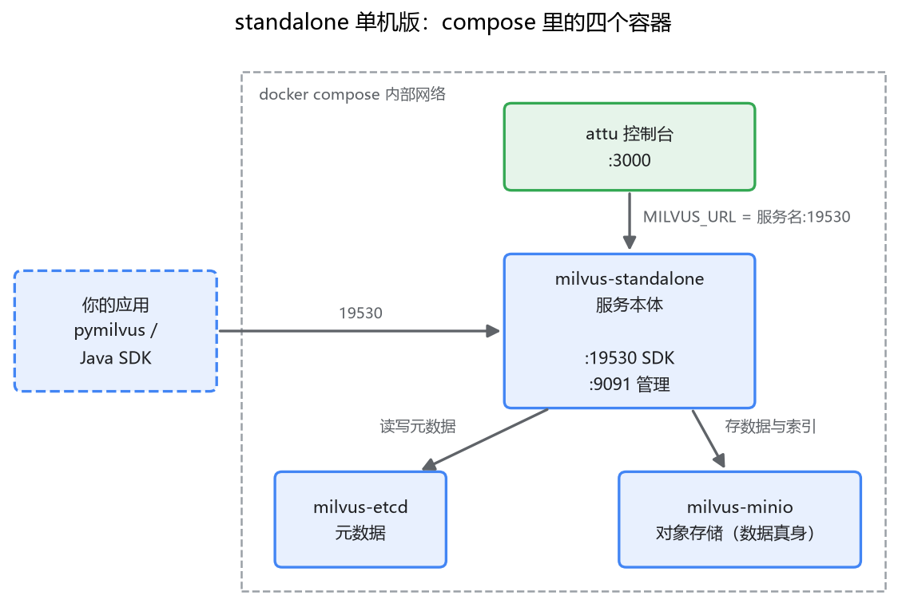
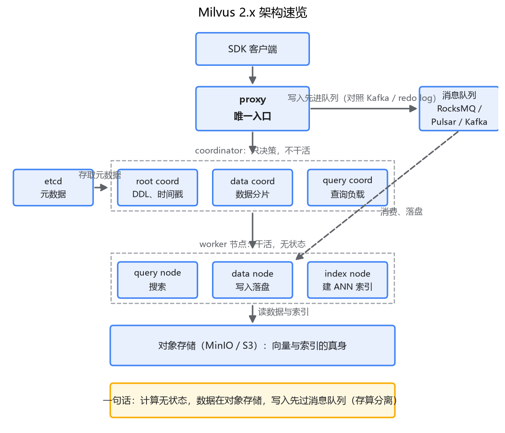

# 02 上手与架构速览

## 装之前，先搞清楚它在你的技术版图里站在哪

上一篇我们说清楚了一件事：向量检索要专门的存储和检索引擎，Milvus 是目前最主流的开源选择。这一篇动手把它跑起来。

动手之前，先用三十秒对齐一个认知：Milvus 在你的架构里站在哪。它是一个**独立部署的数据库服务**——这一点像 MySQL、Redis，不像 SQLite。你的应用进程通过 SDK 走网络连过去，它自己管数据、管索引、管查询。所以"装 Milvus"不是 pip install 完事，而是"起一个服务"。

既然是服务，就有三个问题要依次回答，正好是这一篇的路线：服务怎么跑起来（第一节）；跑起来之后，里面有哪些角色在协作（第二节）；你作为开发者，用什么界面和它打交道（第三、四节）。

## 一、Docker 起一套单机版

Milvus 有三种部署形态：**Lite**（一个 pip 包，数据落在本地文件，写 demo 用）、**Standalone**（单机服务，本文主角）、**Distributed**（分布式集群，生产大规模用）。学习和开发选 standalone。它不是缩水版，而是分布式版的"单机分身"——这一点第二节你会看得更清楚。

官方推荐用 docker compose 起。下载 compose 文件并启动（版本号换成你看到的最新 2.5.x 即可）：

```bash
mkdir milvus && cd milvus
curl -L -o docker-compose.yml \
  https://github.com/milvus-io/milvus/releases/download/v2.5.6/milvus-standalone-docker-compose.yml
docker compose up -d
```

镜像拉完，`docker ps` 里应该有三个容器：milvus-etcd、milvus-minio、milvus-standalone。

看到三个容器你大概会皱眉：不是单机版吗，怎么起了三个？这里就是第一个"像 MySQL 又不是 MySQL"的地方。mysqld 一个进程把存储、索引、查询全包了；Milvus 的架构里，**元数据（etcd）和数据存储（MinIO，一个对象存储服务）是两个独立角色**，单机版只是把分布式版的角色原样塞进一台机器，用容器隔开。所以这三个容器不只是安装依赖，它们就是 Milvus 架构本身。

验证服务活着：

```bash
curl http://localhost:9091/healthz
```

返回 OK 就绪。19530 端口留给 SDK（对应 MySQL 的 3306），9091 是管理接口。

顺手把 attu 也加上。在 docker-compose.yml 里追加一个服务：

```yaml
  attu:
    image: zilliz/attu:v2.5
    ports:
      - "3000:3000"
    environment:
      MILVUS_URL: milvus-standalone:19530
```

再 `docker compose up -d`，浏览器打开 http://localhost:3000，就是 Milvus 的图形控制台。注意 MILVUS_URL 写的是 `milvus-standalone` 这个服务名，不是 localhost——容器之间走 compose 内部网络，用服务名互相找到对方。如果你是单独 `docker run` 起的 attu，这里得写 `host.docker.internal`（Windows/Mac 上容器里的 localhost 不是宿主机），新手在这卡半小时是常态。



## 二、Milvus 长什么样：一分钟架构速览

第二节回答"跑起来的到底是什么"。只给你用起来所需的最小画面，每个角色一句话，拆解留给专栏三。

从上往下看：

- **proxy**：整个集群唯一的入口，SDK 的所有请求都从它进。类比 MySQL 的连接层，但它不止转发——认证、请求校验、分布式结果的归并都在这。后面排查问题、看监控，盯的主要就是它。
- **coordinator**：大管家，只决策不干活。实际是三个：root coord 管 DDL 和全局时间戳，data coord 决定数据怎么分片存放，query coord 决定查询负载分给谁。
- **worker 节点**：真正干活的。query node 负责搜索，data node 负责把写入落成数据文件，index node 负责建 ANN 索引——就是上一篇说的那件事。
- **对象存储**（单机版里的 MinIO）：数据的最终归宿。向量、索引文件，真身都在这。
- **etcd 和消息队列**：etcd 存元数据（有哪些 collection、schema 是什么）；写入不直接进存储，先写消息队列（单机版内置 RocksMQ，分布式版用 Pulsar 或 Kafka），data node 再从队列消费落盘。这个角色你熟——它就是 Kafka 在这套架构里的用法，同时兼任 MySQL redo log 的角色：**先写日志，再落盘，宕机了从日志补**。



把这些串成一句话：**计算节点无状态，数据都在对象存储，写入先过消息队列**。这就是所谓存算分离。好处是节点挂了重新拉一个就行、扩容就是加减节点；代价是链路长，一次读写要跨好几个组件。为什么这么设计？向量数据又大（GB 到 TB 级）、检索又吃内存，存储和计算的最优规模对不上，干脆拆开各自扩。

这套架构还藏着一个你迟早会撞上的旋钮：**一致性级别**。写入先进消息队列、查询节点异步消费，那"写完多久能查到"就不是非黑即白的问题——Milvus 让你自己选，从"强制读到最新"到"容忍几秒延迟"分了档。机制和选型（RAG 场景该选哪档）是专栏三第 6 篇的内容，这里先把疑问记下。

现在只要记住一个和 MySQL 的对照：**mysqld 是一个进程包揽一切，Milvus 把"决策、干活、存储"拆成了三种东西**。单机版的三个容器，就是这套拆分的最小化身。

## 三、attu：Milvus 的 Navicat

后端工程师的肌肉记忆：接一个新数据库，先找个图形客户端看看里面长什么样。attu 之于 Milvus，约等于 Navicat 之于 MySQL。

以 2.5 版的界面为例，四个你马上用得上的地方：

- **Collection 列表**：每张表（Milvus 叫 collection，下一篇细讲）的行数、索引状态、是否已加载，一眼扫完。
- **数据浏览**：直接翻 entity，约等于翻表数据。灌完数据第一步先来这，确认数据到底进没进去——排查"搜不到"的问题，先分清是数据没进去还是查询写错了，能省一半时间。
- **搜索 playground**：在页面上发起一次向量搜索，调参数、看结果，比改代码重跑快得多。调试搜索参数的正确工作流是：attu 里调通，再把同样的参数搬进代码。
- **系统监控**：各节点状态、正在跑的任务。现阶段用不上，知道在哪就行。

## 四、十行代码，跑通第一次搜索

最后用代码把这一篇收尾。`pip install pymilvus`（2.4+，版本跟着服务端走），连上、建表、插数据、搜一次：

```python
from pymilvus import MilvusClient

client = MilvusClient(uri="http://localhost:19530")

# quick setup：自动生成 id 主键 + vector 向量字段
client.create_collection("demo", dimension=4, metric_type="COSINE")

client.insert("demo", [
    {"id": 1, "vector": [0.1, 0.2, 0.3, 0.4], "text": "退款流程指引"},
    {"id": 2, "vector": [0.9, 0.1, 0.05, 0.0], "text": "服务器扩容方案"},
])

res = client.search("demo", data=[[0.12, 0.19, 0.31, 0.38]],
                    limit=2, output_fields=["text"])
print(res)
```

dimension=4 是为了 demo 拿假向量手算方便，真实场景是几百上千维。text 字段没在 schema 里声明也能插入，因为 quick setup 默认开了 dynamic field，文档字段随手塞——原型阶段很爽，生产要不要这么干，下一篇讲 schema 时说。

跑的时候留意一个现象：insert 之后立刻 search，偶尔查不到刚插的数据，等一两秒再查就有了。这不是 bug，就是第二节说的一致性级别在起作用：默认配置取的是"有界一致"，容忍短暂延迟换吞吐。先记住现象，机制留到专栏三。

最后提一句 Milvus Lite：`MilvusClient("milvus_demo.db")` 传个本地文件名，就是一个零依赖的嵌入版 Milvus（2.4+），写单元测试、做小 demo 方便。但它和 standalone 能力有差距（部分索引类型不支持），学习主线还是建议按本文的 compose 走。

## 最后，总结

- Milvus 是独立部署的数据库服务。学习用 standalone，compose 一把起三个容器：milvus（服务本体）、etcd（元数据）、MinIO（数据真身），attu 再加一个容器。三个容器不是依赖，是架构本身。
- 架构一句话：proxy 唯一入口，coordinator 决策，worker 干活，数据真身在对象存储，写入先过消息队列——**计算无状态，存算分离**。mysqld 一个进程包揽一切，Milvus 拆成了三种东西。
- attu 是你的 Navicat：排查问题的第一步，永远是先去 attu 看数据在不在。
- 写入后立刻查不到是正常现象，由一致性级别控制，不是 bug，也不是丢数据。

下一篇，我们把 demo 里那个自动生成的 schema 掰开，正式建一个能给 RAG 用的 collection——字段类型、主键、维度、partition，每一样都有坑。
