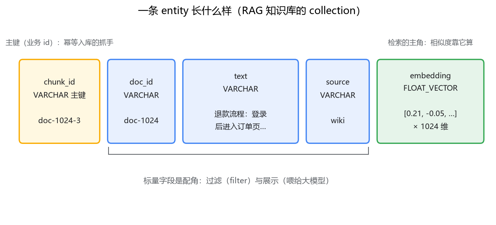
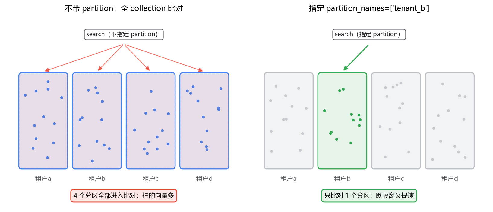

# 03 Collection 与 Schema

## demo 能跑，为什么还要学建表

上一篇的 quick setup 一行 `create_collection` 就把表建了，schema 是 Milvus 替你生成的：int64 主键叫 id，向量字段叫 vector，维度你说了算，其他没有了。原型阶段这样最爽。但真给知识库建模，你马上会撞上三个问题：业务主键和自动 id 怎么配合？向量维度写多少？数据要不要按租户切分？这三个问题正好是这一篇的主线。

先对齐术语。Milvus 的 **collection** 对应 MySQL 的表，**entity** 对应行，**field** 对应列。（2.3 起还有 database 一层，对应"库"，中小规模项目一层 collection 足够，本文不展开。）类推到这里就得刹车，因为 Milvus 的表和 MySQL 的表有一个根本区别：**整张表围绕向量字段组织**。MySQL 表的主角是主键和业务列，索引是加速手段；Milvus collection 的主角是向量字段，所有相似度检索都围绕它发生，其他标量字段要么是它的注脚（展示用），要么是它的过滤器（过滤用）。建表思路因此不同：先想清楚向量怎么检索，再补其他字段。

## 一、先看一张真实的表：RAG 知识库的 schema

一个典型的知识库 collection 长这样：

```python
from pymilvus import MilvusClient, DataType

client = MilvusClient(uri="http://localhost:19530")

schema = client.create_schema(auto_id=False, enable_dynamic_field=False)
schema.add_field("chunk_id",  DataType.VARCHAR, max_length=64, is_primary=True)
schema.add_field("doc_id",    DataType.VARCHAR, max_length=64)
schema.add_field("text",      DataType.VARCHAR, max_length=4096)
schema.add_field("source",    DataType.VARCHAR, max_length=64)
schema.add_field("embedding", DataType.FLOAT_VECTOR, dim=1024)

index_params = client.prepare_index_params()
index_params.add_index(field_name="embedding",
                       index_type="FLAT", metric_type="COSINE")
client.create_collection("kb_docs", schema=schema, index_params=index_params)
```

逐行看含义。chunk_id 是"文档 id + 切片序号"拼出来的业务主键（为什么不用自增，第二节讲）；doc_id 标记这条切片来自哪篇文档，删文档、重灌文档时用得上；text 是切片原文，检索命中后拿它去喂大模型；source 是来源字段，将来做权限过滤；embedding 是主角，1024 维，来自 bge-large-zh-v1.5（为什么是 1024，第三节讲）。索引先用了 FLAT——就是第 1 篇说的暴力检索，建索引和选索引是第 5 篇的事，这里先让它能跑。

字段类型对照 MySQL 盘一下：主键只支持 **INT64 和 VARCHAR** 两种；标量有各宽度整数、FLOAT/DOUBLE、BOOL、VARCHAR（必须给 max_length）、**JSON**（放不固定的元数据很方便，但过滤性能不如定长列——和你在 MySQL 里掂量"要不要用 JSON 列"是同一种权衡）；另有数组类型。向量字段本身有几种：FLOAT_VECTOR 最常用；BINARY_VECTOR 省空间但场景少；2.4 起还有 SPARSE_FLOAT_VECTOR（稀疏向量，给混合检索用，专栏四会再见到）和 FLOAT16/BFLOAT16_VECTOR（半精度，省内存）。

一个必须提醒的点：**老版本的 VARCHAR 不是文本检索字段**。它没有分词和倒排，只能做精确匹配、前缀匹配这类过滤。想对 text 做关键词全文检索，得靠 ES——这正是这个专栏两条腿走路的原因之一。（2.5 起加入了基于 BM25 的全文检索，比较新，采用前先验证你手上的版本行为。）



## 二、主键与 auto_id：像 MySQL 自增主键，坑却不在同一处

auto_id=True 等价于 MySQL 的自增主键：服务端生成，insert 不用传。听着省事，但 RAG 场景我建议默认不用。要想清楚一件事：Milvus 的主键不是"为业务 id 镜像生成的技术 id"，**它就是这份数据的 id 本身**。用了 auto_id，id 是插入后才拿到的 int64，你想按业务逻辑更新、删除某条数据时（比如源文档改了，要重灌某个 chunk），手里没有抓手——除非另外维护一张"业务 id → milvus id"的映射表。为省一个字段，引入一张映射表，不划算。

而 RAG 场景天然有业务主键：doc_id 加切片序号，拼成 `doc-1024-3`。用它做主键，好处立刻兑现：导入脚本可以幂等重跑，配合 upsert，重复执行不会越跑越多。

这里有个和 MySQL 很不一样、必须单独拎出来的行为。往 MySQL 里 insert 一个已存在的主键，报 Duplicate entry，事务回滚；往 Milvus 里 insert 一个已存在的主键，不报错，会出现同主键的多条 entity，查询时命中哪条不保证（不同版本、不同一致性下行为有差异）。要"存在则覆盖"的语义，用 upsert（2.3 起提供），不要依赖重复 insert 的行为。总结成一句：**MySQL 用唯一键冲突帮你拦住重复，Milvus 不拦，幂等要靠自己设计主键加 upsert**。

## 三、维度：必须在建表前定死、而且改不起的数字

dim 必须精确等于 embedding 模型的输出维度，差一维都插不进去。几个常见模型的输出维度：bge-large-zh-v1.5 是 1024，bge-m3 是 1024，m3e-base 是 768，OpenAI 的 text-embedding-3-small 是 1536。建表前先跑一行 `len(model.encode("测试"))` 把维度量出来填进去，别抄文档。

你可能会问：先随手建个大点的 dim，以后换模型再说？这条路在 MySQL 里走得通——改列长度是个 ALTER，顶多锁表重建。在 Milvus 里 dim 建完不可改；就算你重建一个新 collection，事情也远没有"改表"轻：**换模型不是改表结构，是重算全表数据**。不同模型的向量空间互不兼容——A 模型给"退款"的方向，和 B 模型给"退款"的方向，没有任何对应关系，两套向量混在一个空间里检索，结果就是噪声。所以换模型等于全量数据重新 embedding 再重灌，100 万 chunk 就是几小时 GPU 时间，外加新老 collection 并存期间的双倍存储。

等价地说：**embedding 模型是 collection 定义的一部分，就像列类型是表定义的一部分**。所以模型选型不放在代码篇讲，放在下一篇数据入库的第一节专门讲。

## 四、partition：长得像 MySQL 分区表，动机不一样

partition 把一个 collection 的数据切成若干互不重叠的块，查询时可以指定只搜其中几块：

```python
client.search("kb_docs", data=[query_emb], limit=5,
              filter='source == "wiki"',
              partition_names=["tenant_b"])
```

它和 MySQL 分区表形似：都是按规则切表、查询时裁剪扫描范围。但动机要分清，不然容易误用。MySQL 分区主要为了**管理**——几亿行的大表，分区让备份、删历史数据、部分 DDL 变得可行，查询裁剪只是顺带的好处；Milvus 的 partition 首先是一个**检索裁剪**工具。最典型的场景是多租户：每个租户一个 partition，查询带上 partition 名，其他租户的数据根本不进比对范围——既是隔离（和 filter 双保险），也是提速（要扫的向量少了）。

什么时候真的有用？给你两个判断基准：

- **数据天然分块、查询只碰其中一块**：多租户是最标准的场景；按时间切也行（月度知识库，旧数据整块 drop，比 delete 千万行优雅得多，这点和 MySQL 分区删历史数据的理由一样）。
- **单纯"数据多"不是理由**：Milvus 内部本来就会把大数据切成 segment 分布到多节点，partition 解决的是逻辑隔离，不是物理大小。单一数据源、查询永远全库搜的场景，硬切 partition 只是徒增管理动作。

两个注意点。其一，partition 数量有上限（2.x 默认 4096，随版本配置变化，用前查你版本的默认值），拿它做"每用户一个分区"之前先数数用户量级。其二，如果确实要做租户隔离且租户多，2.3 起有 **partition key**：指定一个标量字段，Milvus 自动按哈希分 partition，写入自动路由、查询自动裁剪，省去手建几千个 partition 的尴尬。



## 最后，总结

- collection 约等于表、entity 约等于行、field 约等于列，但整张表围绕向量字段组织：先定向量怎么检索，再补标量字段。
- 主键建议用业务 id（doc_id 加切片序号）而不是 auto_id；Milvus 不替你拦重复主键，幂等入库靠"业务主键 + upsert"。
- dim 必须和 embedding 模型输出严格一致，建后不可改；换模型等于全量重灌——模型选型是 schema 设计的一部分，不是代码细节。
- partition 形似 MySQL 分区表但动机不同：MySQL 为管理大规模单表，Milvus 为检索裁剪和逻辑隔离。多租户、按时间分块有用，"数据多"本身不是理由。

表建好了，下一篇灌数据：embedding 模型怎么选、批量怎么导、COSINE / L2 / IP 怎么定——第 1 篇欠下的那三个缩写，该兑现了。
