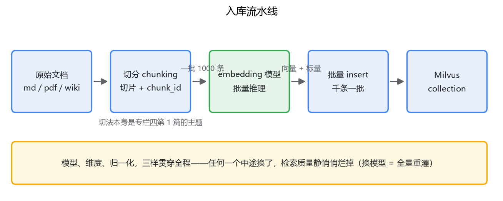
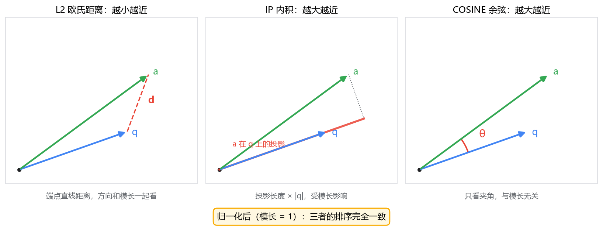

# 04 数据入库

## 坐下来灌数据，第一个要拍板的不是代码

Schema 建好了，导数据的活儿摆在面前。后端的直觉是写个批量任务：读文档、调模型、insert，三步完事。真坐下来写会发现，第一个要拍板的不是代码结构，是**embedding 模型选哪个**——上一篇说过，它决定 dim，而且一旦灌进去，换模型就是全量重灌。模型选型才是入库流程的第一步，我们就在这停留一节。

## 一、embedding 模型怎么选

先盘候选。中文场景，眼下主流的几个：

- **bge-large-zh-v1.5**（智源 BAAI 开源）：1024 维，文本上限 512 token，开源可本地部署，中文检索效果过硬，是中文 RAG 事实上的默认起步选择。
- **bge-m3**：1024 维，文本上限 8192 token，多语言；一个模型能同时输出稠密向量和稀疏向量，稀疏那一路将来做混合检索用得上（专栏四再碰面）。
- **m3e-base**：768 维，更轻，效果略逊于 bge。
- **API 类**：OpenAI text-embedding-3-small（1536 维）/ large（3072 维）、阿里 text-embedding-v3 等。省 GPU、开箱即用，代价是数据出内网、按量付费、有速率限制。

怎么选？给你一个比"看榜单"更可操作的判断框架，按顺序过：

1. **语言**。纯中文，bge-zh 系；中英混排或多语言，bge-m3。
2. **维度，也就是内存**。100 万 chunk × 1024 维 × 4 字节 ≈ 4 GB 裸向量，建了 ANN 索引还要再吃一份（第 5 篇细讲）。维度从 768 涨到 1536，内存翻倍，效果未必翻倍。
3. **文本长度上限**。bge-zh 系 512 token，超长 chunk 会被截断，截断就是信息丢失。文档切片普遍在几百字，bge-zh 够用；整篇长文档不切就 embed 的场景，选上限 8192 的 bge-m3。
4. **部署条件**。有 GPU，用 sentence-transformers 本地起服务，数据和延迟都在自己手里；没有，走 API。
5. **榜单只是初筛**。MTEB / C-MTEB 榜单分能帮你排除明显差的，但榜分是通用任务的均值，不是你的 query-doc 分布。认真做的做法是拿自己业务的两三百条真实问答对做小规模评测，度量方法在专栏四第 4 篇讲。

定了模型，怎么调？以 bge-large-zh-v1.5 为例：

```python
from sentence_transformers import SentenceTransformer

model = SentenceTransformer("BAAI/bge-large-zh-v1.5")

# 文档侧：直接编码
doc_embs = model.encode(texts, normalize_embeddings=True, batch_size=64)

# 查询侧：bge 系列约定要加检索指令前缀（文档侧不加）
query_emb = model.encode(
    ["为这个句子生成表示以用于检索相关文章：怎么退货"],
    normalize_embeddings=True,
)[0]
```

两个细节，漏一个效果就打折。一是 `normalize_embeddings=True`，把向量归一化成模长 1——这就是第 1 篇说"文本向量通常模长相等"的来源，也和下一节的 metric 选择直接相关。二是 bge 系列**检索场景的查询侧要加指令前缀**，这是模型训练时的约定，model card 里写明了的；换别的模型，先查它的文档。

## 二、批量入库：三层批量化

朴素写法是逐条处理：读一条、embed 一条、insert 一条。慢在哪？每条 insert 一次网络往返，proxy 被小请求打满；模型也没吃到批量吞吐——GPU 上一条一条推理和一批一批推理，吞吐差一个数量级。所以批量化要在三层同时做：

```python
from tqdm import tqdm

BATCH = 1000
for i in tqdm(range(0, len(chunks), BATCH)):
    batch = chunks[i:i + BATCH]
    embs = model.encode([c["text"] for c in batch],
                        normalize_embeddings=True, batch_size=64)
    rows = [
        {"chunk_id": c["chunk_id"], "doc_id": c["doc_id"],
         "text": c["text"], "source": c["source"],
         "embedding": emb.tolist()}
        for c, emb in zip(batch, embs)
    ]
    client.insert("kb_docs", rows)   # 要幂等重灌就换成 upsert
```

- **embedding 层**：一批 64~256 条喂给模型，吃满 GPU 吞吐。
- **insert 层**：几百到几千条一个请求，一次网络往返摊给一千条数据。单请求 payload 别太大，遇到报错就把批调小。
- **任务层**：整个流程做成幂等可重跑的任务——业务主键加 upsert 保证重跑不产生重复数据，中途挂了从断点续灌。

另外两个新手常踩的点。一是别频繁手动 flush：insert 之后数据立刻就在消息队列里了，查询节点从增长中的 segment 就能搜到它；flush 管的是后台把数据密封成文件的动作，频繁小 flush 只会制造一堆碎 segment 给后台合并添堵（growing segment、sealed segment 的机制，专栏三第 6 篇展开）。二是 insert 完立刻查不到的老问题，第 2 篇说过，一致性级别控制，不是丢数据。

整条流水线里，**模型、维度、归一化**三样东西从头贯穿到尾：建表时的 dim、写入时的 embedding、查询时的查询向量，必须出自同一个模型、同一种归一化。中途任何一个变了，检索质量就静悄悄地烂掉——不报错，只是结果变差，这种问题排查起来最疼。



## 三、metric_type：COSINE / L2 / IP 怎么定

建索引时要指定度量方式。三个候选，先把各自的含义摆正：

- **L2（欧氏距离）**：两个向量端点之间的直线距离，越小越近。它同时看方向和模长。
- **IP（内积）**：点积，越大越近。受模长影响——模长大的向量天然占便宜，两个方向一致但模长不同的向量，内积差很远。
- **COSINE（余弦）**：第 1 篇讲的那个，只看方向，越大越近。

文本语义检索，默认 **COSINE**。理由第 1 篇已经铺好：文本 embedding 的信息在方向上，模长是干扰项。而且模型做了归一化（模长全是 1）之后，这三者其实**排序完全一致**——余弦等于内积，L2 的平方等于 2 − 2 × cos，单调对应。所以对归一化的文本向量，选哪个都不影响排序；选 COSINE 只是语义最直白，也最不怕将来换一个不做归一化的模型时踩坑。



那另外两个什么时候用？记住一条原则：**metric 不是可以自由调的检索参数，它是模型的一部分**。模型用什么度量训练，就用什么度量检索：有些推荐系统、图像检索的模型训练目标就是最大化内积（向量没做归一化），就得用 IP，这时候硬上 COSINE，等于把模型学到的几何结构拧歪了。判断方法很朴素：模型发布的 model card 写什么就用什么；没写、又是通用文本 embedding，归一化加 COSINE 是最稳的默认。

最后两个实操注意。metric_type 在建索引时指定，改度量方式要删索引重建——数据不用重灌，向量本身没变，变的只是比对方式。以及查询时不需要再传 metric，schema 里定过就是它；忘了这一点的人会在 SDK 里到处找"搜索时指定度量"的参数，找不到还以为缺了配置。

## 最后，总结

- 入库第一步是选 embedding 模型：语言、维度（内存）、长度上限、部署条件四条依次过，榜单只当初筛。中文起步选 bge-large-zh-v1.5，长文档选 bge-m3。
- 调模型两个细节：normalize_embeddings=True；bge 查询侧的指令前缀。
- 批量化做三层：模型层批量推理、insert 层千条一请求、任务层幂等可重跑。别频繁 flush，数据可见性由一致性级别决定。
- COSINE / L2 / IP 里，文本场景默认 COSINE；归一化后三者排序等价；其他模型按 model card 指定的来——度量方式跟着模型走，不跟着感觉走。

到这里，数据在库里了，检索也通了。但 FLAT 是第 1 篇里"百毫秒级"的暴力检索，数据量一上去就得换 ANN 索引——下一篇讲 FLAT / IVF / HNSW / DiskANN 怎么选，nprobe、ef 这些参数调的到底是什么。
