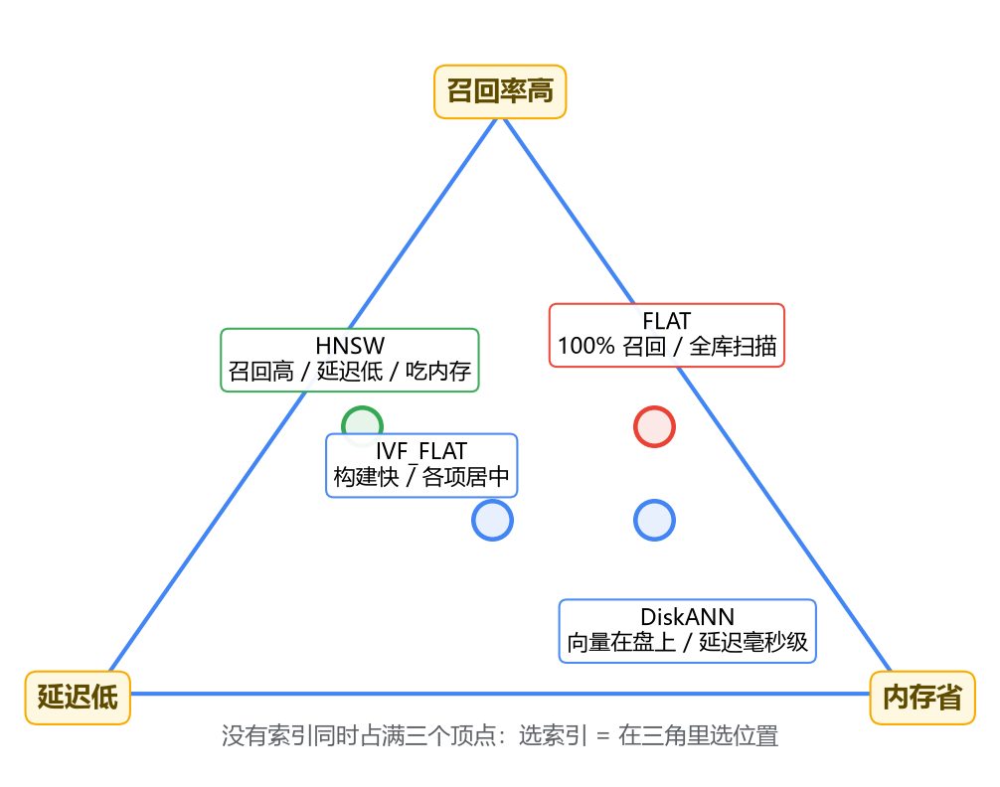
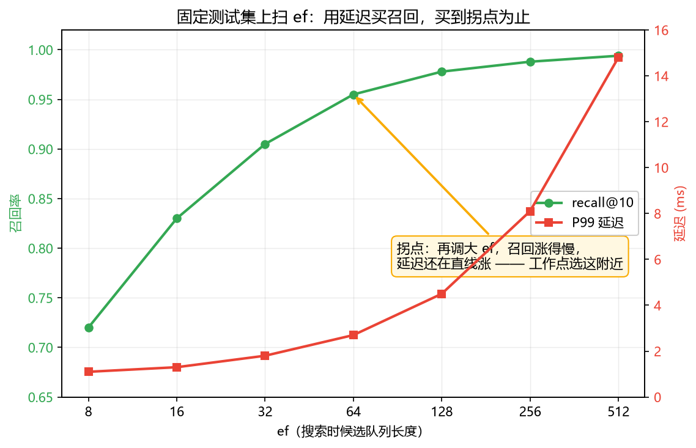

# 05 索引与搜索参数

数据灌进去了，搜索跑通了，demo 效果也不错。然后现实来了：知识库从 5 万条 chunk 涨到 200 万条，一次搜索从十几毫秒变成小一秒；或者 collection 一 load，内存直接顶到警戒线。你翻文档，看到 FLAT、IVF_FLAT、HNSW、DiskANN 四个索引名字，旁边还趴着 nlist、nprobe、M、efConstruction、ef 一堆参数，教程末尾统一写着"根据实际情况调整"。

根据什么实际情况？往哪调？这一篇就把这两个问题讲透。

## 先打破一个从 MySQL 带来的预期

你可能在 MySQL 里养成了一种直觉：查询慢了就建索引，建完就快了，而且结果一个不少。这个直觉到 Milvus 这里要先修正一半，因为向量索引是用**"丢掉一部分结果"换速度**的。

MySQL 的 B+ 树是精确索引：它缩小扫描范围的方式，从数学上保证不漏掉任何满足条件的行。向量索引是**近似**索引（ANN，Approximate Nearest Neighbor，名字里的 Approximate 已经把话挑明了）：它也缩小比对范围，但代价是可能错过真正的最近邻。为什么高维向量没法用 B+ 树那一套排序？简单说，B+ 树靠"维度上的有序性"来二分，一维有效，两维就开始勉强，768 维的向量空间里"左边右边"这个概念根本不存在。具体的机理不展开，你只需要接受这个结论：向量检索的世界里，"快"和"全"天生是一对矛盾。

于是 Milvus 的世界里多了一个 MySQL 里不存在的指标——**召回率（recall）**。搞清楚了这一点，看那四个索引的姿势就变了：不是问"哪个最快"，而是问每个索引在**召回率、延迟、内存**这三个维度上各站在哪。



这张三角图先留个整体印象，下面逐个展开。

## 一、FLAT：先看清没有索引的世界

FLAT 就是暴力比对：每条查询和库里的每一条向量都算一次距离，算完排序。你在 MySQL 里管这叫全表扫描，在 Milvus 里它叫 FLAT 索引——本质上是一回事，只不过没人给 `LIKE '%x%'` 起个索引名。

它的好处是**100% 召回**，因为它就是标准答案本身。任何 ANN 索引的召回率，都是拿 FLAT 的结果当尺子量出来的。记住这一点，后面验证调参效果时会用到。

什么时候用它？数据量小的时候。多小算小？给个数量级感受：几万条、768 维以内，单次查询在几十毫秒内，多数场景可以接受。别急着觉得 FLAT 土——它不需要任何调参，结果精确，数据量没到瓶颈之前，它是工程上最省心的选择。类比一下：你不会给一张 100 行的表建 B+ 树索引。

## 二、IVF_FLAT：先分桶，只搜最近的几个桶

数据量上去了，暴力比对撑不住，怎么办？最直觉的优化思路：能不能别跟全库比，先粗筛一遍？图书馆早就这么干了——按类目分区，查"机器学习"的书直接去科技区，没人会从文学区开始翻。

IVF 就是这个思路的工程化。建索引时，把全库向量聚成 nlist 个簇（本质是 k-means 聚类，细节留给专栏三）；搜索时分两步走：先算查询向量和 nlist 个簇心的距离，挑出最近的 nprobe 个桶，然后只在这 nprobe 个桶内部逐一比对。

这里有一个和 MySQL 分区"似是而非"的地方，必须点破。按 id 范围分区是**精确**的：`WHERE id BETWEEN 1 AND 1000` 落在哪个分区，是确定性的，不会漏。IVF 的桶是**聚类**出来的：一个向量被分到哪个桶，看它离哪个簇心近。簇边界附近的向量就尴尬了——它自己的真近邻可能散落在隔壁好几个桶里。nprobe = 1 等于赌"目标的真近邻都在最近的那个桶"，赌输一次就漏一个结果。IVF 的召回率损失就是从这来的。

所以 IVF 有两个关键参数，作用时机完全不同：

- **nlist**：建索引时定，簇的数量。改它要重建整个索引。经验起点是 `4 * sqrt(N)`（N 为向量总数），N = 100 万时大约 4000。
- **nprobe**：**搜索时**传，每次查询探查多少个桶。随搜随调，不用动索引。

```python
# 建索引（pymilvus 2.4.x，Collection 风格，客户端细节下一篇细讲）
index_params = {
    "index_type": "IVF_FLAT",
    "metric_type": "IP",          # 内积；2.3+ 也支持 COSINE
    "params": {"nlist": 2048},
}
collection.create_index(field_name="embedding", index_params=index_params)

# 搜索时调 nprobe
res = collection.search(
    data=[query_vec],
    anns_field="embedding",
    param={"metric_type": "IP", "params": {"nprobe": 32}},
    limit=10,
)
```

IVF_FLAT 在三角里的位置：构建速度快（这点经常被忽略，HNSW 建索引慢得多），内存中等（存原始向量加桶的划分关系，没有额外的图结构），召回和延迟居中。它适合数据量大但内存预算紧的场景。

## 三、HNSW：多层图导航

IVF 靠"先聚类再选桶"压缩比对范围，HNSW 走了另一条路：把所有向量连成一张**近邻图**，查询时在图上一步步贪心地往目标挪——每一步都走到"当前邻居里离查询向量最近的那个"，挪不动了，答案也就到了。

如果你用过 Redis 的跳表，HNSW 的结构能对上一个大概：跳表是在有序链表上叠加多层稀疏索引，查找从顶层往下走；HNSW 是在近邻图上叠加多层稀疏图，上层节点少、边跨得远，相当于高速公路，下层节点全、边密，相当于小路。搜索从顶层入口进入，快速逼近目标区域，逐层下沉，到最底层精修。

但这里有个本质差异，别让类比骗过去：跳表的每一层是**有序链表**，查找是确定性的，每步都能证明排除了正确的一半；HNSW 的每一步是**贪心选择**，只保证"当前邻居里最近"，没有任何全局保证，可能卡在局部最优点附近出不来。所以 HNSW 搜索时要留一个候选队列做冗余，这个队列的长度就是搜索参数 ef。多层图到底长什么样、为什么这套贪心居然有效，专栏三第 5 篇专门拆，这篇只需要记住它的行为特征。

HNSW 的参数比 IVF 多一个：

- **M**：建索引时定，每个节点最多连多少条边。越大图越稠密、召回越高、内存越大。常用 16~48。
- **efConstruction**：建索引时候选队列长度。越大建出来的图质量越好、建索引越慢。常用 100~500。
- **ef**：**搜索时**候选队列长度，必须不小于你要的 top-k。这是你日常调的旋钮。

行为特征三条：召回率上限高，ef 给够能压到 99% 以上；延迟低且平稳，通常在亚毫秒到几毫秒这个量级；内存开销是四个索引里最大的——不光存原始向量，还要存图结构，每条向量身上的边和指针粗算是 M × 2 × 4 字节的量级（粗略估计，专栏三细算账）。

代价换来的收益很实在：HNSW 是目前 RAG 知识库场景的默认选择，几万到几百万条 chunk 的量级，它几乎总是甜点位。

## 四、DiskANN：内存放不下的时候

HNSW 的软肋是内存：全量向量加图结构都得待在内存里。算一笔账就明白有多狠——200 万条、1024 维的 float 向量，光向量本体就是 200 万 × 1024 × 4 字节 ≈ 7.6 GB，再乘上图的放大系数，轻松翻倍。知识库再涨十倍呢？

DiskANN 的思路：内存里只放**压缩过的图**，完整向量放 SSD。搜索时在内存里导航，走到需要精确算距离的节点，才去盘上读。用磁盘的大容量换内存的紧张，代价是每次读盘的延迟——整体延迟比 HNSW 高一个量级，到毫秒、十毫秒级。

它适合的场景：数据量上亿、或者内存预算就是不够。搜索参数 search_list 控制候选队列大小，作用和 nprobe、ef 类似。有一点要注意：DISKANN 得跑在 SSD 上，机械硬盘扛不住这种随机读的模式。

## 五、到底怎么选

把上面四段收敛成一个决策顺序，按两个问题走：

1. **先算内存账**：向量数 × 维度 × 4 字节，再乘 1.5~2 估上索引开销，HNSW 大概需要这个数。放得下吗？
2. **数据量什么量级？**

- 几万条以内，或者需要精确结果（比如要给 ANN 调参建基准）——**FLAT**，省心且精确。
- 放得下内存、量级在百万上下——**HNSW**，RAG 知识库绝大多数落在这格。
- 放不下内存，但量级还没到天文数字——**IVF_FLAT**，构建快、内存中等，或者等学了量化压缩（专栏三）再回头看 HNSW。
- 上亿条、或者内存预算硬性受限——**DiskANN**，接受毫秒级延迟。

注意这不是"越大越高级"的排序，四个索引没有优劣，只有你在三角里选的位置。几万条数据硬上 HNSW，图还没建利索 FLAT 已经搜完了；反过来百万级数据硬扛 FLAT，每次查询都是全库扫描。

## 六、nprobe 和 ef：花钱买召回的两个旋钮

到调参环节了。先把这两个参数的物理意义统一掉：它们控制的都是**搜索时候选集留多大**。nprobe 是探查多少个桶，ef 是候选队列保留多少个点，本质一样——候选留得越多，真正的近邻被漏掉的概率越小，但每次查询的比对量也越大。

在 MySQL 里你找不到对应的旋钮，因为 B+ 树不丢结果，没有"召回"可调。调参感最接近的其实是布隆过滤器：条数开多一点，多花内存换低误判。这里是多花延迟换召回。

所以"ef 设多少合适"这个问题，等价于"你的业务愿意用多少毫秒换多少召回"。别人博客里的"ef = 64 是最佳值"直接照抄是不可靠的，他的数据分布、维度、量级跟你不一样。正确的做法是自己量。

方法四步，本质就是拿 FLAT 当标准答案，算 ANN 的得分：

1. **抽测试集**：从真实用户查询里抽 100~200 条（别拿灌库的文档凑数，查询和文档的分布不一样），连同它们 embedding 后的向量存下来。
2. **造标准答案**：在同一个 collection 上用 FLAT 跑一遍 top-k，结果存下来当 ground truth。
3. **扫参数**：待调参数取几档（比如 ef = 16 / 32 / 64 / 128 / 256），每档跑完同一批测试查询，记录两列数：recall@k 和延迟（看 P99，别只看平均值）。
4. **找拐点**：画曲线，找"召回增益明显放缓、延迟还在涨"的那个位置，就是你的工作点。

recall@k 的算法：ANN 返回的 top-k 和真实 top-k 取交集，除以 k。核心代码就这么多：

```python
def recall_at_k(ann_ids, truth_ids, k):
    return len(set(ann_ids[:k]) & set(truth_ids[:k])) / k

for ef in [16, 32, 64, 128, 256]:
    latencies, recalls = [], []
    for q in test_queries:
        t0 = time.perf_counter()
        hits = search(q, top_k=10, ef=ef)      # 封装后的搜索函数
        latencies.append(time.perf_counter() - t0)
        recalls.append(recall_at_k([h.id for h in hits], truth[q], 10))
    print(ef, "recall:", mean(recalls), "P99:", quantile(latencies, 0.99))
```

跑出来通常是这样一个形状：召回率先陡后缓，延迟基本线性往上走。拐点之前每一毫秒都买到了实打实的召回，拐点之后再调就是白烧延迟。



最后提醒一句：这个工作点是和数据绑定的。换了 embedding 模型、维度变了、数据量翻倍，曲线整个会挪位置，得重测。把这段验证脚本当成资产存下来，它是你后面所有索引决策的尺子。

## 最后，总结

把四个索引在三个维度上的位置收拢成一张表（量级感受，非精确值）：

| 索引 | 召回 | 延迟 | 内存 | 适用 |
|------|------|------|------|------|
| FLAT | 100% | 随 N 线性涨 | 低（仅向量） | 几万条以内、要精确结果 |
| IVF_FLAT | 中 | 中 | 中 | 量大且内存紧，构建快 |
| HNSW | 高（99%+） | 低且稳 | 最高 | 百万级、内存放得下，RAG 默认 |
| DiskANN | 中高 | 毫秒级（读盘） | 最低（向量在盘上） | 上亿条、内存受限 |

两个带走的判断：第一，向量索引和 MySQL 索引最本质的差异是有损，所以选索引永远是召回、延迟、内存三角里的位置问题，不存在全局最优；第二，nprobe 和 ef 不是玄学，是"花延迟买召回"的旋钮，值不值要用固定测试集对照 FLAT 量出来，而不是抄别人的配置。

至于 HNSW 的多层图凭什么又快又准还那么吃内存、IVF 的聚类细节、PQ/SQ 量化怎么在省内存和掉召回之间做交易——这些原理层的账，留到专栏三第 5 篇《ANN 索引原理》集中算。下一篇先回到工程现场，讲讲标量过滤：检索不只是找相似，权限和租户隔离也躲不开。
