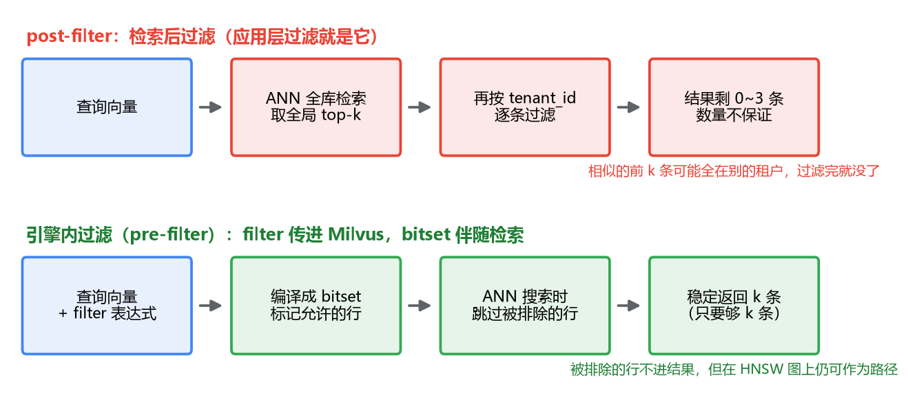

# 06 标量过滤与混合字段

知识库 RAG 上线第二天，安全团队找上门了：A 租户的客服在提问框里搜出了 B 租户的产品文档摘要，截图已经在外网群里传了。

你检查了 embedding、检查了 top-k、检查了 rerank，都没问题。问题出在一个你默认'检索之后再处理'的环节：权限。向量检索本身只认相似度，它不知道哪条数据属于谁、谁能看什么。检索如果只是"找相似"，这种事故只是时间问题。

这一篇讲的就是怎么把"谁能看什么"做进检索本身：标量字段怎么和向量字段混在一个 collection 里，filter 表达式怎么写，以及它在引擎内部和向量检索是怎么配合的——这里面有个 pre-filter 和 post-filter 的差别，理解了它，你才知道为什么过滤必须在引擎里做，而不是在应用层做。

## 一、先看一个错误的朴素方案

最直觉的做法是应用层过滤：照常检索 top-10，拿到结果后在 Java 里按 `tenantId` 筛一遍。

```java
List<SearchResult> hits = milvusSearch(queryVec, 10);
List<SearchResult> mine = hits.stream()
        .filter(h -> h.get("tenant_id").equals(myTenantId))
        .collect(toList());
```

逻辑上无懈可击，实际用起来会发现结果数量飘忽不定：有时候剩 3 条，有时候一条不剩。

原因值得掰开看。向量检索返回的是**全库**范围内最相似的 top-10——注意，是全库。如果 B 租户有一批文档和你的查询真的很相似（同行业的两家公司，文档相似太正常了），top-10 可能被 B 租户包圆，过滤完自然是零。你花了一次全库检索的钱，买到的是别人的答案。

你可能会说，那把 k 调大点，top-200 再过滤？这是在赌：赌你自己的数据里有足够多的条目挤进前 200。租户数据占比高时能蒙混过关，占比低时照样翻车，而且每次查询都白白多比对一堆最终要扔掉的结果。k 越大越安全，也越慢——这条路走到头就是暴力搜索。

问题的根子在于：过滤条件发生在检索之后，检索时引擎对它一无所知。要真正解决，得把条件送到引擎里去。在那之前，先解决一个前置问题：引擎得有地方放这些条件。

## 二、混合字段：向量旁边站标量

前几篇灌数据时我们聚焦在向量字段上，真实的 schema 一定是混合的：向量字段管相似，标量字段管归属和状态。给一个知识库的典型设计：

```python
from pymilvus import CollectionSchema, FieldSchema, DataType

fields = [
    FieldSchema(name="id", dtype=DataType.INT64, is_primary=True, auto_id=True),
    FieldSchema(name="tenant_id", dtype=DataType.VARCHAR, max_length=64),   # 租户
    FieldSchema(name="dept", dtype=DataType.VARCHAR, max_length=64),        # 部门，权限的二级粒度
    FieldSchema(name="visibility", dtype=DataType.VARCHAR, max_length=16),  # public / dept / private
    FieldSchema(name="created_at", dtype=DataType.INT64),                   # 时间过滤
    FieldSchema(name="embedding", dtype=DataType.FLOAT_VECTOR, dim=768),
]
schema = CollectionSchema(fields, description="知识库 chunk")
```

对照 MySQL 看，这个 schema 没有任何新东西：主键、若干业务列、一个放向量大 blob 的列。区别在用法上——MySQL 里你不会对 blob 列做 WHERE，Milvus 里整个 collection 的检索主入口恰恰是这个向量列，标量列的角色从"查询主体"降级成了"检索约束"。

有个容易忽略的设计提醒：把所有可能在检索时要用的条件想清楚，**一次建进 schema**。Milvus 2.x 支持开 `enable_dynamic_field` 往后塞计划外的字段（也能参与过滤），但显式定义的字段在存储和过滤上都更规整，版本演进中的行为也更稳。schema 变更的成本不低，宁可在设计期多想一步。

字段有了，条件怎么写进查询？这就轮到 filter 表达式出场了。

## 三、filter 表达式：长得像 WHERE，命运不同

先看写法。pymilvus 2.4.x 里，搜索时把表达式传进去：

```python
res = client.search(
    collection_name="kb_chunks",
    data=[query_vec],
    filter='tenant_id == "t_123" and visibility in ["public", "dept"]',
    limit=10,
    output_fields=["tenant_id", "visibility"],
)
```

常用的算子和 SQL 高度一致：`==`、`!=`、`>`、`>=`、`in`、字符串的 `like`，用 `and` / `or` / `not` 组合。权限场景的表达式通常长这样：

```
tenant_id == "t_123"                                  # 租户隔离，每次查询必带
tenant_id == "t_123" and dept in ["sales", "legal"]   # 部门级权限
visibility == "private" and owner == "u_9527"         # 个人文档只归本人
created_at >= 1735689600                              # 时间窗口
```

写着写着你会有一种错觉：这不就是 WHERE 吗？语法确实像，但有一个根本差异，正是这一篇的核心——SQL 的 WHERE 和打分是两阶段先后的关系，而 Milvus 的 filter 和向量检索是**交织在一起执行**的。这个差异落到工程上就是接下来要讲的 pre-filter 和 post-filter。

顺带认识一个和 search 并列的接口：`query()`。它不带向量，纯按标量表达式取数据——`client.query(collection_name="kb_chunks", filter='tenant_id == "t_123"', output_fields=["id"])`。对照着记：search 是 kNN 的入口，query 是 SELECT 的入口。知识库全量下线某个租户、跑数据对账、按条件删除前先查 id，用的都是它。

## 四、pre-filter 和 post-filter：过滤的时机决定结果

现在回答开头那个事故的根源问题。过滤条件有两种挂进检索流程的时机，效果天差地别。

**post-filter（检索后过滤）**：引擎先做完整的向量检索，返回全局 top-k，然后过滤。这就是第一节应用层过滤的引擎版，同样的病：结果数量不保证，可能不足 k 条甚至为空，因为相似度排名靠前的数据可能全被过滤条件挡在门外。

**pre-filter（检索前过滤）**：先用标量条件筛出允许参与检索的行，再在这个子集里做向量检索。结果数量有保证——只要符合条件的行够 k 条，就返回 k 条。

两者的差别画出来一目了然：



那 Milvus 2.x 实际是哪一种？答案是**效果上等价于 pre-filter**，实现上比"先筛再搜"更巧一点：引擎先把 filter 表达式编译成一个 **bitset**（每个数据行一个 bit，1 表示允许参与检索，0 表示排除），搜索时拿着这个 bitset 走——被标 0 的行永远不进结果。你不用在两种模式里选，`filter` 参数传了就是这个行为（以 2.3/2.4 的实现为准，内部细节随版本还在演进）。

这里有个 HNSW 特有的暗坑，值得多说两句，因为它解释了为什么"先筛再搜"不是想象中那么简单。HNSW 是图索引，搜索靠在图上一步步导航。如果 pre-filter 真的把不满足条件的行**从图里删掉**，图就可能断成几截——导航走到一半发现路没了，明明存在满足条件的近邻却够不着。所以带过滤的图遍历要做特殊处理：被过滤的行不能作为**结果**，但仍可以作为**路径**，路过它继续往前走。这是"过滤条件下图检索"这个领域的经典难题，各家引擎的解法细节不同，你知道这个坑的存在、明白为什么不能简单删点，就够了。

还有一个实践层面的选择问题：过滤的选择性。如果一个条件把数据过滤掉 99%，比如十万条里只有一千条属于这个租户，让 ANN 索引在只有 1% 有效的数据上导航，效率不会好看。这种"每条查询必带、且天然互斥"的条件，Milvus 有更对口的机制——下一节讲。

## 五、租户隔离：filter 不是唯一的工具

专栏二第 3 篇讲过 partition：collection 里的物理分区，搜的时候指定分区，其他分区的数据完全不碰。多租户场景下它比 filter 更狠——filter 是"检索时逐行检查"，partition 是"物理上根本不碰"。

但手工管 partition 很繁琐：新租户入驻要建分区、查询时要自己算分区名。Milvus 2.3+ 提供了 **Partition Key**，把这件事自动化了：

```python
FieldSchema(name="tenant_id", dtype=DataType.VARCHAR, max_length=64,
            is_partition_key=True),   # 声明这个字段是分区键
```

建 collection 时标上 `is_partition_key=True`，写入时 Milvus 按字段值自动把数据路由到对应分区；查询时表达式里带上 `tenant_id == "..."`，引擎自动只搜那个分区。你不用再感知分区的存在。

要注意 partition 数量是有上限的（默认上千的量级，具体数值随版本可配），租户数超出时 Milvus 会把多个 key 哈希进同一个分区。所以租户规模特别大时，"partition key 隔离物理分区 + filter 兜底"两者叠加是更稳的组合，反正 filter 的表达式你本来就要写。

现在手里有两件工具，什么时候用哪件？按条件的性质分：

- **每条查询必带、取值互斥的条件**（租户、环境）——用 partition key，物理隔离，检索快。
- **灵活组合的业务条件**（时间范围、文档类型、关键词标签）——用 filter，表达力强。

两者不冲突，一次查询可以同时用：partition key 圈定租户的地盘，filter 在地盘里继续筛。

最后补一句过滤自身的开销。filter 表达式要在数据行上求值，数据量大了这也是一笔扫描成本，标量字段同样可以建索引来加速（不同版本支持的标量索引类型不同，2.4 起统一走向倒排索引，具体查你所用版本的文档）。经验上：数据量到百万级、且过滤字段的选择性不错时，给标量字段配索引是值得的。

## 最后，总结

这一篇的靶心是：检索不只是找相似，权限和租户隔离必须做进检索本身。

- **应用层过滤是错误方案**：向量检索在全局找相似，过滤后结果数量没有保证，你的 top-k 可能整批属于别人。
- **schema 要混合设计**：向量字段旁边把 tenant_id、权限、状态、时间这些标量字段一次建全，它们是检索约束的载体。
- **filter 传进引擎，效果等价于 pre-filter**：Milvus 2.x 把表达式编译成 bitset，搜索时排除无效行。语法像 WHERE，但执行时机和向量检索是交织的，不是先后两阶段。
- **HNSW + 强过滤有暗坑**：被过滤的点要保留作路径，理解这点你才明白引擎在做多难的事。
- **租户隔离优先用 partition key**（2.3+）：每查询必带的互斥条件走物理隔离，灵活业务条件留给 filter，两者可叠加。

写到这里，检索这条链路上的概念基本齐了：schema、入库、索引、过滤。但前面几篇的代码一直零敲碎打——pymilvus 和 Java SDK 到底该怎么正经地用进一个服务里？下一篇收尾客户端：连接管理、批量写入，以及和 Spring 工程集成时的几个关键决定。
