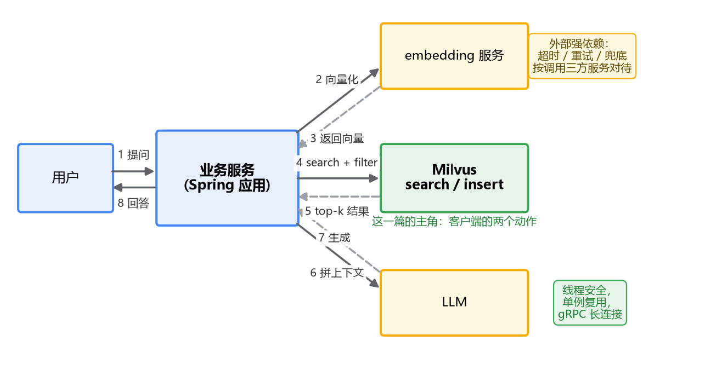

# 07 客户端使用

前面六篇，代码都是零敲碎打：一段建索引的片段、一段搜索的片段，剩下的操作在 attu 控制台里点点点也能完成。demo 阶段这么玩没问题，真要把 Milvus 接进服务，你面对的是另一组问题：连接怎么管理、collection 谁来建、插入怎么批量、代码放在工程的哪一层。

这一篇把客户端的正经用法收个尾。先说清楚适用版本：文中 API 以 **Milvus 2.4、pymilvus 2.4.x、milvus-sdk-java 2.4.x** 为准，2.3 基本通用，更早的版本差异请对照官方文档。

客户端要干的活，先在整体链路里定个位。一次 RAG 检索请求的完整旅程长这样：



这一篇的主角是图里"业务服务"手上那两个客户端调用：把向量送进 Milvus，把结果取回来。embedding 服务和 LLM 都是外部依赖，后面会看到这个定位对工程决策的影响。

## 一、pymilvus：认清两代 API，新代码用 MilvusClient

pymilvus 里现在并存两套写法，你在网上搜教程会看到两种风格混着来，先分清楚免得自我怀疑：

一套是老的 ORM 风格：`connections.connect()` 建全局连接，然后 `Collection("名字")` 拿对象操作。前几篇代码里为了聚焦主题用的多是这种，它能用，也还会被长期支持。

另一套是 2.4 起主推的 **MilvusClient**：一个对象包打天下，不依赖全局状态。新代码建议用它——没有全局连接这种隐式共享的东西，写单元测试可以随意起实例，连多个环境也不用担心串线。

基本套路一次走完，建库、灌数据、检索：

```python
from pymilvus import MilvusClient, DataType

client = MilvusClient(uri="http://localhost:19530")   # 连接

# 显式 schema（生产推荐；quick setup 一行 client.create_collection(name, dimension=768) 适合试验）
schema = client.create_schema(auto_id=True)
schema.add_field("id", DataType.INT64, is_primary=True)
schema.add_field("tenant_id", DataType.VARCHAR, max_length=64)
schema.add_field("embedding", DataType.FLOAT_VECTOR, dim=768)

index_params = client.prepare_index_params()
index_params.add_index(field_name="embedding", index_type="HNSW",
                       metric_type="IP", params={"M": 16, "efConstruction": 200})
client.create_collection("kb_chunks", schema=schema, index_params=index_params)

# 插入：list[dict]，一次一批
rows = [{"tenant_id": "t_123", "embedding": vec} for vec in batch_vecs]
res = client.insert("kb_chunks", data=rows)
```

搜索和过滤第 6 篇写过，这里补齐全貌：

```python
res = client.search(
    collection_name="kb_chunks",
    data=[query_vec],
    filter='tenant_id == "t_123"',
    limit=10,
    output_fields=["tenant_id"],
    search_params={"metric_type": "IP", "params": {"ef": 64}},   # 第 5 篇的调参落点
)
```

三个工程上必须心里有数的点。

**第一，插入要批量。** 逐条 insert 每次都是一个网络往返，几十万条 chunk 逐条灌，时间全花在 RTT 上。经验批量是几百到几千条一批，太大则单请求内存和超时压力大，又被拆分重传。数据管道里标准的分批写法（攒 batch、定时 flush）在这里照搬即可。

**第二，主键映射要自己管。** 上面 `auto_id=True` 时，`insert` 返回值里的 id 列表要接住，和业务侧的 chunk id 存好映射（存 MySQL 就行）。Milvus 不会替你回答"这条向量对应哪个文档的哪一段"，这个映射是后面把检索结果还原成文本、喂给 LLM 的依据。ES/Milvus 双库对齐的坑，专栏四还会回来算这笔账。auto_id 之外主键还能怎么选，下一节展开。

**第三，插入后立刻搜，可能搜不到。** 不是 bug。Milvus 2.x 默认的一致性级别是 Bounded（读到的数据允许有几秒的滞后），写入后马上查询，落在这几秒窗口里的数据看不见。联调时可以先给客户端指定 `consistency_level="Strong"` 消除困惑；线上要不要放松、放松到哪档，本质是可见性和吞吐的权衡，机制（growing segment、快照时间戳）在专栏三第 6 篇展开。

## 二、更新和删除：知识库不是只进不出的

demo 阶段的数据只灌不改，真实知识库不是这样：文档会修订，切分策略会调整，租户会下线。向量库得跟着动，pymilvus 里对应两个动作。

**删除**按表达式来，第 6 篇的 filter 语法直接复用：

```python
# 某个文档重新切分前，先清掉旧 chunk；或整个租户下线
client.delete("kb_chunks", filter='doc_id == "d_1001"')
client.delete("kb_chunks", filter='tenant_id == "t_dead"')
```

一个要有预期的事：删除是逻辑标记，删完磁盘空间不会立刻回来，要等后台的 compaction 合并数据段后才回收。对容量规划有影响，机制留到专栏三讲存储时展开。

**更新**用 upsert（2.3+ 引入）：按主键"有则覆盖、无则插入"。文档重新 embedding 之后，一批 upsert 就把旧向量换掉了，比"先查 id、再删、再插"省事得多：

```python
client.upsert("kb_chunks", data=[{"id": 1001, "tenant_id": "t_123",
                                  "embedding": new_vec}])
```

但注意 upsert 的前提：**主键必须由你来定**。回看第一节说的 `auto_id=True`——主键是 Milvus 自动生成的，你手里只有它返回给你的 id 列表，"用哪个主键去覆盖旧数据"这个问题在 auto_id 模式下没有答案，upsert 无从谈起。所以选主键策略时先想清楚数据会不会更新：

- 只进不出的日志型、快照型数据——auto_id 省心，插入时不用管唯一性。
- 会修订的知识库——业务侧生成主键（比如 chunk 的确定性 id），代价是插入前你自己保证不重，换来的是 upsert 一条路走到黑。

这个选择建库前就要定，它藏在 schema 的主键字段上，事后改的成本很高。

## 三、Java SDK：builder 风格的熟人

业务服务的主语言是 Java 的话，用的是 milvus-sdk-java。引入依赖时注意一点：**SDK 版本和 server 大版本对齐**，2.4.x 的 SDK 配 2.4.x 的 server，跨大版本混搭可能出现协议不兼容的怪问题。

较新版本的 SDK 提供 MilvusClientV2（和 pymilvus 的 MilvusClient 命名对齐，用法也接近）；老代码里常见的 `MilvusClient + ConnectParam` 是 V1 风格，能跑但新项目没必要再选它。以 V2 为例：

```java
// 连接：一次创建，全程复用（为什么不能每次请求 new，下一节说）
MilvusClientV2 client = new MilvusClientV2(
        ConnectConfig.builder().uri("http://localhost:19530").build());

// 检索
List<Float> queryVec = embeddingClient.embed(question);   // 向量化是外部服务的事
SearchResp resp = client.search(SearchReq.builder()
        .collectionName("kb_chunks")
        .data(Collections.singletonList(new FloatVec(queryVec)))
        .filter("tenant_id == \"t_123\"")
        .topK(10)
        .outputFields(Arrays.asList("tenant_id"))
        .build());

List<List<SearchResp.SearchResult>> results = resp.getSearchResults();
```

插入同样是 builder：`InsertReq.builder().collectionName("kb_chunks").data(rows).build()`，rows 是 JsonObject 的列表，批量原则和 Python 侧一致。DDL（建 collection、建索引、load）在 Java 里也都能做，但该不该由业务代码来做，值得单独拎出来说。

## 四、和 Spring 工程集成：四个关键决定

Java 侧的 API 本身没有惊喜，真正决定这套东西在工程里好不好活的，是下面四个决策。

**决定一：客户端做成单例 Bean，还是每次请求建一个？**

答案没有悬念：单例。MilvusClientV2 是线程安全的，底层是一条 gRPC 长连接，天然支持并发复用——这一点和 Lettuce 一样，和老版本 Jedis 那种"一个连接一个实例、池化才敢用"的模式不同，别把池化的老经验照搬过来。

```java
@Configuration
public class MilvusConfig {

    @Bean(destroyMethod = "close")
    public MilvusClientV2 milvusClient(
            @Value("${milvus.uri}") String uri) {
        return new MilvusClientV2(
                ConnectConfig.builder().uri(uri).build());
    }
}
```

反面对照很直观：每次请求 new 一个 client，等于每次都做一遍 TCP 建连和 gRPC 握手，QPS 一高连接和延迟一起爆。这和你不会在每次 Redis 命令前 new 一个连接是同一个道理。

**决定二：collection 和索引谁来管？**

省事的写法是应用启动时检查 `hasCollection`，没有就建一个。小项目无所谓，团队一多就有问题：两个服务都"顺手"建了 collection，参数不一致，谁覆盖谁？索引参数调整（比如第 5 篇调出来的 M 和 efConstruction）要改代码发版？

把 schema 和索引当 DDL 对待——你不会在业务代码里建 MySQL 表，同样不该在业务代码里建 collection。迁移脚本管理（Flyway/Liquibase 的思路，或简单的版本化脚本 + 启动执行器），业务代码只做增删查，schema 变更走发布流程。Milvus 本身没有内置等价 Flyway 的工具，用初始化 Job 或人工跑脚本都行，重点是"谁有权变更"要收口。

**决定三：embedding 调用按外部强依赖对待。**

回看开头的链路图：业务服务调的 embedding 服务挂了，Milvus 客户端写得再健壮也没用——搜都没得搜。向量化是这条链路上故障率最高的环节（模型服务、GPU 资源、超时），超时、重试、熔断这一套该配就配，失败时返回什么兜底结果要想清楚。Milvus 客户端自身的异常（连接拒绝、collection 未 load）反而简单直接，按基础设施故障处理即可。

**决定四：参数进配置中心。**

uri、一致性级别、ef 这类参数，放在配置文件里而不是写死在代码里。第 5 篇说过，ef 的工作点跟数据绑定，数据涨了要重调——重调的落地方式就是改配置，而不是改代码发版。你们的配置中心是哪家的都行，关键是调参的回路要短。

## 最后，总结

这一篇把"先会用"的最后一块补齐了：

- pymilvus 认清两代 API，新代码用 **MilvusClient**（2.4+）：一个对象管连接和操作，没有全局状态。
- 插入**批量**（几百到几千一批）、**主键映射自己管**（auto_id 返回的 id 存到业务库）、**插入后查不到先想一致性级别**（默认 Bounded 有秒级滞后，联调用 Strong）。
- 更新删除有讲究：**upsert 要求主键归业务管**，会修订的知识库别用 auto_id；删除是逻辑标记，空间等 compaction 才回收。
- Java 侧用 **milvus-sdk-java V2**，SDK 与 server 大版本对齐，builder 风格，client 线程安全。
- Spring 集成四个决定：**单例 Bean**、**schema/索引当 DDL 管理不进业务代码**、**embedding 按外部强依赖配好超时重试**、**参数进配置中心**。

到这里，专栏二"先会用"的目标算达成了：schema、入库、索引调参、标量过滤、客户端集成，一条链路走完。接下来两条路：急着出原型，直接跳专栏四搭 RAG 项目，遇到问题回来查；想把地基打深，进专栏三——为什么写入后要等一秒才查得到、HNSW 凭什么又快又准还那么吃内存，这些"凭什么"的问题，下一篇开始集中回答。
