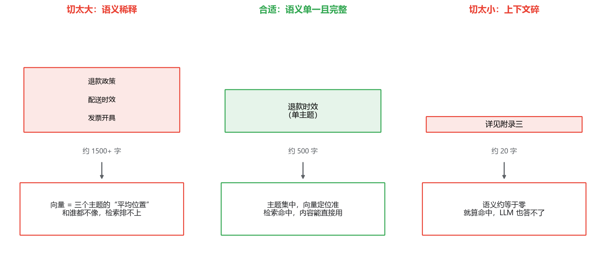
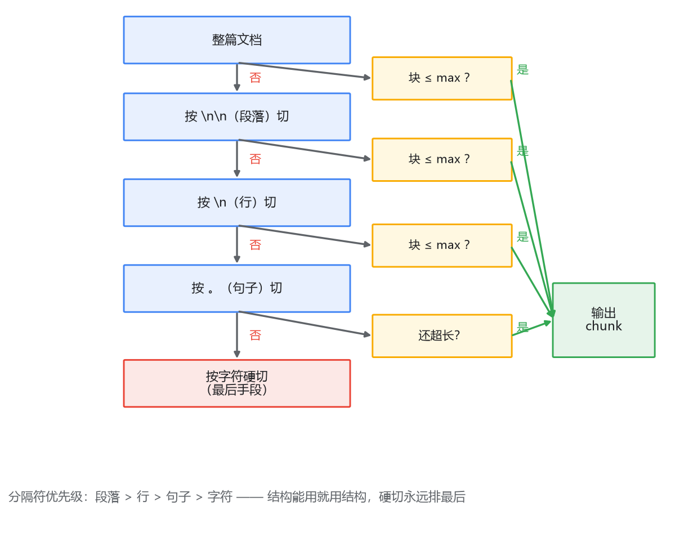
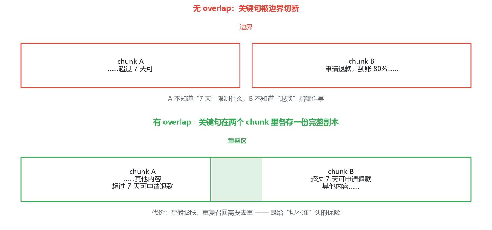

# 01 文档切分：切法对检索质量的影响，比索引算法还大

## 检索结果不对，先别怀疑索引

设想你走到了这一步：ES 集群跑起来了，IK 分词调好了；Milvus 的 Collection 建好了，HNSW 索引也选了。你把公司的售后政策文档灌进去，自己先测一轮——

问"超过 7 天还能申请退款吗"，BM25 一路召回了三段都带"7 天"字样的内容，其中一段讲的是配送时效；向量一路召回了一段讲"售后流程总览"的长文，看着相关，读完发现没有一句在回答你的问题。

这时候你的第一反应是什么？大概率是去调分词器、换 embedding 模型、把 `ef` 调大。都可能白费力气。先去看看你的 chunk 长什么样——我猜你会看到一块 2000 字的大块，里面混着退款、配送、发票三个主题；或者一堆几十字的小碎片，单独看谁都不知道在说什么。

问题出在**切分（chunking）**上。这一步在整条 RAG 链路里技术含量看着最低——不就是把长文档切成段吗——但它决定了后面所有环节的天花板。

为什么这么说？我们前面花了整整一个专栏讲倒排索引、HNSW、IVF，讲的是"在已有的数据表示上，怎么查得又快又全"。而切分决定的是**数据表示本身对不对**。这就像 MySQL：索引建得再精妙，你要是把十条业务记录揉成一个 BLOB 塞进同一列，查询照样是废的。表示错了，检索算法再先进也是在错误的表示上做优化。

## 一、切太大和切太小，各自坏在哪

切分的核心矛盾一句话就能说完：**chunk 既要语义完整，又要语义单一。** 违反前半句，检索到了也用不了；违反后半句，根本检索不到。

先看切太大。向量检索的原理，是把一段文本的全部语义压缩成一个固定维度的向量。假如一个 chunk 有 2000 字，讲了退款、配送、发票三个主题，那这个向量就是三个主题的"平均位置"。拿"退款政策"去查，这个平均向量和查询向量的相似度不上不下——它确实含一点退款语义，但被另外两个主题稀释了。排在它前面的，可能反而是某个只讲退款但内容浅的 chunk。这就是**语义稀释**。BM25 这边也没好到哪去：文档越长，词频被摊薄，而且 BM25 的长度归一（下一篇细讲）会直接惩罚长文档。

再看切太小。一个 chunk 只有"详见附录三"五个字，它的向量语义约等于零，检索基本不会命中它；就算碰巧命中了，你把它塞给 LLM，LLM 也不知道附录三说了什么。检索和生成两头都不讨好——这就是**上下文碎**。BM25 这边的问题是反的：短 chunk 里的词太少，没有区分度，稍微常见一点的词 IDF 压不住，容易混进噪声结果。

三种状态放在一起看：



中间那个"合适"是真实存在的区间，不是理论假设。经验上中文 300~800 字、以 token 计 256~512，大多数知识库文档落在这个区间里检索表现不会差。但注意这是起点不是结论——chunk_size 是个应该用评测集调的参数，怎么调是第四篇的事，这里先记住：**每次改切分策略，都要有办法量化它变好还是变坏，否则就是盲调。**

## 二、最朴素的方案：固定长度切分

顺着"控制大小"的直觉，最朴素的方案自然是固定长度：每 500 字切一刀，简单、可控、代码十行写完。

它的问题你也能一眼看到：**一刀切下去不管句子死活**。"7 天内可申请退款，逾期系统自动关闭入口"这句话正好横在边界上，前半句落在 chunk A 的结尾，后半句落在 chunk B 的开头。两个 chunk 单独看语义都不完整：A 不知道"7 天"限制的是什么，B 不知道"逾期"指哪件事。向量编码这种残句，两个方向的查询都可能漏掉它。

但固定长度不是一无是处。判断一个方案烂不烂，要看它面对的数据是什么样的：

- **纯文本、聊天记录、工单描述**这类天然无结构的内容，按结构切无从下手，固定长度反而是合理默认；
- **长度本身均匀**的内容（比如每条 200 字左右的客服话术），固定长度切出来天然就是完整的条目。

真正不能接受的是"对着一篇结构清晰的 Markdown 也硬切 500 字一刀"。有结构，就该用结构——这就引出第二种方案。

## 三、按结构切分：有结构就别浪费

Markdown 和 HTML 文档天然带着结构：标题层级、段落、列表。一篇售后文档里，`## 退款政策` 下面的内容，本身就是作者精心组织好的一个语义单元——作者写的时候就是按"这一节只讲退款"来组织的。**顺着作者的切分走，往往比我们用长度去硬切更贴近语义边界。**

但按结构切会立刻遇到两个新问题：

第一，**标题块可能太长**。一章 8000 字，按 `##` 切完还是一个 8000 字的 chunk，语义稀释的问题原样回来了。

第二，**标题块可能太碎**。有的小节就一行"具体以线下门店公告为准"，这种 chunk 进了向量库就是噪声。

所以按结构切分在实践中从来不是"见到标题就切一刀"，而是**以结构为首选边界、再套一层长度约束**：标题块超长就降级到段落再切，太短的块和相邻块合并。你看，这个描述已经和下一种方案长得很像了——它们本来就是一个方案的两半。

## 四、递归切分：默认从它开始

把"结构优先"和"长度兜底"正式组合起来的，是 **RecursiveCharacterTextSplitter**（LangChain 里的实现，别家工具也有等价物）。它的逻辑用一句话说：**按分隔符优先级从高到低切，切不动的块降级用下一级分隔符继续切。**

分隔符列表通常长这样：`\n\n`（段落）→ `\n`（行）→ `。`（句子）→ 空格 → 单字符。过程是：

1. 先按段落切开。所有段落都落在 min~max 之间，结束，这是最理想的情况；
2. 某个段落超过了 max，就把**这个段落**单独拿出来，降级用 `\n` 再切；还不行就降到句子；
3. 切完发现一堆碎块低于 min，就尝试把相邻的小块合并。

整个过程走下来，结构清晰的部分按结构切，没有结构的部分退到句子，实在不行才轮到硬切——硬切永远排在最后一位。这个降级过程值得一张图：



这就是为什么各种实践指南都推荐从递归切分开始：它不是最聪明的方案，但它在**大多数数据上都犯不了大错**。固定长度在无结构数据上表现好，按结构切在结构化文档上表现好，而递归切分在两者之间自动滑动。

参数上除了 chunk_size，还有一个 min_chunk_size（低于它就合并相邻块），设成 max 的 1/3 到 1/2 是常见起点。

## 五、overlap：留，还是不留

递归切分已经让大部分切口落在自然边界上了，但边界本身仍然会吞内容。设想关键句恰好压在两个 chunk 的分界上："超过 7 天可"是上一个 chunk 的结尾，"申请退款，到账 80%"是下一个 chunk 的开头——两个 chunk 各自语义残缺，这一条对"超过 7 天怎么退"的查询就废了。

**overlap（重叠）**就是给这个问题打的补丁：每个 chunk 向后多切 10%~20%，让边界附近的内容在两个 chunk 里各存一份。前一个 chunk 的结尾和后一个 chunk 的开头有一段重复，关键句总有一个完整版本存在：



代价也明摆着。第一，存储和索引直接膨胀一成到两成——50 个 chunk 变 60 个，ES 和 Milvus 都要多存多算。第二，**同一段内容会从两路召回里重复出现**，你还得写去重逻辑，不然 LLM 的上下文里塞两段一样的文字，白白浪费预算。

那到底留不留？给一个判断框架而不是标准答案：

- **硬切多、边界质量差**（无结构文本、固定长度切分），overlap 挡在边界上救命，留，10%~20% 或者干脆按句子数留 1~2 句；
- **按结构切、切口落在标题上**，很少从句子中间拦腰斩断，overlap 能救的很少，可以只留 0~5% 甚至不留；
- **去重逻辑写起来成本高**的话，倾向小 overlap——重复召回对上下文预算紧张的 RAG 是实打实的浪费。

一句话：overlap 是给"切不准"买的保险，切得越准，保费越不值。

## 六、chunk 元数据：切分之外的另一半工作

到这里，chunk 的"正文"部分讨论完了。但一个能用的 chunk 绝不只是 `{"text": "..."}`，它还得带元数据。最核心的四个字段：

```json
{
  "doc_id": "refund-policy-v3",
  "title_path": "售后政策 > 退款 > 退款时效",
  "chunk_index": 4,
  "text": "超过 7 天未超过 30 天的订单……"
}
```

为什么每个都要带上？分开看。

**doc_id（来源）**是溯源的依据。RAG 的答案要能给出"依据是什么"，没有 doc_id，LLM 说对了没法核对、说错了没法排查。它还有第二个身份：第五篇讲增量更新时，"文档变了怎么同步"全靠 doc_id 做删除和替换的主键，到时候它是主角。

**title_path（标题路径）**是被最多人忽略、又最便宜的一个。它有两个用途。一是拼进 embedding 的输入：`"售后政策 > 退款 > 退款时效\n超过 7 天……"`——标题里的词（"退款""时效"）恰好就是用户查询里最常出现的词，等于免费给向量加了一层语义锚点，对 BM25 更是直接的词面匹配加成，检索命中率通常都能涨一截。二是拼进最终给 LLM 的上下文：LLM 看到"这段话出自《售后政策》的退款时效一节"，理解准确度会好于裸文本。

**chunk_index（序号）**解决"找到一段之后"的问题：RAG 经常需要把命中 chunk 的前后邻居也带上（答案是"如上一段所述"时尤其需要），没有序号就无从找邻居。

再往上一层，权限、租户、部门这些业务标签如果需要，也应该是 chunk 的元数据——ES 用 filter、Milvus 用标量过滤，都是在 chunk 这一级做的隔离（专栏一和专栏二都讲过）。**切分的时候多带一个字段，检索的时候才有多一个开关可用**；切完再想补，就是全量重建的活。

## 最后，总结

这一篇讲的是链路里最不起眼、但决定天花板的一步：

- 切分决定数据表示，索引算法只在表示之上做优化——**切不对，后面全白搭**；
- chunk 要**语义完整且语义单一**：太大向量被稀释、BM25 被长度归一惩罚，太小上下文碎、检索生成两头不讨好；
- 三种切法：固定长度适合无结构数据，按结构切适合结构清晰的文档，**递归切分把两者组合起来，是默认起点**；
- chunk_size 不是玄学，是应该用评测集调的参数，经验起点 256~512 token；
- overlap 是给边界质量买的保险，硬切多就留 10%~20%，按结构切可以基本不留；
- **chunk 元数据和正文一样重要**：doc_id 管溯源和增量更新，title_path 免费提升检索命中率，chunk_index 支撑邻居扩展。

切分定了，数据的地基就定了。但地基打好了，怎么把两条检索路的结果拧到一起？下一篇我们先把 BM25 这个"用了一路却没拆开看过"的算法讲透，再回答一个绕不开的选型问题：ES 8.x 自带 kNN，什么时候单 ES 就够，什么时候值得引入 Milvus。
