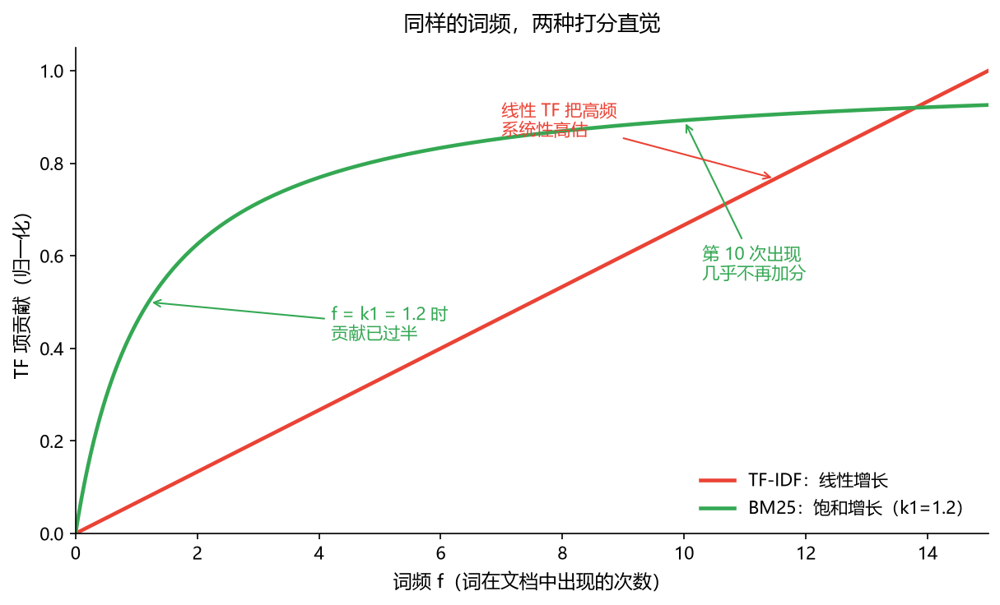
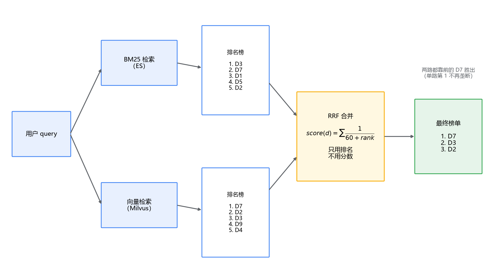

# 02 BM25 与混合检索：两路结果怎么拧到一起

## score 是 3.5，相似度是 0.85，谁排前面

混合检索的架子你已经搭出来了：一个 query 同时发给 ES 和 Milvus，BM25 这路管"字面要精确匹配"的（错误码、型号、法条编号），向量这路管"意思相近但用词不同"的。两路各自排好序返回 top 10，然后问题来了——**这两份榜单怎么合成一份？**

ES 说这个文档 score 是 3.5，Milvus 说那个文档相似度是 0.85。3.5 大于 0.85，所以前者排前面？稍有直觉你就觉得不对劲：这是两把刻度不同的尺子。但具体哪里不对、怎么个不对法、该怎么合并，值得认真掰扯一次。这是本篇第二层的主题。

但在那之前，得先把 BM25 拆开看。它陪伴了我们一整个专栏——ES 里每一次 `_score` 都是它算出来的——但一直没打开过。不打开它，你就理解不了为什么它的分数"没有刻度"，也就理解不了混合检索里一半的坑。先从它的前身 TF-IDF 讲起。

## 一、TF-IDF：两个直觉，各对一半

问题本身很朴素：用户搜"退款"，库里有一万篇文档，哪些文档相关、怎么排序？

**TF（词频）** 给出第一个直觉：一个词在文档里出现得越多，这篇文档和这个词越相关。搜"退款"，出现 3 次的文档比出现 1 次的相关。这个方向大体没错，但线性外推就出问题了：出现 10 次的文档，比出现 1 次的相关 10 倍吗？显然不是。判断一篇文档讲不讲退款，第一次出现就基本说明了；第十次出现几乎不提供新信息。**相关度随词频的增长应该是先快后慢的，而线性 TF 把它当成了匀速增长**——高频被系统性高估。

**IDF（逆文档频率）** 给出第二个直觉：一个词出现在越多的文档里，它对"区分相关不相关"的贡献就越小。"退款"只出现在 5% 的文档里，是强信号；"的"出现在所有文档里，零信号。用文档总数 N 除以包含该词的文档数 n 再取对数，就得到这个词的权重——越稀有的词越值钱。这个直觉到今天也没被推翻，它是整个倒排检索大厦的地基之一。

TF-IDF 就是两者相乘：词频高的、而且这个词本身稀有的，得分高。作为 1970 年代的方案，它已经能解决大部分排序问题。但它留下了两个毛病，正是 BM25 要修的。

## 二、BM25：三处修正，每一处都在解决一个具体问题

BM25 的完整公式长这样：

$$score(D, Q) = \sum_{i} IDF(q_i) \cdot \frac{f(q_i, D) \cdot (k_1+1)}{f(q_i, D) + k_1 \cdot \left(1 - b + b \cdot \frac{|D|}{avgdl}\right)}$$

不需要背它。把它拆成三处修正，每一处能说出"在解决什么问题"，就算懂了 BM25。

**修正一：词频饱和（k1）。** 上面那个分式就是改造后的 TF：随着词频 f 增大，分式趋近于 k1+1，不再无限增长。k1 控制饱和的速度——k1 取 1.2 时（Lucene 的默认值），词频到 1.2 次贡献就过半，之后每多一次出现增加的分数越来越少。这正对应我们对 TF 那个毛病的判断：第一次出现最有信息量，第十次几乎白给。k1 越大，饱和越慢，词频的影响持续得越久；k1 若设成 0，词频完全不起作用，出现一次和一百次一个价。

**修正二：文档长度归一（b）。** 分式分母里的 `|D|/avgdl` 是这篇文档的长度和全库平均长度的比值。同样出现 3 次"退款"，一篇 100 字的短文和一篇 10000 字的长文，能一样吗？短文里 3 次出现说明"这篇就讲这个"，长文里 3 次可能只是顺带提了提。TF 本身不管这个，长文档词多、天然容易堆高频，于是 BM25 用 b 来惩罚长文档：b=0.75（也是 Lucene 默认）时，长度归一起 75% 的作用；b=0 完全不看长度；b=1 严格按平均长度拉平。我们的 chunking 篇讲过"切太大 BM25 会被长度归一惩罚"，惩罚就是从这里来的。

**修正三：IDF 平滑。** 经典 IDF 在"一个词出现在超过一半文档"时会产生负分——越常见的词越负，最后从总分里倒扣。这数学上自洽，工程上却很别扭：一个常见词不帮忙可以，倒过来帮倒忙说不过去。BM25 把 IDF 改造成 `ln(1 + (N - n + 0.5)/(n + 0.5))`，永远非负：常见词的权重平滑地趋近于 0，而不是翻成负数。分寸感的差别，仅此而已。

把两条词频曲线画出来对比，修正一的直觉一目了然：

到这你可以对上号了：ES 的 `_score` 默认就是 BM25（k1=1.2、b=0.75，都可以在 mapping 的 similarity 里调）。它是一个**依赖全库统计量**（N、avgdl、每个词的 n）的打分函数——记住这一点，下一节马上要用到。

## 三、两路合并：分数不能直接比，那怎么办

现在回到开头的问题。为什么 BM25 的 3.5 分和向量的 0.85 相似度不能直接比？

向量这边的分数还算有界，余弦相似度落在 -1 到 1 之间（实践中 0 到 1）。但"有界"不等于"可解释"：0.85 到底算高算低，取决于 embedding 模型、取决于语料，没有任何绝对含义。

BM25 这边连界都没有。刚才说了，它的分数依赖全库统计量——同一个 query、同一篇文档，换一个库、库平均长度变了、词的文档频率变了，分数就变。3.5 在这个小库里可能是满分水平，在另一个库里是垫底水平。**它衡量的是"这篇文档在这个库的这批候选里相对多相关"，是一个纯粹的相对量。** 拿一个相对量和一个伪绝对量直接比大小，比出来的排序没有意义。

你可能会想：那归一化行不行？把两路分数各自 min-max 拉到 0~1 再加权求和。这是很多人第一版的做法，它能跑，但有两个坑：

第一，**min-max 是拿本次召回集的最好最差成绩当刻度尺的**。某次查询向量一路的 top 10 个个都是高分（简单查询），归一化后差的那个也接近 1；另一次查询 top 10 分数平平（难查询），归一化后第一名被拉满到 1。同一篇文档在不同查询下的归一化分数不可比，加权之后 BM25 和向量的权重比例实际上在每次查询间漂移。

第二，**离群值敏感**。一路出了一个特别高的分，其他所有结果的归一化分数全被压扁，这一路等于被一个离群点废掉了。

那怎么办？换个思路：**分数不可比，排名可比。** 一篇文档在 BM25 榜上排第 2、在向量榜上排第 3，这两个数字是有意义的、跨路可比较的信息。**RRF（Reciprocal Rank Fusion，倒数排名融合）** 就是建立在这个思路上的：

$$RRF(d) = \sum_{r \in \text{各路榜单}} \frac{1}{k + rank_r(d)}$$

每一路给文档的贡献是 1/(k + 排名)，k 通常取 60。排第 1 贡献 1/61，排第 2 贡献 1/62，把两路的贡献加起来就是文档的最终分。整个计算里**没有出现任何一路的原始分数**，分数无界、分布漂移、离群值的问题全部绕开了。

k=60 这个值也值得看一眼。它控制的是"第一名到底比第二名强多少"：k 若取 1，第 1 名贡献 1/2、第 2 名贡献 1/3，头部垄断；k 取 60，第 1 名和第 2 名的贡献只差不到 2%。**RRF 有意压低了排名本身的权威性**——它想要的是"两路都说你靠前"的文档，而不是"某一路说你是第一"的文档。一篇 BM25 第 1、向量第 30 的文档，会被一篇两路都排第 5 的文档比下去。对混合检索来说，这通常正是你想要的行为。

加权也好办：给两路各乘一个系数，`w_bm25/(k+rank) + w_vec/(k+rank)`。什么时候偏哪边，回到专栏开篇的原则：精确词重要（错误码、型号、法条）就加重 BM25，口语化提问多就加重向量，大多数场景从 1:1 起步再按评测调（又是评测，第四篇的老规矩）。

完整的合并流程画出来：

顺带说一句工程上的好消息：ES 从 8.14 版本起正式内置了 RRF（retriever API 里的 rrf retriever，更早版本以预览形式存在），单 ES 做混合检索时两路融合不需要自己写代码。跨 ES + Milvus 的融合才需要自己实现——也就是上面这个流程，量级不大。

## 四、绕不开的问题：什么时候单 ES 就够

说到这，一个选型问题躲不开了：ES 8.x 已经支持 `dense_vector` 字段和 HNSW 的 kNN 搜索，"BM25 + kNN + RRF"在单 ES 里就能闭环。那 Milvus 什么时候才值得引入？多引入一个组件就是多一份运维、多一份双写一致性要操心（第五篇的主题），这笔账必须算清楚。

按四个维度算。

**维度一：向量规模。** 这是第一道分水岭。百万级以内（一百万个 chunk，按 768 维 float32 算原始向量约 3GB），ES 的 HNSW 完全扛得住，单 ES 方案的简单性是实打实的优势。上了千万级，ES 的成本曲线开始变陡：向量索引藏在 Lucene 的 segment 里，内存压力压在 JVM heap 上，而 heap 过大又直接影响 GC；segment merge 的时候 HNSW 索引要跟着重算，向量越重、merge 越痛。Milvus 是存算分离架构，向量主体放对象存储，查询节点按需加载，扩容是加节点的事，不是搬数据重索引的事（专栏三讲过的架构，这里兑现它的价值）。

**维度二：索引与压缩手段。** ES 的 kNN 目前只有 HNSW（外加精确暴力扫），没有低配选项。Milvus 提供 IVF、HNSW、DiskANN、GPU 索引一整排，还有 PQ/SQ 量化把内存压掉一个量级、mmap 把冷数据放到磁盘。数据量大到内存放不下原始向量时，"能不能量化、能不能下盘"就不是锦上添花，而是做不做得成的问题。

**维度三：标量过滤的深度。** 这一项反过来偏袒 ES。RAG 知识库几乎一定要带权限、租户过滤，ES 的 bool filter 生态和 BM25/kNN 的组合非常成熟。两边各自的实现路径不同：ES 的 kNN 过滤发生在候选收集阶段，ANN 图遍历本身感知不到过滤条件，过滤命中的比例低时会凑不满 k 个结果（官方文档也承认这点，建议加大 k）；Milvus 的标量过滤能下推到 segment 扫描层，路径更彻底，但表达式能力整体弱于 ES 的 DSL。过滤场景重的话，两边都要实测，别信纸面对比。

**维度四：团队和现状。** 已经有运维成熟的 ES 集群，加一个 dense_vector 字段是顺手的事；从零引入 Milvus，意味着新的组件、新的监控、新的一致性问题。反过来，如果检索 QPS 上去后 ES 集群为了扛向量把 heap 和 CPU 吃紧、影响了本来的日志/搜索业务，那把向量独立出去反而是隔离风险。

串成一个判断：**百万向量以内、过滤要求常规、团队已有 ES——单 ES，别犹豫；向量上千万、需要量化或磁盘索引、检索是独立的重负载——Milvus 值得引入。** 中间地带用评测和压测说话。这个决策结构你其实见过：当年"缓存从 MySQL 的内存表挪到 Redis"也是同一道题——单库能解决时不加组件，规模和隔离性到了，独立组件的成本就开始划算。

## 最后，总结

这一篇把"用了一路却没拆开看过"的 BM25 讲透，再往上搭了混合检索的合并层：

- TF 的毛病是**线性高估高频**：第 10 次出现不比第 2 次多说明什么；IDF 的直觉（稀有词值钱）至今成立；
- BM25 三处修正：**k1 让词频饱和**、**b 做文档长度归一**（chunk 切太大被罚就是它）、**IDF 加平滑**不翻负；公式不用背，每一项说出它在解决什么问题即可；
- BM25 分数依赖全库统计量，是**相对量**；向量相似度是有界但无绝对含义的数——**两把刻度不同的尺子，不能直接比**；
- 归一化合并有坑：min-max 随召回集漂移、离群值敏感。**RRF 只用排名不用分数**，1/(k+rank) 加和，k=60 压低单路头部的垄断性，要的是"两路都说好"；需要偏心就加权；
- 选型：**百万向量内单 ES 闭环**（8.14 起自带 RRF）；**上千万、要量化下盘、检索独立成重负载时引入 Milvus**，中间地带拿评测和压测说话。

两路结果拧到一起了，每路 top 10、合并后还是 10 条。但 LLM 的上下文只塞得下三五条——这 10 条里谁上谁下，就是下一篇 rerank 要接管的地方。
