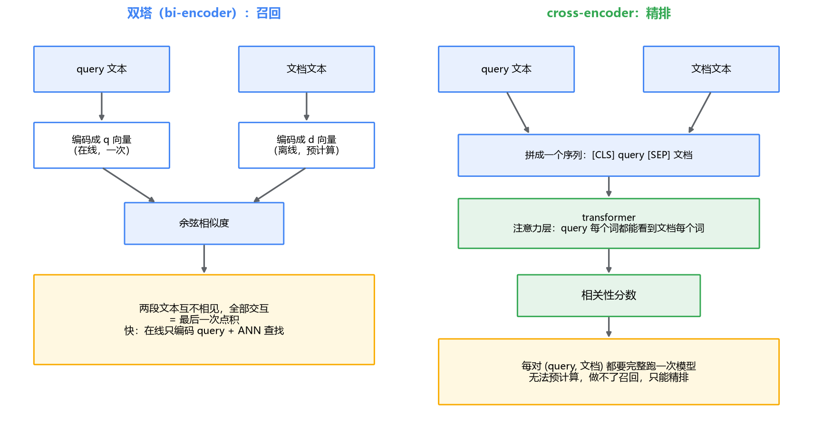
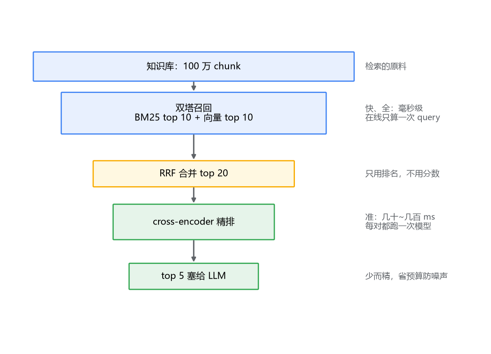

# 03 Rerank 精排：召回之后，谁来定最后几条

## top 10 进得来，上下文塞不下

上一篇结束时留了个扣子：两路各 top 10，RRF 合并后还是 10 条候选。这 10 条都要塞给 LLM 吗？

塞不下，也不该塞。一方面是预算：上下文按 token 计费，10 条 chunk 每条几百字，光检索结果就吃掉几千 token。另一方面更隐蔽：**塞得越多，噪声越多**。LLM 的注意力会被不相关的内容稀释，"10 条里混 3 条不相关"的答案质量，常常比"只给 5 条精准的"更差——模型分不清哪条该信。

所以现实的做法是：合并后取 20 条左右，从中挑 3~5 条塞给 LLM。问题变成了——**这 20 条里，谁上谁下？**

RRF 的排序到这里就是能力边界了。它只做了排名融合，没有对"这条内容到底回不回答这个问题"做任何判断。BM25 只数字面，向量只算粗粒度的语义相似，都到不了"逐字读一遍 query 和文档，判断后者能否回答前者"的精度。要这个精度，得换一类模型——这就是 rerank。

## 一、双塔：快是快，但两段文本从未见过面

先看清现有排序手段为什么有天花板。向量检索的结构是这样的：embedding 模型把 query 编码成一个向量，把每篇文档也各自编码成向量，相似度就是两个向量的距离。

注意一个容易被忽略的事实：**文档的向量是离线算好的**。一百万篇文档入库时各自编码、建好 ANN 索引；在线查询时只算一次 query 的向量，然后在索引里找邻居——毫秒级。这是向量检索能用的前提，如果每篇文档的向量都要等 query 来了才能算，那和暴力扫描没区别。

代价藏在结构里：文档编码的时候，**它看不到 query**。模型只能算出一个"这篇文档泛泛的语义位置"，至于你要问什么，它不知道。反过来 query 的编码也看不到文档。两段文本之间零交互，全部交互被压缩成最后那一次点积。这种"两边各自编码、最后比距离"的结构叫**双塔（bi-encoder）**——两座塔各算各的，塔顶碰一下。

BM25 甚至更彻底：连模型都没有，纯词面统计，query 和文档的"交互"就是数有几个词相同。它当然快，但它对"退款"和"退钱"是同一个意思这件事一无所知。

双塔的结构决定了它的精度天花板：**表示是静态的、与 query 无关的**，而"一篇文档相不相关"这件事，本质上取决于 query 问了什么。

## 二、cross-encoder：让两段文本坐到一张桌子上

把交互做足的模型叫 **cross-encoder**。结构上就一步：把 query 和文档拼成一个序列——`[CLS] query [SEP] 文档`——整体过一遍 transformer。注意力层里 query 的每个词都能"看"文档的每个词，模型逐字读这对组合，最后输出一个数：相关性分数。

判断质量上，cross-encoder 明显优于双塔：在各类公开检索基准上，拿 cross-encoder 重排双塔召回的结果，指标普遍有肉眼可见的提升。原因是结构性的——充分交互对零交互，差距就摆在这。

但它的代价同样结构性：**每一对 (query, 文档) 都要跑一次完整模型**。双塔里文档向量是预计算的，cross-encoder 里没有任何东西可以预计算——query 变了，整段注意力要重算。对一百万篇文档的库，一次查询就是一百万次前向传播。按单次几十毫秒算，这是几个小时。

所以结论不是"用 cross-encoder 替换双塔"，而是分工：

- **召回用双塔**：快、能预计算、配得上 ANN 索引，负责从一百万里捞出 top 100~1000，要快要全；
- **精排用 cross-encoder**：慢、准，只面对召回捞出来的 20 条，要准。

一个你熟悉的对照：招聘。双塔是按简历关键词初筛，一秒看一份，从一万份简历里筛出 50 份；cross-encoder 是面试官逐个面谈，判断准得多，但没人会拿面谈去筛一万份简历。**初筛管覆盖面，面谈管最后那几名的成色**——检索的召回和精排，是同一套分工。



整条链路拼起来是一个漏斗：



顺带说一个容易被忽略的红利：**rerank 还顺手解决了分数量纲问题**。上一篇讲 RRF 时说过，BM25 分数和向量相似度是两把刻度不同的尺子，只能绕开分数用排名。而 rerank 之后的排序里，每条候选的分数都出自同一个 cross-encoder、对着同一个 query 打出来的——量纲天然统一。所以 RRF 只负责"把两路候选公平地凑到一起"，最终座次由 rerank 一锤定音，两个机制各管一段，不打架。

## 三、bge-reranker 怎么用

工程上最常用的开箱模型是 BAAI 的 **bge-reranker** 系列，和 bge embedding 是同一家出的，但用途不同：embedding 模型输出向量，rerank 模型输出的是"这对 (query, 文档) 有多相关"的分数。中文场景常用 `bge-reranker-base`（轻量）和 `bge-reranker-v2-m3`（多语种、精度更好），都是开源权重本地部署。

用 sentence-transformers 的 `CrossEncoder` 接口，代码短得不像一个"精排模块"：

```python
from sentence_transformers import CrossEncoder

# 模型加载一次，常驻内存
model = CrossEncoder("BAAI/bge-reranker-v2-m3", max_length=512)

query = "超过 7 天还能申请退款吗"
candidates = [...]   # RRF 合并后的 top 20，每条是 chunk 文本

pairs = [(query, c) for c in candidates]
scores = model.predict(pairs)   # 一次性批量打分

ranked = sorted(zip(candidates, scores), key=lambda x: x[1], reverse=True)
top_k = ranked[:5]             # 最终塞给 LLM 的 5 条
```

几个工程细节值得说。

**放的位置**：rerank 在 RRF 之后。两路召回各取 top 10~20，RRF 合并成 20 条，再交给 cross-encoder 精排出 3~5 条。别把 rerank 放在单路内部——它应该面对的是"两路都认为值得看"的全集。

**延迟预算**：20 对文本过一遍模型，GPU 上通常几十毫秒，CPU 上可能到几百毫秒。这个数字必须进你接口的 P99 预算里算，RAG 的端到端延迟是"检索（两路并发）+ rerank + LLM 生成"三段加起来的，rerank 是第二段。如果延迟吃紧，先砍候选数（20 降到 10），再换小模型，最后才考虑去掉 rerank——它在答案质量上的收益通常是全链路里性价比最高的一笔。

**吞吐靠批量**：`predict` 一次喂 20 对，远快于循环单条调 20 次——GPU 的并行能力在 batch 里才能吃满，单条调用大部分时间在等数据搬运。候选多的时候注意 `max_length`：pair 里的文档按 512 token 截断，chunk 切得太长时被截掉的后半段，rerank 是看不见的——又一次，切分质量在下游收账。

**分数不要跨 query 比较**：rerank 分数和 BM25 分数一个脾气，是相对量。同一个模型对"难查询"整体打分偏低、对"简单查询"整体偏高，别拿"分数低于 0.3 就不要"这种绝对阈值做过滤——要过滤也用相对规则，比如"只取分数不低于第一名 60% 的"。

## 四、rerank 救不了烂召回

最后说一个容易抱错的期望。团队里常见的对话是这样的：检索质量不行？上 rerank。上了 rerank 还不行？换个更强的 rerank 模型。

这两个动作都未必对症。cross-encoder 的能力边界很清楚：**它只能对送进来的候选排序**。正确答案压根不在候选里，它排得再精，也只是把 20 条错误内容排了个座次。

用 MySQL 打个比方：查询没走对索引、返回的行集就是错的，后面的 `ORDER BY` 写得再优雅，也排不出本来就不在结果集里的行。ORDER BY 管排序，不管行集对不对——rerank 之于检索，就是 ORDER BY 之于查询。

所以排查检索问题的顺序应该是：

1. **先看召回**：正确答案在不在两路合并的 top 20（甚至 top 100）里？
2. **不在**——这是召回的问题，rerank 无能为力。去调 chunk 策略、换 embedding 模型、调 RRF 权重、补 BM25 的同义词，这些才是对症的药；
3. **在，但排在十几名**——这才是 rerank 的主场。cross-encoder 对"语义相关但表面排序吃亏"的候选，提升立竿见影。

当然，"正确答案在不在 top 20 里"这个判断，肉眼抽查三五次可以，持续地做就需要度量的支撑了。而且这两个阶段的病要用不同的药：召回期的病在数据表示（chunk 切得不对、embedding 模型太弱、BM25 分词没调好），精排期的病在模型选型和延迟预算——药不对症，吃再多也没用。下一篇讲检索效果评估：recall@k、MRR 这些指标怎么算，评测集怎么建——它是前面所有调优（chunk 大小、RRF 权重、要不要 rerank）共同的裁判，也是判断"病在哪一层"的检查手段。

## 最后，总结

- 合并后的候选不能全塞给 LLM：成本是一方面，**噪声稀释注意力**是更隐蔽的一方面，挑 3~5 条精准的胜过塞 10 条掺杂的；
- 双塔（bi-encoder）是召回的结构：**两段文本各自编码、互不相见**，文档向量离线预计算换来 ANN 索引和毫秒级在线查询，但表示与 query 无关，精度有天花板；
- cross-encoder 把 query 和文档拼在一起过模型，**交互做足、判断准**，但每对都要跑一次完整前向，无法预计算——所以只能做精排，做不了召回；
- 架构是漏斗：**两路召回各 top 10~20、RRF 合并 top 20、cross-encoder 精排 top 5**；bge-reranker 用 CrossEncoder 接口十几行接上，注意延迟预算和"分数不跨 query 比较"；
- **rerank 是精排不是召回**：候选里没有正确答案，排得再好也没用。先确认召回里有（调 chunk、换模型、调权重），再让 rerank 把它顶上去。
