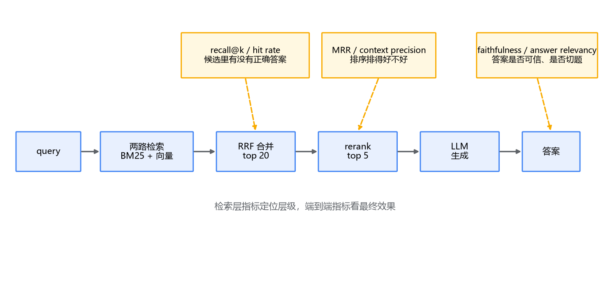
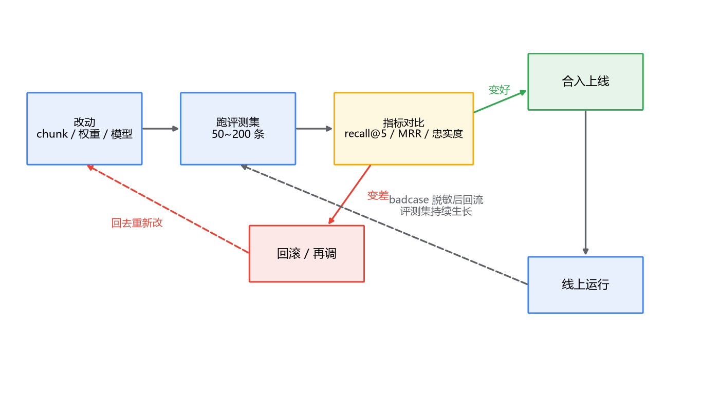

# 04 检索效果评估：没有度量，就没有优化

## "感觉好点了"不是工程

回顾一下这几篇你可能做过的事：chunk 从 500 字改到 300，overlap 从 0 调到 15%；RRF 权重从 1:1 试到 3:2；昨天又上了 bge-reranker。每改一次，你都拿自己那几个问题试了试，"感觉好点了"，然后合代码。

现在同事问你：上了 rerank 之后，效果好了多少？chunk 改小这一步，和 rerank 这一步，哪个贡献大？你答不上来。更麻烦的是，你隐约记得上周某类问题原来能答对的，现在答不对了——是哪次改动弄坏的？没有记录，没有对比，说不清。

这个局面你一定眼熟。前端没有埋点和 A/B 测试时，改个按钮颜色全靠"感觉变好看了"；后端没有压测基线时，一次"性能优化"上线，是快了慢了全凭体感。检索这块也一样，而且更依赖度量——因为它的效果本身就是个统计量，单次查询的结果好坏，一大半是运气。

解法是老一套：**建评测集，定指标，每次改动跑一遍，拿数字说话。** 这一篇就把这两件事讲清楚：指标怎么选，评测集怎么建；最后讲 RAGAS 怎么把评估延伸到端到端。

## 一、三个指标，各自关心什么

先看检索层的指标。最常用的是三个，名字都见过，但"各自在关心什么"经常被搅在一起。

**recall@k（召回率）**：对每个 query，你已经标注了哪些文档是相关的（怎么标下一节讲）。检索返回 top k，相关的有多少落在了这 k 条里，就是 recall@k。10 个 query、每个标注 2 条相关文档，检索后 10 个 query 总共 20 条相关文档回来了 14 条，recall@k = 0.7。**它关心的是：该找到的，找到了没有。**

**hit rate（命中率）**：recall 的宽松版——top k 里**只要有至少一条**相关的，这个 query 就算命中。20 个 query 里 17 个的 top 5 至少含一条相关文档，hit rate@5 = 0.85。**它关心的是：LLM 至少看到一条对的没有。** 单标注场景（每个 query 只标一条正确答案）下，hit rate 和 recall@k 是同一个数。

**MRR（Mean Reciprocal Rank，平均倒数排名）**：对每个 query，找**第一条**相关结果排在第几位，取倒数。排第 1 得 1 分，排第 3 得 1/3，排第 10 得 0.1，没进 top k 得 0，所有 query 取平均。**它关心的是：对的答案排得多靠前。**

拿一个 query 走一遍三个指标：标注了 2 条相关文档，检索的 top 5 里命中了 1 条、排在第 3——recall@5 = 0.5，hit rate = 1，这条 query 对 MRR 的贡献是 1/3。

那 RAG 场景该盯哪个？**优先 recall@k（连带 hit rate），MRR 其次。** 理由在链路结构里：你的 top 5 后面还站着 rerank 和 LLM，排序上的粗糙它们能兜住一部分——排到第 3 的正确答案，rerank 有机会把它顶到第 1，LLM 也有能力从 5 条里挑对的用。但 top 5 之外的正确答案，谁来都救不回来：rerank 见不到它（上一篇刚讲过），LLM 拿不到它就只能硬编。**漏召回是不可修复的，排序粗糙是可以修复的**，所以度量先盯前者。MRR 那种"第一名必须正确"的执念，更适合搜索框下拉联想那种只展示第一条的场景。

## 二、评测集怎么建

指标是尺子，评测集是尺子要量的东西。它长这样：一组 (query, 相关文档集合) 的列表，比如 100 个 query，每个 query 标注了 1~3 条相关的 chunk id。建的过程分三步。

**第一步，query 从哪来。** 最值钱的是真实用户的提问——从线上日志里挖，用户怎么问、用什么词、问得多口语，都在里面。冷启动没有日志时，退而求其次：让 LLM 读每个 chunk，生成"这个 chunk 能回答的问题"。这条路能快速铺量，但要清醒地知道它的偏差：**LLM 生成的问题倾向复述文档原话**——文档写"7 个自然日内可申请退款"，它生成的问题就是"几个自然日内可以申请退款"，而真实用户会问"过了一个星期还能退吗"。所以 LLM 生成的 query 要人工过一遍、改写得口语化，至少改一部分。

**第二步，标注。** 每条 query 标注相关文档。两个人的标注经常对不上——你觉得这条算相关，他觉得那条只是"提到了"。分歧是正常的，相关性本来就是主观判断，关键是定一条标准并写下来，比如：**"这条 chunk 单独拿出来，能不能直接回答这个 query"**——能回答算相关，只是沾边不算。标准比人多少更重要。

**第三步，规模和维护。** 50~200 条就可以起步，不用憋一次到位——它本来就该随系统迭代持续生长：线上发现的 badcase，脱敏后补进评测集，下次改动它就是回归用例。这套东西你早就有等价物：它就是检索界的**单元测试 + 回归测试集**，改代码跑一遍，防止按下葫芦浮起瓢。

## 三、RAGAS：把评估延伸到端到端

到这为止的评估都停在检索层。但用户最终感受到的不是 recall，是答案。检索层指标全绿、答案照样翻车的情况真实存在：rerank 排错了、prompt 写得差、LLM 把检索内容理解歪了——这些都在检索指标的视野之外。所以要再补一层端到端评估，常用的开源框架是 **RAGAS**。

RAGAS 的核心思路是 **LLM-as-judge**：拿一个够强的 LLM 当裁判，对你的 RAG 输出打分。四个核心指标，两个看生成，两个看检索：

**忠实度（faithfulness）**——答案有没有胡说。RAGAS 的做法是把答案拆成一条条论断，逐条判断"这条论断能不能从检索内容里推出来"，被支持的论断占比就是忠实度。答案说"超过 7 天退款收 20% 手续费"，而检索内容里只说了"超过 7 天可以退"——手续费那条就是编的，忠实度打折。它是对抗幻觉的核心指标。

**答案相关性（answer relevancy）**——答的是不是问的。实现思路很巧：让裁判 LLM 从答案**反向生成**几个问题，再算这些问题和原问题的向量相似度。答非所问的答案，反向生成出来的问题会跑偏，相似度就低。

**上下文召回率（context recall）**和**上下文精确率（context precision）**——把第一节的指标自动化了：前者问"该检索到的是不是都检索到了"（需要一个参考答案做锚点），后者问"检索回来的是不是都相关、相关的排得靠不靠前"。区别在于第一节靠人工标注，这两个靠 LLM 裁判判断，省人力但引入了裁判本身的不确定性。

四个指标在链路上的位置：

怎么和检索层指标配合？分工是：**离线指标定位层级，端到端指标看最终效果。** recall@k 掉了，问题在检索层，去调 chunk、权重、embedding；recall 没动但忠实度掉了，问题在生成侧，去查 prompt 和模型。没有前者的定位能力，你面对一个"答案不好"的现象只能瞎猜；没有后者的兜底，你优化了半天检索，用户感受却没变化。

也要说清 LLM-as-judge 的局限：裁判打分有随机性，同一条答案两次评分可能差不少（可以多评几次取平均缓解）；裁判要花钱，所以这套是**离线、抽样**地跑，不是在线全量；裁判模型自己也有偏好，换裁判等于换尺子，历史数字要重跑。把它当"统计意义上可信的参考"，别当精确读数。

## 四、真正用起来：改动闭环

有了评测集和指标，工作流就变成了闭环：

每次改动——调 chunk、换模型、改权重——跑一遍评测集，把 recall@5、MRR、忠实度这几个数存下来和上次比。变好了合入，变差了回滚或再调。攒下来的这串数字还有第二个用处：**它就是你向团队证明"这个优化值得做"的证据**，"上了 rerank 之后 recall@5 从 0.71 到 0.74，忠实度从 0.86 到 0.91"比"感觉好点了"有说服力得多。

两个实操提醒。第一，指标之间会打架：rerank 把 MRR 抬上去了，但延迟也涨了，这又回到专栏开篇那个三角——召回率、延迟、资源，评估体系就是让你在三角里挪位置时看得见代价。第二，评测集别当一次性用品，线上 badcase 定期回流进去，它会越来越像你的真实用户。

## 最后，总结

- **没有度量的优化是玄学**：每次改动跑评测集、存数字、做对比，和单元测试一个地位；
- 三个指标各有关心：**recall@k 问"该找到的找到没有"**，hit rate 问"至少有一条对的没有"，MRR 问"对的排多前"；
- RAG 场景**优先 recall@k**：排序粗糙有 rerank 和 LLM 兜底，漏召回谁也救不了——漏掉的正确答案，最后会变成幻觉；
- 评测集 50~200 条起步：真实 query 最值钱，LLM 生成的要人工改写去"文档腔"；标注分歧靠标准解决，**"这条 chunk 能不能直接回答这个 query"**；badcase 定期回流；
- RAGAS 做端到端：**忠实度**抓幻觉（论断逐条对检索内容核账）、**答案相关性**抓答非所问（反向生成问题算相似度）；LLM 裁判有抖动、有成本，离线抽样地跑；
- 用法：**检索指标定位层级，端到端指标看效果**，两者配合，别只看一头。

到这里，RAG 检索链路的技术环节讲完了：切分、双路召回、合并、精排、评估。但这些都还是"系统跑起来"的事。下一篇是最后一篇，讲把这套东西放到生产环境要面对的问题：知识库天天在变，增量更新怎么做？ES 和 Milvus 双写，一致性怎么保、挂了怎么兜底、监控看什么——工程化落地篇收尾。
