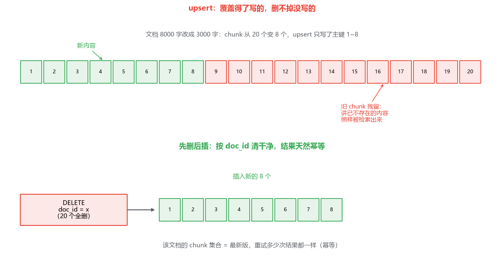
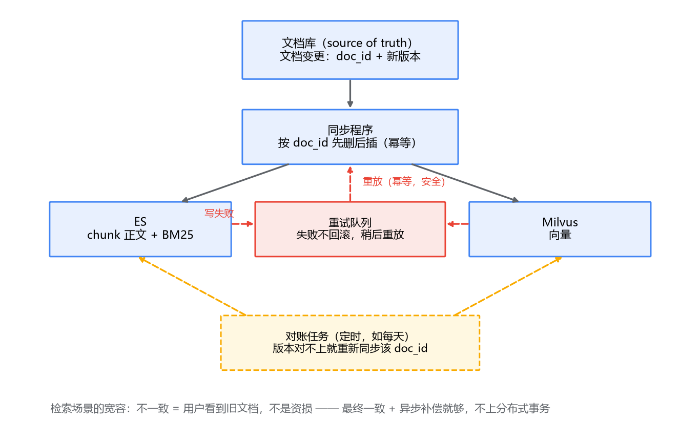

# 05 工程化落地：增量更新、双写一致性与兜底

## demo 跑通之后，麻烦才刚开始

前四篇，你已经有了一条能跑的链路：文档切分、双路召回、RRF 合并、rerank、评测护航。拿 demo 的标准看，完成了；拿生产的标准看，还有三件事没人管。

第一件：**知识库是活的**。产品文档每周改，政策每月调，昨天灌进去的 5000 篇文档，今天已经有 30 篇过时了。过时的 chunk 还在库里被检索、被塞给 LLM，答案就是错的——检索系统不会自己知道数据旧了。

第二件：**两个存储，两份数据**。chunk 的正文在 ES，向量在 Milvus（还有元数据两份），任何一次更新都要两边同时生效。一边成功一边失败怎么办？这是你在 MySQL + Redis 双写上摔过的老跟头，现在换了个地方再摔一次。

第三件：**ES 和 Milvus 都是独立部署的组件，都会挂**。挂一个，你的混合检索残了一半；两个都挂，系统是报错还是硬答？

这三件事分别对应这一篇的四节：增量更新、双写一致性、降级兜底、监控。它们没有前几篇那种算法上的精巧，但决定这套系统在生产上活多久。

## 一、增量更新：文档变了，chunk 怎么跟着变

最朴素的方案是全量重建：文档一变，把整个库删光重灌。逻辑简单，不容易出错，而且——如果知识库只有几千个 chunk、每周更新一次——它真的是合理方案，别不好意思用。

但它有天花板。重灌要重算所有 chunk 的 embedding，百万 chunk 按每个几十毫秒算，单卡就是十几小时；重灌期间（或者滚动重建期间）检索质量打折；更新频率一高，系统就永远在重建的路上。所以数据量或者更新频率上来了，就要换增量：**以文档为单位，谁变了更新谁**。

增量更新的第一步是主键设计，它决定了后面所有操作怎么写。两种常见做法：

**方案 A：doc_id + chunk_index 做主键**，比如 `refund-policy-v3:4`。一个 chunk 在文档内的位置就是它的身份。更新一个文档，就是删掉它所有旧 chunk、插入新的。

**方案 B：内容 hash 参与主键**，比如 `refund-policy-v3:a3f9...`，chunk 内容算个哈希拼进主键。好处是文档里没改的段落 hash 不变，重灌时可以跳过这些 chunk 的 embedding 计算，省算力；代价是"删除旧 chunk"变成一件要记账的事——你得拿新旧两组 hash 做差集，才知道哪些要删，复杂度实打实上去了。

建议从 A 起步。一个文档通常几十上百个 chunk，即使全文只改了一个错别字、全文档 chunk 重算一遍 embedding，也就几秒钟的事；**省下这点算力换来一堆记账逻辑，多数场景不划算**。真到了 embedding 算力是账单大头的那天，再换 B 不迟。

第二步是更新动作：**先删后插，还是 upsert？**

先看 upsert。ES 的 index API 指定 `_id` 写入时本身就是 upsert 语义——同 id 覆盖，没有就插入；Milvus 从 2.3 起也支持 upsert，按主键先删后插。看起来正好对口？但这里埋着一个真实的坑：**upsert 只覆盖"这次写了的主键"，删不掉"上次有、这次没有的主键"**。一篇 8000 字的文档改成了 3000 字，chunk 从 20 个变成 8 个，upsert 之后 9~20 号旧 chunk 还好好地躺在库里——它们讲的是已经不存在的旧内容，还会被检索出来。残留比缺数据更隐蔽：缺了顶多答不出，残留是理直气壮地答错。

所以对"整文档更新"这个场景，正确的动作是**先删后插**：

1. `DELETE`：按 `doc_id` 删掉这个文档的所有旧 chunk（ES 用 delete_by_query，Milvus 用 `doc_id == 'xxx'` 的 delete 表达式），注意条件是 doc_id 而不是带 chunk_index 的主键；
2. 切分新版本，算 embedding；
3. 批量插入。

这个顺序天然**幂等**——重试多少次，结果都是"该文档的 chunk 集合 = 最新版"，这对下一节的双写补偿至关重要。upsert 留给别的场景：单条记录原地改字段、chunk 数不会变的那类更新。两种做法的差别画出来：

先删后插有毫秒级的空窗，这个窗口内检索这个文档会落空。要缩小影响面，可以把粒度做细：按文档而不是按全库更新，窗口就已经从"小时级"缩到"毫秒级"了；真在意这几毫秒，再考虑"先插新、延迟删旧、检索时按版本过滤"的复杂版，但那是大厂的病，先别急着得。

## 二、双写一致性：一个老问题，但答案变了

chunk 要进 ES（正文 + BM25），也要进 Milvus（向量）。一次文档更新，两次写入。一边成功一边失败——ES 里有新版、Milvus 里还是旧向量，检索出来的就是新旧杂交的结果。

这个局面你太熟了：MySQL 写成功、Redis 写失败，缓存里脏数据一挂几个小时。当年的解法也历历在目：先写 DB 再删缓存、延迟双删、canal 订阅 binlog 异步刷缓存……核心思想都是**不追求双写原子性，用最终一致 + 补偿兜底**。

检索场景是同一个问题，但先要确认一件事：**这里的不一致到底有多可怕？** 交易场景里，MySQL 和缓存不一致是超卖、是资金错误，所以当年要那么较真。检索场景里，ES 和 Milvus 短暂不一致的后果是——用户多看了一会儿旧版本文档，或者某次查询少召回一条。烦人，但不造成资损。**这是检索场景比交易场景宽容的地方：最终一致可接受，补偿可以异步慢慢来。** 想明白这一点，就不会有人提议在这儿上分布式事务——那是拿大炮打蚊子，还打不中（ES 近实时的 refresh、Milvus 可调的一致性级别，决定了它们本来就不承诺写入立即可见，强一致在此无从谈起）。

所以方案就是老三样，套上检索的外衣：

**以文档库为 source of truth**（别让 ES 或 Milvus 任何一个当源头，源头应该是最上游那份"文档的真身"，哪怕是个对象存储加个元数据库）。同步程序监听文档变更，对每个变更的 doc_id 执行上面那套"先删后插"，**同时作用于 ES 和 Milvus**。

**失败进重试，而不是当场补偿**。写 ES 成了、写 Milvus 失败：不回滚 ES（回滚也未必成功，还把好的写坏了），把这个 doc_id 扔进重试队列——Kafka 的重试 topic、数据库里的任务表都行，你有现成的基建。重试是安全的，因为先删后插幂等，来几次都一样。

**对账做兜底**。重试也可能一直失败（Milvus 挂了三天），队列里的任务不能无限堆积不管。定期对账任务扫一遍：每个 doc_id 在文档库里的版本，和 ES、Milvus 里 chunk 的版本比一比，对不上的重新同步。频率不用高，一天一次足矣——回到刚才那个判断，检索场景等得起。

## 三、一路挂了怎么兜底：降级单路

第三件事：故障。ES 和 Milvus 都是独立进程、独立集群，任何一个都可能抖、可能挂。混合检索的一个隐藏好处在这里兑现：**你天然有两份独立的检索能力，一份挂了另一份还能撑**——前提是你把降级逻辑写出来。

写法你在熔断器（Hystrix、Sentinel 那套）上早就会了，换个地方用：

- **检测**：对每一路设超时和错误率阈值，连续超时或错误率超标就熔断这一路，接下来的一段时间直接跳过它，不再白白等超时；
- **降级**：Milvus 被熔断，就走单 BM25：query 只发 ES，rerank 照常。语义检索能力受损——"过了一个星期还能退吗"这种问法命中率会降，但错误码、型号这类精确查询不受影响；反过来 ES 被熔断，就走单向量，受损面正好对调；
- **恢复**：半开状态放一小部分流量试探，通了就闭合熔断器。

两个设计决策要想清楚。

**降级要不要让用户知道？** 悄悄降级，用户感受到的只是"今天搜得不太准"；明确提示"检索能力部分受限"，用户至少知道该怪谁。知识库问答这种内部工具，建议悄悄降级加日志报警；面向客户的产品，提示的代价小于让用户困惑的代价。这是产品判断，不是技术判断。

**两边都挂了怎么办？** 这个问题的答案没有商量余地：**报错，别硬答**。检索全失败意味着 LLM 拿不到任何 grounding，这时候把问题裸抛给模型，它不会说"我不知道"，它会编——一个平时可靠、唯独今天开始一本正经胡说的系统，比一个干脆报错的系统危害大得多。宁可白屏提示"知识库暂时不可用"，也别让幻觉顶上。

## 四、监控该看什么

系统跑起来了，接下来要能回答两个问题：它现在健康吗？它在变坏吗？监控就盯这几样。

**检索延迟，分段看**。只看端到端一个数是不够的，出了问题无从下手。拆开：ES 路延迟、Milvus 路延迟、合并开销、rerank 延迟，各自 p50/p99。两路是并发的，端到端检索延迟约等于较慢的那路加 rerank——哪个环节吃掉了预算，分段指标一眼可见。这些数据同时是你的容量依据：rerank 的 p99 涨了，就是该砍候选数或者扩模型的信号。

**空结果率，单独打点**。这是最容易被漏掉的指标：两路检索都返回 0 条的比例。它隐蔽，因为**在所有常规监控里它都是"成功"**——接口 200，无报错，无慢查询，SLO 全绿。但用户体验是灾难：检索两手空空，LLM 拿着空上下文开始编。它的类比你很熟：接口不报 500 但返回空集，成功率统计看它一切正常，实际什么都没干。空结果率突然升高，通常意味着：知识库没覆盖住新话题、分词/过滤出了问题、或者一边存储悄悄没了数据。给它设个告警阈值，涨了就去查。

**检索质量的线上监测**。离线评测集（第四篇建的）别只在改代码时跑，挂个定时任务每周跑一遍基线——数据在变（知识库更新、用户 query 分布漂移），代码没动效果也会变。再配合线上的 badcase 回流：用户点了"这个回答不对"、或者明显追问"到底能不能退"的会话，抽样人工看，是召回问题就补评测集。质量监控没有延迟监控那么实时，但它是唯一能告诉你"系统在悄悄变坏"的东西。

**存储层健康**：ES 的 heap、segment 合并压力，Milvus 的 segment 加载状态、query node 内存——这些属于两个组件各自的运维范畴，按官方手册配常规告警即可，不展开。

## 最后，总结

这一篇没有算法，全是工程，但每一条都对应一类线上事故：

- **增量更新**：全量重建在中小规模是合理方案；规模上来后按文档粒度增量，主键用 **doc_id + chunk_index** 起步，内容 hash 等算力真成瓶颈再上；
- **整文档更新用先删后插，慎用 upsert**：upsert 覆盖不了"上次有这次没有"的主键，chunk 变少时旧 chunk 残留，理直气壮地答错；先删后插天然幂等，是双写补偿的基石；
- **双写一致性**：检索比交易宽容——不一致的代价是旧文档、不是资损，**最终一致 + 异步补偿**就够，别上分布式事务；文档库当 source of truth，失败进重试队列，对账任务兜底；
- **降级**：熔断一路、单路撑住，这是混合检索附赠的可用性红利；但**两边全挂必须报错**，让 LLM 裸答等于开动幻觉制造机；
- **监控**：延迟分段看，**空结果率单独打点**（它在常规监控里永远是"成功"的），质量用离线评测集做定时基线加线上坏例回流。

到这里，专栏四的五篇走完了，整个专栏也到了收口的地方。回头看这份大纲走过的路：专栏一、二把 ES 和 Milvus 用起来，专栏三往底层挖了原理，专栏四把两者拧成一条 RAG 检索链路——切分决定数据的表示，双路召回负责又快又全，RRF 合并、rerank 精排负责把最好的几条送出去，评估让每次改动有数字背书，工程化让它活在生产里。贯穿始终的还是开头那个三角：召回率、延迟、资源，没有免费午餐，只有清楚自己在哪条边上的取舍。地基打完了，往上盖生成层——prompt、上下文组织、流式输出——的时候，你会发现检索这一层打得越扎实，上面盖得越省心。
